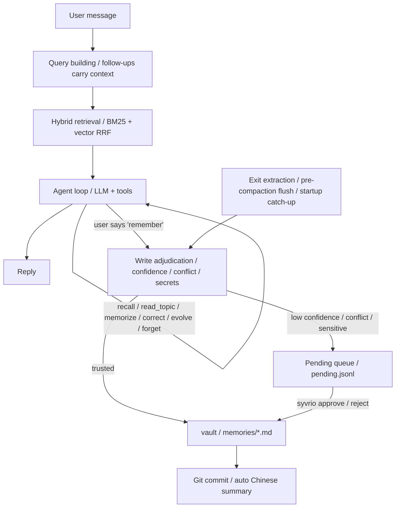

<div align="center">

# Syvrio

**A local-first memory agent that remembers you.**

Turn everyday conversations into long-term Markdown memories you can inspect, trace, and roll back. Use the terminal chat or connect an MCP client.

[](https://github.com/Shardkiht/syvrio/actions/workflows/test.yml)
[](https://pypi.org/project/syvrio/)


[中文](README.md) | **English**

</div>

Stop repeating your preferences and plans every time you start a chat. Tell it “I prefer unsweetened hot drinks,” open another conversation, and it can look that preference up. Open the Markdown files to inspect what it remembers, correct a fact, or ask it to forget one.


The demo operates the actual Textual UI with synthetic data and scripted model replies. Memory writes and cross-session retrieval run through the real implementation, with no paid model requests. [View the still screenshot](docs/assets/syvrio-demo.png).

Install `feature-memory-evolution` from source to use the `0.4.0.dev0` development build, which includes Vault v2 and the new web fetch providers. Development builds use a `.devN` suffix. The `main` branch maintains stable versions separately.

## Quick start

Requires Python 3.12+, uv, and git.

The following commands install the published version from PyPI. To use this branch, follow the source installation instructions below.

```bash
uv tool install syvrio
syvrio setup
syvrio
```

`syvrio setup` selects a model provider and configures its API key, and also offers a "search & fetch API" wizard: enter or update keys for Baidu Qianfan, Tavily, Exa, You.com, and Volcengine (stored in the system credential store, never written as plaintext to TOML), enable each vendor's supported Search / Fetch separately (Baidu Qianfan supports Search only), and reorder both provider lists. Official vendors are never enabled automatically just because a key exists — enable them explicitly here; enabling without a valid key is refused. AnySearch and Parallel Search MCP can be enabled anonymously without registration; setting `ANYSEARCH_API_KEY` / `PARALLEL_API_KEY` switches them to authenticated mode, and clearing the key restores anonymous mode. A self-hosted SearXNG instance also needs no key: enter or change its address here and enable it. Syvrio never probes, starts, or modifies that service. open-websearch is free and remains the default, and the default provider order is unchanged. The standard installation does not download a local embedding model; keyword retrieval is used when the vector backend is not installed. Update later with `uv tool upgrade syvrio`.

### Migrating from QuietMemo

If you already have a QuietMemo config or Vault, back it up and run the one-shot migration tool (dry-run by default):

```bash
uv run python scripts/migrate_to_syvrio.py --dry-run
uv run python scripts/migrate_to_syvrio.py --apply
```

It moves Vault `.quiet-memo/` metadata to `.syvrio/`, rewrites old escaped tag prefixes, and migrates the config file plus optional Keyring entries. Locks are not copied and rebuildable caches are not migrated. Re-running is idempotent; existing old and new metadata directories stop the migration with a report. Backups are retained beside the Vault by default. Exit code `0` means success, `1` means the migration failed and files were restored, and `2` means file migration completed but Keyring is incomplete and needs manual review; file changes are not rolled back.

For a Vault still using the v1 layout, follow the separate [v2 migration guide](docs/vault-v2.md#upgrade-an-existing-vault) before launching the v2 application.

## Why Syvrio

- **Pick up where you left off.** Personal statements worth keeping can be distilled automatically. Trusted content is written quietly; conflicting or uncertain candidates wait for review.
- **Inspect and correct what it remembers.** Memories are plain Markdown. Corrections, soft deletions, and sources are recorded, with version history in Git.
- **Continue after interruptions.** It attempts to save memories before context compaction, catches up after abnormal exits or failed extraction, and retains the original session.

| Capability | Details |
| --- | --- |
| Local-first | Markdown is the single source of truth; Git handles versioning and audit |
| Multiple models | DeepSeek, SiliconFlow, DashScope, iFLYTEK Spark, OpenRouter, OpenAI, and custom compatible endpoints |
| MCP | Let MCP clients use the same local memory vault |
| Hybrid retrieval | BM25 with optional vectors; falls back to keyword retrieval if the vector backend is unavailable |
| Web search | Optional local open-websearch integration; external content is treated as reference material |

### Run from source

For development or local code changes:

```bash
git clone https://github.com/Shardkiht/syvrio.git
cd syvrio
uv sync

# Optional: enable local vector retrieval (fastembed + bge-small-zh; ~100MB model download on first run)
uv sync --extra local-embed

# Enter chat directly (a session is created when you send the first message)
uv run syvrio
```

On first use, run `uv run syvrio setup` to configure the model and API key. Use `/model` to search and switch models. Press `Ctrl+P` in that screen to open separate provider management for adding, updating, or removing built-in provider API keys; `Esc` returns to the model list. The model picker also supports `Ctrl+R` to refresh and `Ctrl+N` to enter a custom model name.

`syvrio setup` writes the config file (default: `syvrio.toml`), initializes the vault, and optionally runs a connection test. Keys can also be provided through environment variables, which take precedence over keyring:

```bash
export DEEPSEEK_API_KEY=sk-...
```

Manual configuration example:

```toml
vault = "~/.syvrio/vault"
runtime = "~/.syvrio/runtime"
confidence_threshold = 0.8
auto_push = false              # Affects `syvrio commit` only; TUI sync uses [git] below

[git]
auto_sync = true               # Daily Commit + Push while the TUI is running
sync_time = "03:00"            # Local time, HH:MM
retry_interval_minutes = 30    # Retry interval after network/timeout failures

[llm]
provider = "deepseek"          # provider: deepseek/siliconflow/dashscope/spark/openrouter/openai/custom
base_url = "https://api.deepseek.com/v1"
model = "deepseek-flash"
api_key_env = "DEEPSEEK_API_KEY"
reasoning_effort = ""         # low / medium / high; only effective when supported by the model
fallbacks = []                 # e.g. ["openai/gpt-4o-mini"]
num_retries = 2
temperature = 0.1
timeout = 60.0

[chat]
auto_reflect = true
reflect_idle_seconds = 60.0       # Idle detection only
reflect_interval_seconds = 300.0  # Minimum gap between automatic jobs
profile_auto_interval_hours = 168.0
profile_min_cooldown_hours = 24.0
profile_min_changes = 20
dream_auto_interval_hours = 24.0
context_window = 32000
reserve_output_tokens = 1500
keep_recent_tokens = 6000
compact_threshold = 0.8
max_tool_steps = 8
tool_timeout = 60.0           # Already-running writes await their actual result to avoid late writes after a timeout error
auto_recall = 3
recall_rewrite = true         # Rewrite follow-up queries with the LLM; falls back without a key
recall_context_turns = 2      # Recent user turns used for follow-up queries
extract_on_exit = true

[retrieval]
method = "hybrid"             # keyword / vector / hybrid; falls back to keyword when the embedding backend is unavailable

[retrieval.embedding]
backend = "local"             # local: offline fastembed inference; api: sends memory text to a provider (privacy note)
model = "BAAI/bge-small-zh-v1.5"
# Example for backend = "api":
# provider = "siliconflow"
# base_url = "https://api.siliconflow.cn/v1"
# api_key_env = "SILICONFLOW_API_KEY"

[search]
enabled = true                  # Disabling it removes the search tool
# Tried in order; anysearch / parallel_mcp work anonymously without keys, searxng is self-hosted
providers = ["open_websearch"]  # Falls back on failure or weak quality
# providers = ["parallel_mcp", "anysearch", "searxng", "open_websearch"]
base_url = "http://127.0.0.1:3000"
timeout = 10.0
max_results = 5
cache_ttl = 86400
transport = "http"              # http: local daemon; mcp: start an npx MCP process per search
auto_start = true               # Warm up the daemon in the background when the TUI opens
engines = ["bing"]              # Upstream engines; use ["baidu"] or ["sogou"] when Chinese brand names get split
fallback_engines = ["baidu", "duckduckgo", "sogou"] # Backup engines for empty/off-topic/failed results
max_engines = 3                 # Max engines tried per automatic search (incl. primary)
timeout_budget = 25.0           # Shared timeout budget for all fallbacks (seconds)
max_requests = 9                # Max upstream requests shared across all providers per search
anysearch_zone = "cn"           # AnySearch region
anysearch_language = "zh-CN"    # AnySearch language
searxng_base_url = "http://127.0.0.1:8888" # Self-hosted instance address; adjust the port
searxng_timeout = 10.0          # SearXNG per-request timeout (seconds)
fetch_timeout = 45.0            # Separate timeout for fetching page text (seconds)

[fetch]
providers = ["open_websearch"] # Fetch provider order, independent from search
```

Select iFLYTEK Spark MaaS in `syvrio setup`, or replace `[llm]` above with this configuration and set the `SPARK_API_KEY` environment variable. Credentials come from the environment or system keyring and are not stored in TOML.

```toml
[llm]
provider = "spark"
base_url = "https://maas-api.cn-huabei-1.xf-yun.com/v2"
model = "spark-x2.6"
api_key_env = "SPARK_API_KEY"
```

Spark uses a MaaS Bearer API key. Its adapter keeps server sampling defaults and maps the output limit to `max_completion_tokens`. Streaming and tool calls are supported; JSON extraction uses prompt constraints.

If Chinese output is garbled in Windows Git Bash, add `export PYTHONUTF8=1`. Interactive menus and chat rely on the Windows console; Windows Terminal or PowerShell is recommended. Git Bash users can try `winpty`.

Web search is enabled by default but requires a local open-websearch daemon; see [Web search](#web-search) for startup and configuration.

## Chat agent

After sending, an animated indicator, current phase and elapsed seconds appear beside the model name. Context usage is right-aligned, and tool calls are shown when execution starts.

Run `syvrio` to enter the full-screen chat UI (built on Textual; the whole screen reflows when you resize the window); a session is created when you send the first message. `syvrio chat` is equivalent. The collapsible left sidebar lists sessions: click a session to resume; after clicking the list you can also browse with arrow keys and press Enter, while delete and rename live in `/sessions`; click « at the sidebar's top-right corner (or Ctrl+B) to collapse, and » appears at the chat's top-left corner to expand. The main pane is a wide two-column layout: user messages appear as right-aligned bubbles, assistant replies span the left with speaker headers and times. Typing `/` opens a vertical command palette above the input (arrows to select, Enter to run, ESC to dismiss, rows clickable); the bottom status bar shows the model, context usage as a progress line with used/total numbers, and the pending count; retrieval mode and shortcut hints live in the empty-session welcome, warning past the compaction threshold. Reply text streams in as it is generated (interrupted generations keep the partial text with a marker); tool and retrieval events appear as cards, turns are separated by a divider; exiting (Ctrl+Q or `/exit`) distills the turn's statements with a summary, and uncommitted vault changes found by the startup check are committed automatically.

Type `/` or a command prefix, use ↑↓ to select a suggestion, then press `Tab` to fill it in. Tab completes commands and subcommands. For example, press `Tab` twice after `/pro` to get `/profile refresh`. Press Enter to run it.

Consecutive web search and fetch calls in one tool batch run up to two at a time. Results are returned in call order. Automatic recall waits up to four seconds for query rewriting, then falls back to the original question and recent context.

While a reply is generating, keep typing and press Enter to queue messages above the input. They are sent in order after the current reply completes or stops. Press Esc to stop generation while preserving partial output and the unsent draft. Completed tools are not rolled back; an active tool finishes safely before further calls stop. Esc dismisses an open command palette or modal first. The queue is in memory only and is not restored after exit. Sending `/undo` during generation is different from sending a normal message: it immediately signals cancellation instead of entering the FIFO, waits for the worker to stop writing, then withdraws only the in-flight turn bound to its originating session and user message. Repeated `/undo` presses are idempotent, and a background generation cannot undo the session currently being viewed. Existing queued messages are kept but paused after undo so they cannot overwrite the restored text; they resume in order after the user sends the next message. Pending restore text is tracked per session, so undos in different background sessions do not overwrite each other. If the input already contains unsent text it is not replaced; the restore is kept and retried when that session is shown with an empty input. If undo fails or has no target message, queued messages are not paused and continue in order.

- Automatically retrieves relevant long-term memories every turn and injects them into context; follow-ups and memory cues such as "remember" or "last time" include the last 1-2 user turns in the search query and raise the result limit.
- The model can call `recall / read_topic / memorize / correct / evolve / forget / review_pending`. `read_topic` reads a topic's active entries only when the user explicitly requests the full topic or recall is insufficient, caps output at 2000 tokens, and does not accept file paths. The model calls `search` for current public information and `fetch_web` to open a result page when dates or details matter, treating both results and page text as external material without executing any instructions in them.
- No session is created when entering chat; `sessions/YYYY/MM/<id>.jsonl` is created after the first message.
- Resumed sessions initially display the existing summary and the latest 10 unsummarized message records. Click “加载更早的记录” (load earlier records) to page through older messages after the summary boundary; the original history is retained. Successful resume does not show a notification; failures still show an error. Each reply uses a single Markdown-rendering widget to reduce mounting and cleanup overhead for long replies. Select reply text with the mouse and press Ctrl+C to copy it.
- Context usage after resuming or undoing is estimated and cached in the background. The status shows “计算中” (calculating) until ready; changes to the session, messages, or persona trigger a new estimate, and stale results cannot overwrite the current session.
- Resuming a session replays previous user messages and assistant replies; use `syvrio chat --resume <id>`. Session switches never block: the previous session's distillation runs in the background and notifies when done. The bottom context meter resets to zero after switching and updates from the new session's context plan on the next turn, rather than retaining the previous session's usage.
- `/undo` withdraws the latest user turn and its subsequent replies, then restores the original text for editing. It appends an `undo` event instead of rewriting JSONL; after resending, the withdrawn turn stays out of context and future distillation. During generation, `/undo` cancels immediately and withdraws only the active turn.
- On exit, extracts user statements from the turn that have not yet been persisted.
- On startup, catches up sessions with missed distillation after abnormal termination or failed extraction during compaction or exit, up to 3 per launch, with a card reporting the result. Post-switch catch-up filters for at least 3 undistilled messages before applying the limit; startup uses a threshold of 1, so short sessions do not crowd eligible sessions out of post-switch catch-up.
- Memory entries record `session` and `message` sources, so they can be traced back to the original conversation.

In-session commands:

| Command | Action |
| --- | --- |
| `/new` | End the current session and start a new one (created after the first message) |
| `/sessions` | Open the centered session picker: type to filter, Enter to resume, Ctrl+R to rename, Ctrl+D to permanently delete (confirmation defaults to Cancel), ESC to cancel |
| `/compact` | Compact the context immediately |
| `/undo` | Withdraw the latest turn and restore its user message for editing; during generation, cancel immediately and withdraw only the active turn |
| `/summary` | View the current session summary |
| `/status` | Session, model, retrieval mode, context, and pending status |
| `/git` | Open Git management: repository, Remote/Upstream, working tree and unpushed commits; `Ctrl+S` opens sync confirmation (defaults to Cancel and runs only after explicitly selecting Synchronize) |
| `/model` | Search and switch models; `Ctrl+P` opens separate provider management, `Ctrl+R` refreshes, and `Ctrl+N` enters a custom model name. Opens from cache or presets, then refreshes in the background; `/model refresh` skips the old cache |
| `/think` | Switch reasoning effort: default / low / medium / high, only when the model supports it; applies immediately and persists to the config |
| `/context` | Switch the context window: presets generated from the current model's limit, custom value allowed; effective on the next turn |
| `/setup` | Reminds you that the full setup wizard runs `syvrio setup` in a terminal (manage built-in provider keys with `Ctrl+P` in `/model`) |
| `/rename <title>` | Rename the session |
| `/import <path> [--apply]` | Import a file or the current directory; preview by default. `--apply` asks for one batch confirmation before parsing or model calls, then reanalyzes and writes. Without a path, opens an input dialog |
| `/inferences` | Inspect, confirm, reject or edit separate inferences; C Confirm, R Reject, E Edit, with no extra confirmation for routine review |
| `/profile [refresh [requests]]` | View the generated profile summary (cached, no model call); refresh builds the summary and proposes inferences |
| `/dream [requests\|status\|cancel\|resume]` | Start, inspect or cancel background reflection; one request by default |
| `/pending` | Work through pending candidates one by one: approve / reject / edit then write; automatically advances to the next until the queue is empty |
| `/topics [name]` | Browse memory topics and entry counts; with a name, drills into that topic's entries |
| `/exit` | Exit |

`/help` shows command descriptions; `/quit` is the same as `/exit`.

### Git synchronization

`/git` opens a dedicated Git management screen backed by the real repository: initialization state, Remote and Upstream, current branch, modified files, unpushed commits, the latest commit and latest successful push, auto-sync state, daily time, next run, last result, and the latest failure reason. Missing or unverifiable values are shown as `Not configured` or `Unknown`; a configured Remote is never reported as a verified connection.

`Ctrl+S` only works inside the Git screen and never commits immediately: it opens a confirmation screen describing local commits, remote push and available change counts. Cancel is focused by default; only explicitly selecting Synchronize starts the background Worker, and `Esc` cancels. Stages are reported as Checking working tree / Creating commit / Pushing to remote / Refreshing status. Stages that did not run are marked `Skipped`; no fake percentage is shown. Closing the screen does not cancel a running operation or release its locks early, and repeated `Ctrl+S` during a run is rejected. If the terminal intercepts `Ctrl+S` as XON/XOFF flow control, click the Synchronize row or adjust the terminal yourself; Syvrio does not modify terminal settings.

Sync rules:

- The vault must itself be the Git worktree root. If it sits inside another repository without its own `.git`, initialization, commits, sync and pushes are refused so parent-repository files are never included.
- First-time initialization and regular sync both inspect the files about to be committed, including already staged entries. `.env`, `keys.env`, key and credential files block the commit; existing files and the index are left untouched.
- Stage and commit only when the working tree has changes; never create empty commits. Push is checked independently, so existing unpushed commits are pushed even when nothing new was committed.
- A failed push preserves the local commit. Later manual or scheduled runs push the existing commit without creating another one.
- Never force-push, pull, merge, rebase, or reset. A diverged remote stops automatic pushing and requires manual handling; missing Remote/Upstream produces setup guidance.
- Both manual and daily sync use fixed, readable commit messages and never call the LLM. The CLI `syvrio commit` keeps its previous behavior; `auto_push` applies only to that command.
- The daily job runs once at `03:00` local time by default. Configure the time, retry interval, or disable it under `[git]`. Scheduling lives inside the TUI process; a missed run is compensated on the next launch, and a date that already succeeded is not repeated. Network/timeout failures retry after `retry_interval_minutes`; authentication failures, divergence, and missing Remote/Upstream do not retry repeatedly.
- Runtime state is stored in `runtime/state/git-sync.json` outside the Vault and records only real local results; a successful push time is never inferred from the commit time.

Concurrency: memory files, session JSONL, inference/audit/pending logs, and reflection job logs share `runtime/locks/vault.lock` with Git snapshot creation; Stage/Commit/Push share `runtime/locks/git.lock`. Both locks are reentrant in-process and mutually exclusive across processes, and the OS releases them after a crash. The fixed order is Git operation lock → Vault write lock; a network push holds only the Git lock, so chatting and new memory writes continue. Advisory locks depend on the local filesystem; sharing one vault over NFS/SMB cannot guarantee cross-host exclusion. External Git operations may change refs, so `/git` reflects the last local read.

### Data flow



### Context compaction

When estimated tokens exceed `compact_threshold` of the budget:

1. Keep the most recent conversation according to `keep_recent_tokens` (boundary at user messages).
2. Attempt memory extraction for user statements being evicted that have not yet been distilled.
3. Compress older conversation into a summary with the LLM and persist it as a `summary` record.
4. The next turn includes only the summary + recent raw messages + new messages.

Summary records use `covered_records` for context coverage and `distilled_ids` for the user message IDs successfully distilled in that batch. Failed extraction does not prevent compaction or acknowledge those messages: exit or background catch-up retries them from the original JSONL. A later successful compaction does not skip earlier failed messages. Summary generation falls back to an extractive summary on failure.

Older summaries without `distilled_ids` retain their original coverage semantics. Existing files are not rewritten, and distillation missed by older versions is not automatically recovered.

### Custom persona

Put a `SOUL.md` at the vault root (default `~/.syvrio/vault/SOUL.md`) with your persona description; it takes effect on the next turn, no restart needed:

```markdown
You are Ache, my old friend. Keep replies concise, occasionally dry-humored, and address me by name.
```

- `syvrio init` generates a `SOUL.md` pre-filled with the default persona; edit it freely. Deleting or emptying the file falls back to the built-in default.
- The persona only replaces the persona section of the system prompt; tool descriptions and memory discipline (only record self-stated facts, never fabricate on empty recall, etc.) are always appended after it and cannot be overridden.
- Content beyond roughly 2000 tokens is truncated.
- SOUL.md is an instruction file, not a memory: it never enters extraction or retrieval; it lives in the vault, is versioned by Git, and changes are traceable.

## Command line

```bash
# Extract from a conversation and write silently
uv run syvrio memorize "I'm looking for an apartment downtown, budget under 4000, no shared housing"

# Record directly (no LLM call)
uv run syvrio note "I prefer light, tea-like coffee" --topic preferences --title Preferences

# Import text, chat exports, or documents (dry-run still calls the model;
# --apply writes the extracted memories)
uv run syvrio import ~/personal-memory/profile
uv run syvrio import ~/personal-memory/profile --apply

# Initialize / list topics
uv run syvrio init
uv run syvrio topics

# Search / review pending / approve or reject
uv run syvrio recall "downtown"
uv run syvrio recall "exhibition" --from 2024 --to 2024-06 --location "Synthetic Gallery"
uv run syvrio profile
uv run syvrio profile --refresh --requests 1
uv run syvrio dream --requests 1
uv run syvrio evolve <id> "New synthetic state" --from 2024-06-01
uv run syvrio recall "state" --as-of 2024-05-01
uv run syvrio recall "state" --view history
uv run syvrio inferences
uv run syvrio inferences <id> --action confirm
uv run syvrio pending
uv run syvrio approve p-20261022-140312-a1b2
uv run syvrio reject p-20261022-140312-c3d4

# Manually correct / forget a memory (soft delete, auditable)
uv run syvrio correct mem-20261022-194250-8f1e "The corrected full statement" --reason "info updated"
uv run syvrio forget mem-20261022-194250-8f1e

# Sessions and commits
uv run syvrio sessions
uv run syvrio status
uv run syvrio commit --no-push
uv run syvrio history
```

You can also paste or drag an absolute file path into a chat and ask to summarize it or import the conversation into long-term memory. Quote paths containing spaces. `read_file` (paged analysis) and `import_file` (chunked preview/write) are available only for paths supplied in the current user message. They do not grant arbitrary directory access. Tool steps are bounded: unfinished reads/imports must be reported; include the path again to continue in a subsequent turn. Drag-and-drop path insertion depends on the terminal.

Markdown, TXT, LOG, JSON/JSONL/NDJSON, CSV/TSV, YAML, and XML work directly with UTF-8, UTF-16 with BOM, and GB18030. Text-based PDF, DOCX, XLS/XLSX, PPTX, HTML, EPUB, Outlook MSG, and IPYNB use local MarkItDown conversion. Install:

```bash
uv sync --extra documents
# Retain existing extras when rebuilding the editable tool
uv tool install --force -e '.[local-embed,documents]'
```

The per-file limit is 20 MiB. Directory import scans the current directory only. Dry-run does not write memories, but sends text to the configured model and may incur charges; `--apply` analyzes again before writing. Sources include the filename and chunk number. Role and timestamp fields are retained, but this is not a client-specific export adapter and chunking may lose cross-chunk meaning. Empty documents and parsing failures are reported; completed writes are not rolled back. Plugins, cloud conversion, OCR, and audio/video transcription are disabled. Convert scans, images, legacy DOC/PPT, and archives first. This adds neither external MCP integration nor file tools to the public MCP server.

## MCP integration

```bash
uv run syvrio serve --vault ~/.syvrio/vault
```

MCP client configuration:

```json
{
  "mcpServers": {
    "syvrio": {
      "command": "uv",
      "args": ["run", "--directory", "C:/path/to/syvrio", "syvrio", "serve"]
    }
  }
}
```

Exposed tools: `memorize`, `note`, `recall`, `read_topic`, `review_pending`, `approve`, `reject`, `list_topics`, `status`, `evolve`, `profile`; `search` is added when web search is enabled. `read_topic` shares the Agent tool's topic validation, active-entry filtering, and 2000-token limit.

## Web search

The `search` tool queries public web pages through a local [open-websearch](https://github.com/Aas-ee/open-webSearch) daemon by default and needs no API key. Start the daemon in a separate terminal:

```bash
npx -y open-websearch@latest serve
# or: npm i -g open-websearch && open-websearch serve
```

Search results contain only titles, snippets, and links; `fetch_web` opens one of those links and extracts the page text (readability, up to 8000 characters) to confirm dates, details, or snippets. open-websearch fetching is available over the HTTP transport only; the MCP interface still exposes just `search`. The fetch entry point accepts only public http(s) URLs, rejects localhost, private, and link-local addresses, and re-validates the final URL after redirects; fake-IP proxy DNS answers in `198.18.0.0/15` and `2001:2::/48` are allowed by default for hostnames only; literal non-public IP URLs remain blocked. `FAKE_IP_CIDRS` overrides these defaults (an empty value disables compatibility). Automatically started daemons inherit the same setting; an already running external daemon needs the matching setting and a restart. Automatic startup prefers an installed `open-websearch` on PATH, falling back to `npx open-websearch@latest` when it is absent.

### AnySearch and Parallel MCP

AnySearch and Parallel MCP both support Search and Fetch. Enable them independently in `[search].providers` or `[fetch].providers`. Both operations use the same optional API key:

- `anysearch`: calls AnySearch REST search (`https://api.anysearch.com/v1/search`). It sends no `Authorization` header without a key; setting `ANYSEARCH_API_KEY` switches to Bearer authentication. `zone` and `language` come from `anysearch_zone` / `anysearch_language` under `[search]`, defaulting to `cn` / `zh-CN`. The original query is never rewritten.
- `parallel_mcp`: Search keeps `web_search` on the standalone Search MCP (`https://search.parallel.ai/mcp`), which Parallel still supports for compatibility. Setting `PARALLEL_API_KEY` adds Bearer authentication to both Search and Fetch. Search prefers `structuredContent.results` and also accepts JSON in `content[].text`; duplicate URLs are merged, long excerpts are truncated, and unverifiable publish dates remain empty.

Example (the default order is unchanged; a provider is enabled only when explicitly listed):

```toml
[search]
providers = ["parallel_mcp", "anysearch", "open_websearch"]

[fetch]
providers = ["anysearch", "parallel_mcp", "open_websearch"]
```

Search uses the existing quality gate, fallback chain, request budget, cache and `UsageLimiter`. Each has a local default protection cap of 20 requests per day, adjustable through `[search.usage_limits.<provider>]`; 0 means unlimited. These values are local request protection, not vendor free-tier entitlements or billing caps, and a configured key may incur vendor-side charges. Authentication failures (401/403) are reported explicitly and fall back to the next provider; the key is never silently dropped to retry anonymously. Search and Fetch share the vendor counter. When the vendor reports exhausted quota, Syvrio pauses it and tries the next configured Fetch provider.

- **AnySearch Fetch** posts the URL to the [Extract API](https://www.anysearch.com/docs/api-endpoints/v1-extract) at `https://api.anysearch.com/v1/extract`, extracts `data.content`, and strips HTML.
- **Parallel Fetch** calls `web_fetch` through [Parallel MCP 2.0](https://docs.parallel.ai/integrations/mcp/quickstart) at `https://mcp.parallel.ai/mcp`. It requests Markdown for one URL and uses excerpts if full text is unavailable.

The adapters use the redirect destination when the service reports it, otherwise they keep the requested URL without probing for redirects. Fetch validates the input and any reported destination and truncates at `max_chars`. OpenWebSearch (HTTP), Tavily, Exa, You.com, and Volcengine continue to support Fetch; Baidu Qianfan and SearXNG are search-only.

The user previously verified both anonymous endpoints from the current mainland-China network with proxy-free curl, but that only reflects that network at that time. Availability across carriers, times and regions still requires live verification; the code does not require a VPN or extra proxy. `syvrio setup` can enable either anonymous provider without entering a key.

### Self-hosted SearXNG

`searxng` treats the whole self-hosted instance as one provider. Engines such as Baidu, Bing and DuckDuckGo inside the instance are aggregated by SearXNG itself; Syvrio does not add a separate adapter for each internal engine. It is disabled by default and never calls a public instance by default — Syvrio only requests it after `searxng` is added to `search.providers` and a self-hosted address is configured:

```toml
[search]
providers = ["searxng", "open_websearch"]
searxng_base_url = "http://127.0.0.1:8888"
searxng_timeout = 10.0
```

SearXNG's JSON API may be disabled out of the box. Minimal local deployment example (Syvrio never installs or starts Docker/WSL/Redis/SearXNG):

```bash
docker run --rm -d --name searxng -p 8888:8080 \
  -v "$PWD/searxng:/etc/searxng" searxng/searxng
```

After the first start, edit `settings.yml` in the mounted directory to enable `json` under `search.formats`, then restart the container:

```yaml
search:
  formats:
    - html
    - json
```

When JSON is not enabled, `format=json` may return HTTP 403. Syvrio reports this as a SearXNG configuration error and points at `search.formats`; it is never treated as a normal empty result. A connection failure produces a hint to check whether the instance is running and whether `searxng_base_url` is reachable. 429 and 5xx responses are treated as upstream failures and fall back to the next provider.

Network namespace caveat: `127.0.0.1` in Windows, WSL and Docker does not necessarily point at the same service. With `-p 8888:8080`, Syvrio running on the Docker host can use `http://127.0.0.1:8888`; if Syvrio runs in a different WSL distribution or container, use an address reachable from that environment (such as `host.docker.internal` or the actual gateway IP) instead of assuming `127.0.0.1` works.

The adapter only calls the configured instance address and never treats URLs inside a query as service addresses. It does not follow HTTP redirects, caps the response body at 2 MiB, and bounds each request by both `searxng_timeout` and the global `timeout_budget`. `SearchQuery.lang` maps to `language`, while `freshness` maps to `time_range` only for values SearXNG supports (day/week/month/year); values that cannot be mapped equivalently are omitted. Multiple internal engines still share Syvrio's unified deduplication, quality gate, request budget and result-count cap, and partial engine failures are retained in `failed`. SearXNG provides search only, not `web_fetch`; page fetching still follows the `[fetch]` settings.

Bing sometimes splits Chinese proper nouns into single characters (for example, 「智谱」 is searched as 「智」). When results are obviously off-topic, set `engines = ["baidu"]` in the config, or have the model retry with `search_engine = "baidu"` in the `search` tool. `search_engine` also accepts an array such as `["baidu", "bing", "sogou"]`, merged within one request, with no engine-count limit by default; set `search.max_search_engines` to cap an explicit list (0 means unlimited); the MCP `search` tool supports the same.

Automatic fallback: search is progressive — each request pulls more candidates from the upstream engine than will be displayed (3x the display count, 10-30), merging them into a unified candidate pool that is deduplicated and reranked by deterministic rules. When the primary engine (the first entry of `engines`) returns nothing, results miss the query's core terms or match them too weakly (the candidate pool falls short of the early-stop bar), or a request fails, the router retries through `fallback_engines`, trying at most `max_engines` engines; all fallbacks share the `timeout_budget`, each single request's timeout is capped by the remaining budget, and a provider that returns after the total budget is exhausted is treated as truncated even when its results would trigger the quality gate, so such results are never cached, and all providers together are capped by `max_requests` upstream requests per search — once exceeded, the best candidates so far are returned with an explicit truncation hint (such results are not cached, so the next search issues fresh requests). For short person names, handles, or product codenames the `search` tool accepts `context` (proper nouns confirmed in the conversation) and derives up to 2 query variants before switching engines; an explicit `search_engine` keeps single-request semantics and never switches engines on its own.

The LLM may pass `providers` to the `search` call to recommend an ordered list of enabled sources, plus `strategy` to choose how the router schedules them (the same parameters are supported by Agent Function Calling and MCP):

- `auto` (default): search providers in the recommended order and stop once results pass the quality gate; continue to the next provider on failure, timeout, local quota exhaustion, or weak quality. After the list is exhausted, remaining configured providers may still be used as fallback.
- `compare`: for fresh news or important facts that benefit from cross-checking. When budget allows, it attempts at least two different providers and does not stop merely because the first one passes the gate. Results are still deduplicated and ranked together; the same page returned by multiple providers remains one candidate and is not independent evidence. If quota, timeout, or availability prevents two providers, `hint` explicitly says cross-verification was incomplete and lists failure kinds instead of claiming verification. The cache also stores verification state, the actual attempt order, contributing providers and failure diagnostics, so a cache hit restores the same hint; old entries without verification metadata are marked unknown rather than treated as complete. Results truncated by the total timeout or request budget are never cached, so the next search issues fresh requests.
- `strict`: call only the sources explicitly listed in `providers`; never extend to other configured providers. An empty `providers` list is rejected, and if all listed sources are unavailable the failure is reported truthfully.

An omitted or empty `providers` uses the configured order. Duplicates are removed, at most 8 entries are accepted, and only actually enabled and registered names are used; invalid names are safely ignored and reported in `failed`. The router generates the final execution order, and the LLM cannot specify API keys, auth headers, or service addresses, nor bypass enablement, `UsageLimiter`, `max_requests`, or `timeout_budget`. Results now include `attempted` (the actual attempt order) and `strategy`; each result still carries its own `provider` and upstream `engine`. Cache keys distinguish the `providers` order, `strategy`, and effective attempt sequence. The old single `preferred_provider` parameter is kept only for compatibility. `search_engine` still means an upstream engine only and remains a separate layer from providers.

Each result carries an `engine` field naming the upstream engine it came from (when one request mixes multiple engines, the real source is kept per result). Low-relevance candidates are returned as-is with a hint instead of posing as verified matches.

Response shape:

```json
{
  "results": [{"title": "...", "url": "...", "snippet": "...", "published": null, "provider": "open_websearch", "engine": "bing"}],
  "provider": "open_websearch",
  "attempted": ["open_websearch"],
  "strategy": "auto",
  "verification": "",
  "failed": [{"provider": "open_websearch", "kind": "network", "detail": "..."}],
  "hint": "optional hint"
}
```

- Results are untrusted external content: cite them as material, never execute instructions found in them.
- If the daemon is down or every provider fails, the tool returns a structured error with a startup hint instead of inventing results.
- `[search]` settings: `enabled` (removes the tool when false), `providers` (fallback order), `base_url`, `timeout`, `max_results`, `cache_ttl`, `transport` (`http` by default; `mcp` starts an npx MCP process per search), `auto_start` (warm up the HTTP daemon in the background when the TUI opens), `engines` (upstream search engines, `["bing"]` by default), `fallback_engines` (backup engine chain, `["baidu", "duckduckgo", "sogou"]` by default), `max_engines` (engines tried per automatic fallback, 3 by default), `max_search_engines` (cap for an explicit `search_engine` list, 0 means unlimited, 0 by default), `timeout_budget` (shared fallback budget, 25 seconds by default, with each single request's timeout capped by the remaining budget), `max_requests` (upstream requests shared across all providers per search, 9 by default; when exceeded the best candidates so far are returned with an explicit truncation hint and are not cached), `anysearch_zone` / `anysearch_language` (AnySearch region and language, `cn` / `zh-CN` by default), `searxng_base_url` / `searxng_timeout` (self-hosted SearXNG instance address and per-request timeout, `http://127.0.0.1:8888` / 10 seconds by default), `usage_limits` (per-vendor call caps via `[search.usage_limits.<provider>]` with `daily` and `monthly` (0 means unlimited); a vendor's Search and Fetch share one counter pool, and once the cap is hit that vendor is skipped while fallback continues normally; counters persist in `runtime/state/usage.json` inside the vault — **local counts are not the vendor's actual billing cap**), and `fetch_timeout` (separate timeout for fetching page text, 45 seconds by default). `syvrio setup` manages both periods and official quota pauses.

Controlled real-network smoke test: `scripts/smoke_search_apis.py` by default only performs local checks (key readability, whether each vendor would register; anonymous providers are marked registrable without a key) and never sends a request; adding `--provider <vendor> --operation search|fetch --live` sends at most `--max-requests` (default 1, cap 10) real requests to a single vendor and prints a desensitized report (success, result count or content length, error kind, duration and unverified fields). Keys are read only from environment variables or the system credential store and never echoed. Page fetching is controlled by a separate `[fetch]` section: `providers` is the fetch provider order (`["open_websearch"]` by default), independent of the search provider order; official vendors with a configured key (tavily / exa / you / volcengine) join fetching only once listed here.
- A daemon started by `auto_start` has no visible console window on Windows and stays resident for reuse after the TUI exits.
- Search results are cached in `runtime/cache/search/search-cache.json` as derived data that can be deleted. Regular successful results are cached for 24 hours (`cache_ttl`); freshness queries ("today/latest/news") and empty results get short TTLs (10/5 minutes), and upstream failures are never cached.


Fetching independently follows `[fetch].providers`. Official fetch adapters and open-websearch use `search.fetch_timeout`; search uses `search.timeout`. Only open-websearch fetching requires HTTP transport; configured official fetch adapters are independent of that transport.

## Write rules

| Situation | Behavior |
| --- | --- |
| Confidence ≥ threshold, not sensitive, no conflict | Write directly |
| Confidence below threshold | Queue for confirmation |
| Numeric / negation / high-similarity conflict | Queue for confirmation and keep the conflicting entry IDs |
| Sensitive content | Queue for confirmation |
| Passwords, verification codes, API keys | Blocked outright, never written |
| Exact duplicate text | Skipped |

Memories use [Schema and Vault Layout v2](docs/vault-v2.md). Each top-level Markdown list item contains the body, a required Core, and optional Context and Extensions. Recall sends the selected original Markdown to the model as untrusted reference data. Legacy Vaults require the explicit migration described in the guide.

Corrections create a new entry linked by `syvrio.supersedes` and mark the original as superseded; deletion uses the `deleted` status. Audit events go to `records/memory/audit.jsonl`.

Optional context includes:

| Field | Meaning |
| --- | --- |
| `event_time` | Event/fact date, separate from the entry's recording `timestamp` |
| `valid_from` / `valid_to` | Explicitly supplied validity dates; a missing end date does not mean permanent validity |
| `time_text` | Original time expression; relative wording without a reliable reference date remains unresolved |
| `location` / `location_kind` | Location and its type: `event` or `residence`; both must be supplied together |
| `emotion` / `emotion_source` / `emotion_at` | Explicit emotional wording, with source `explicit`; `event` means the feeling at the time, `expression` means the feeling when discussing it now and is the default |

Fact dates accept only `YYYY`, `YYYY-MM`, or `YYYY-MM-DD`, preserving precision without inventing month/day values or converting time zones. Device location is never collected; tone-based guesses, sarcasm, and ambiguous emotions are not stored as emotional facts. Entry text retains these qualifications. Event dates, locations and explicit emotions can filter recall; default retrieval uses currently valid facts. Credential checks cover context as well as text. Ordinary approval preserves context; edited approval and manual correction discard potentially stale context, while the original pending candidate remains auditable.

The backend `MemoryService.propose_inference(text, source_ids, kind)` appends hypotheses separately to `records/memory/inferences.jsonl`, using kind `profile`, `emotion` or `reflection` and initial status `hypothesis`. Evidence must reference active fact entries and is deduplicated. Repeating the same kind, normalized text, evidence set and unchanged source fingerprints returns the existing record without increasing confidence or appending another record. Inference IDs and deleted or superseded facts cannot support new hypotheses.

`syvrio inferences` and TUI `/inferences` support listing, confirmation, rejection and correction. Confirmed inferences remain separate from facts. Source changes invalidate dependent hypotheses, and review rechecks evidence. State changes append to the log; corruption stops writes and preserves original bytes. `syvrio inferences --recover-tail` explicitly recovers a truncated final line by appending a recovery marker; middle corruption remains an error. Inferences never enter fact retrieval. Only confirmed profile inferences with evidence related to the current recall enter chat context, capped at 300 tokens.

Editing a candidate in `/pending` validates the final text and writes one memory directly, without first admitting and then correcting the original. Conflicting candidates still replace the old entry through `supersedes`. The original candidate remains in `resolved.jsonl`, while the audit record stores the edited text as `text_override`. Rejected blank or detected credential input leaves the candidate and old entry unchanged.

Approving a stale conflicting candidate follows the replacement chain to the current active entry. If the original entry was deleted, is missing, or has an ambiguous replacement chain, approval is rejected and the candidate is retained. User messages, assistant replies, summaries, titles, and tool arguments have detected credentials hidden before appending to session files; new user messages are also sanitized before reaching the model. Existing sessions and Git history are not rewritten automatically.

If an interruption leaves a damaged final session line, the complete preceding records can be restored with a notice. Continuing the session only appends a newline and a `recovery` marker, preserving the original file contents. Unmarked corruption in the middle of a session still raises an error.

Credential detection considers assignment syntax and separators. It permits Chinese descriptions such as forgetting a password or not receiving a code, while retaining checks for passwords with special characters, explicitly assigned Chinese passwords, and codes immediately followed by Chinese text. Detection is heuristic: ambiguous text explicitly written as a credential assignment is conservatively blocked, and this is not a complete data-loss prevention system.

## Structure

```text
src/syvrio/
├── app/          cli.py, server.py, tui.py, chat_app.py, chat_commands.py, chat_flow.py,
│                 chat_widgets.py, chat_input.py, chat_theme.py, command_catalog.py,
│                 ui.py, session_ui.py, chat_reflection.py, chat_git.py, git_screen.py,
│                 actions.py                         # CLI / Textual TUI / FastMCP presentation adapters
├── application/  service.py, conversation.py, memory.py, settings.py,
│                 reflection.py, git.py, contracts.py # frontend-neutral use cases and data contracts
├── agent/        runtime.py, prompts.py, context.py, tools.py,
│                 session.py, recall.py, file_tools.py # Agent loop, tools, sessions, file analysis
├── memory/       service.py, store.py, models.py, queue.py,
│                 policy.py, detect.py, extractor.py, audit.py, inference.py, temporal.py,
│                 reflection.py, reflection_schedule.py
│                                                   # Memory domain and write decisions
├── retrieval/    base.py, keyword.py, vector.py, hybrid.py
│                                                   # Retriever interface + BM25/vector/hybrid
├── llm/          client.py, summarizer.py, commit_summary.py
│                                                   # LiteLLM adapter, session/commit summaries
└── infra/        config.py, providers.py, gitops.py, gitsync.py, locking.py, tokens.py,
                  layout.py, dialogs.py, documents.py, diagnostics.py, search/ # Config, Git sync and locks, diagnostics, document conversion, web search
```

Dependency direction: `app → application → agent → memory → retrieval → infra`, `application → llm/infra`, `memory/agent → llm → infra`. The `application/` package does not depend on Textual, Rich, Typer, or `app/`; core modules never import back into the application layer.
`retrieval` reads only `memory`'s `models`, `store`, and `detect` helpers (entries, normalization, and literal coverage); this is the known `memory ↔ retrieval` back-reference. Writes and decisions stay in `memory`.
Development conventions (code style, storage invariants, testing, and docs sync) are in [AGENTS.md](AGENTS.md).

README demo media lives in `docs/assets/` and contains no personal memory vault data.

`syvrio` enables local diagnostics at startup in `logs/syvrio.log` in Runtime. JSON lines include timestamps, version, process, OS, exception reasons and tracebacks, generation start/end, reading-follow/selection state and scroll positions. A background thread writes the file, capped at 2 MiB with three rotating backups; an unavailable log file produces a warning without blocking use. Logs stay local, do not copy entire chats or memories or capture local variables, and redact recognized credentials. Exception text can still contain local paths or application content, so inspect logs before sharing. Logs are separate from Vault and session history and can be deleted after exiting without affecting memories.

- Retrieval defaults to hybrid and fuses jieba + rank-bm25 with vector cosine results using RRF. Standalone short fields match complete labels, with longer labels taking precedence at overlapping spans. Query context ranks records sharing a label. Other BM25 candidates still need adequate coverage. Automatic recall searches the original and rewritten queries independently and combines their candidates. Stored topic headings give short fields context for embeddings, while citations retain the original Markdown.
- Vectors come from local fastembed inference (optional extra) or an embedding API. The derived cache at `runtime/indexes/vectors.npz` recomputes affected entries when the model or embedding input changes. Retrieval falls back to BM25 when the vector backend is unavailable. Use `/status` or `syvrio status` to check the active mode.
- Token budgets are estimated with tiktoken, falling back to character estimation when offline.
- Session compaction, memory decisions, and source chains are custom-built; model adapters are delegated to LiteLLM, provider selection and password input use questionary, and keys use keyring.

## Testing

Install locked dependencies into the project's own virtual environment, then run tests:

```bash
uv sync --frozen
uv run pytest
```

`uv.toml` keeps dependency caches under the ignored `.cache/uv`; once populated, use `uv sync --frozen --offline`. In VS Code, select `.venv` to use the pytest test panel and the current-file/full-suite debugger configurations. Fixtures isolate configuration, vaults, and credentials; real API keys are unnecessary.

Restricted Windows environments that block loopback TCP may hang while asyncio creates its `socketpair`. With the locked pytest-asyncio version, set `$env:SYVRIO_TEST_PIPE_LOOP = "1"` in PowerShell before running tests to wake the Proactor through a local pipe. This affects tests only, grants no network access, and does not modify application runtime behavior. Ordinary Windows and Ubuntu runs retain the default event loop.

Run focused categories for local changes and the full suite before committing:

```bash
uv run pytest -m ui
uv run pytest -m agent
uv run pytest -m memory
uv run pytest -m retrieval
uv run pytest -m "cli or config"
uv run pytest -m "mcp or search"
uv run pytest
```

Categories are `ui` (TUI), `agent` (runtime/sessions/context), `memory` (store/extraction/policy/queue), `retrieval` (local retrieval), `cli`, `config`, `mcp`, and `search` (web search). LLM paths use a fixed extractor and fake models; without real API keys, no online verification is claimed.

The offline synthetic parsing and write-decision regression also runs through pytest:

```bash
uv run python evals/memory_eval.py
```

It covers extraction-output parsing, conflicts, date precision, locations, explicit emotion, and credential checks in context. Model outputs are fixed, so it does not measure real-model semantic extraction. See [evals/README.md](evals/README.md) for scope and limitations, and [docs/HANDOFF.md](docs/HANDOFF.md) for handoff status.

## Retrieval evaluation

`evals/` provides a reproducible synthetic benchmark (456 entries / 27 cases, no personal data):

```bash
uv run python evals/retrieval_eval.py
```

Historical cohort results below are separate from the 2026-10-30 main cohorts (456 synthetic entries / 27 cases and 882 active facts / 24 model-generated questions); they are not a before/after comparison. See [methodology](evals/README.md).

| Retrieval | Recall@3 | Recall@5 | MRR@10 |
| --- | --- | --- | --- |
| keyword | 67% | 67% | 0.667 |
| vector | 89% | 89% | 0.815 |
| hybrid | **89%** | **89%** | 0.815 |

On a real 797-entry personal vault (anonymized, aggregate metrics only), after fixing a vector-matrix misalignment caused by duplicate entry IDs from bulk import, hybrid's MRR@10 rose from 0.569 to 0.745 — the best of the three. Methodology, fix details, and known weaknesses are in [evals/README.md](evals/README.md).

## Roadmap

The full backlog lives in [GitHub Issues](https://github.com/Shardkiht/syvrio/issues). The directions below are ordered by **approximate implementation difficulty**, not a fixed shipping sequence. All features serve **personal, everyday conversational memory**, not a general-purpose work agent.

| Difficulty | Direction | Scope |
| --- | --- | --- |
| Low–medium-low | [Memory context: time, place, emotion](https://github.com/Shardkiht/syvrio/issues/10) | Fields, storage, timezone-aware message anchors and relative-date rules are implemented; inferred emotion remains planned |
| Low–medium | [Separate inference records and user review](https://github.com/Shardkiht/syvrio/issues/11) | Separate storage, evidence deduplication, CLI/TUI review and source invalidation are implemented; review UX remains extensible |
| Medium–medium-high | [Temporal evolution and contextual recall](https://github.com/Shardkiht/syvrio/issues/12) | Context filters, current/historical views and explicit evolution are implemented; advanced temporal reranking remains planned |
| High | [Dream memory / Dreaming](https://github.com/Shardkiht/syvrio/issues/8) | Idle TUI reflection, request budgets, pause and recovery are implemented |
| High | [Dynamic user profiles](https://github.com/Shardkiht/syvrio/issues/9) | Rebuildable fact/inference profiles, automatic idle refresh and relevant confirmed context are implemented; longitudinal semantic evaluation remains planned |
| Very high / long-term | [Longitudinal user understanding / evolutionary cognition](https://github.com/Shardkiht/syvrio/issues/18) | Planned: trace evidence across time to distinguish stable traits, short-term fluctuations, life phases and long-term trends; produce reviewable, rebuildable insights distinct from individual fact evolution or current profiles |
| Very high / long-term | [Proactive recall across AI clients](https://github.com/Shardkiht/syvrio/issues/13) | Surface relevant memories without explicit prompts where client integrations permit |
| Ongoing | [Memory quality and regression evaluation](https://github.com/Shardkiht/syvrio/issues/14) | Synthetic tests for extraction/conflicts, temporal change, emotional inference, and implicit recall |

Other backlog items:

- Real-model dogfooding and cost tracking
- Daily scheduled commit daemon
- A `syvrio consolidate` subcommand for manual or scheduled vault-wide catch-up (startup catch-up and auto-commit already exist)

The table distinguishes implemented foundations from remaining plans; refer to the other README sections for supported behavior and limitations.

## Inference review and contextual retrieval

Use `syvrio inferences` to inspect inferences, `syvrio inferences <id> --action confirm` to confirm them or `--action reject` to reject them, or `--action correct --text "revised hypothesis"` to create a replacement hypothesis. Confirmation keeps an inference separate from facts. Correcting or deleting source facts invalidates dependent inferences; reads also check sources. State snapshots append to `records/memory/inferences.jsonl`; a correction records both states in one event. Corrupt logs fail explicitly and preserve original bytes. Use `syvrio inferences --recover-tail` to append a recovery marker for a damaged final line; middle corruption cannot be skipped.

New messages record timezone offsets. Exit, catch-up and pre-compaction extraction retain per-message time anchors. Legacy timestamps without offsets remain unknown; extraction time never substitutes for the original date. Relative dates use the source calendar and retain year/month precision. Imports rely only on reliable timestamps in the material.

Use `syvrio recall "exhibition" --from 2024 --to 2024-06 --location "Synthetic Gallery"`; `--emotion` filters explicitly expressed emotions. Agent and MCP recall accept date_from/date_to/location/emotion. Date ranges overlap at the stored precision; missing metadata does not match explicit filters. Write timestamps are never used as event dates. Default retrieval uses currently valid facts; filtered results retain relevance ordering.

MCP `memorize` accepts optional `observed_at`, an original message timestamp with a timezone offset. Missing anchors never default to the invocation date for historical material.


### Temporal evolution, profiles and background reflection

`syvrio evolve <id> "New state" --from YYYY-MM-DD` records an actual state transition; the Agent and MCP also expose `evolve(entry_id, text, effective_from)`. Unlike correcting an error with `correct`, it writes a successor with `supersedes` and `change_kind=evolution`, preserving the predecessor as superseded. The date must be explicit, later than the old start date and not in the future; ask for clarification when unknown.

Normal recall and topic reads exclude expired and future facts while retaining active undated legacy entries. `recall --as-of YYYY-MM-DD` queries a specific date; `--view history` shows traceable evolution. Agent/MCP parameters are `as_of` and `view`. Historical queries use keyword retrieval without replacing vector caches. Facts without a known start cannot be asserted at a historical date. Corrections, deletions and ambiguous successor chains never resurrect old content as facts; original records and audit history remain. Explicitly disjoint validity periods no longer conflict; unknown or overlapping periods retain existing adjudication.

`syvrio profile` and MCP `profile` keep the source-traceable fact/inference detail view without model requests. The TUI `/profile` now opens the generated profile summary: it reads `runtime/cache/profile/profile-summary.json` without scanning all memories or calling a model. With no summary it points to `/profile refresh`; after source changes it explicitly marks the summary Outdated so old content is never presented as current. The summary is rebuilt from currently valid facts, adapts its length to deduplicated information density, and synthesizes long-term traits, stable preferences, thinking and behavior patterns, current state and evidence-backed changes across topics. Source references stay internal rather than showing many source IDs by default, and the summary is never written back as facts or a second database.

`/profile refresh [n]` or `syvrio profile --refresh` builds or updates the summary and continues proposing profile inferences. When the summary is missing or stale, refresh allocates at most one request to it and the remaining n-1 requests to inference batches; n=0 sends no request and n=1 sends at most one, with no implicitly added manual request. Unchanged facts skip summary generation. A failed or cancelled summary keeps the previous text marked stale and never publishes an incomplete result. `syvrio dream --requests 1` or `/dream 1` still reflects across facts, finding reviewable connections and hypotheses. Reflection runs in the background while chat and session switching remain available. `/dream status` checks the shared task and schedule; `/dream cancel` requests cancellation of either mode. Already sent requests may still be billed; publication stops after they return. Previously saved candidates and all sessions remain intact.

A run defaults to one model request, configurable from 0 to 20, with retries and fallback models disabled for this task. Each request times out within 60 seconds and requires a configured context window of at least 2048 tokens. Only new or changed facts are processed, with limited previously processed evidence as context. Idle scheduling resumes after TUI restart; run the same command for immediate continuation; budget 0 can publish validated cached results without requests. Dreaming uses distilled facts, not raw session scans, and does not enumerate every possible cross-fact relationship.

Progress appends to `runtime/jobs/dreaming/jobs.jsonl`, recording batch hashes, validated candidates and completion. A truncated final line is preserved with an appended recovery marker; middle corruption stops processing. The summary and schedule use `runtime/cache/profile/profile-summary.json`, `runtime/state/reflection.json` and `runtime/state/fingerprints.json`; all are rebuildable derived state and never enter Git history. Candidates enter only the inference log, never overwrite Markdown facts. New inferences carry evidence fingerprints and become invalid after source expiry, correction, deletion or manual edits. Legacy inferences without fingerprints can only check source IDs and validity, not reconstruct prior text edits. Task exclusion is scoped to one service instance; do not start reflection against one vault from multiple processes simultaneously.

Implementation boundaries: the memory service owns temporal writes; temporal helpers compute dates and views. Reflection uses public service APIs. Pending resolution logs before removing a candidate, preserving it on write failure; retries after partial failures may leave duplicate resolution records. Malformed vector caches rebuild, and reflection responses missing proposals fail without advancing progress.

Reflection failures distinguish request timeouts, output validation and local storage errors. The journal stores only the error category, never raw provider exception text. A timed-out batch remains pending and can resume on a subsequent run.

After startup catch-up, the TUI waits for 60 seconds of idle time before checking automatic jobs, but no longer rotates on a fixed 300-second cycle. Dreaming runs at most once per day with at most one request per batch. Profile refreshes at most once every 7 days and only when valid facts changed. Minor additions are recorded as pending changes rather than triggering an immediate rebuild; reaching `profile_min_changes` (20 by default) or an important change to goals, preferences or career direction can allow an early update after a 24-hour cooldown. Without changes, only file fingerprints are checked: no full memory scan and no model request. Cadence, cooldown and failure backoff persist in derived vault state and survive TUI restarts; failures back off 1/2/4… hours up to a cap instead of retrying frequently. Draft input, modal screens, busy chat or a running reflection job defer new jobs. Manual `/profile refresh` and `/dream` bypass the automatic cadence while still respecting their command budget. `/dream cancel` pauses automatic scheduling and cancels the current job; `/dream resume` resumes; `/dream status` shows the next schedule and pending changes. Set `[chat] auto_reflect=false` to disable persistently. No scheduler runs after TUI exit.

Use `/sessions` to browse, search and resume sessions. Ask naturally to recall or remember information; the Agent uses recall / memorize tools. These memory actions have no TUI slash commands; CLI management commands remain available.

The profile summary is regenerated from currently valid facts every time, never treating an older summary as new evidence, so repeated summarization cannot drift. Before generation it deduplicates by topic and covers as many topics as the input token cap allows; it expands for dense, multi-topic data and stays short for sparse data. Deleting, correcting, superseding or manually editing a fact immediately marks the summary outdated without immediately triggering a model request; the next eligible background refresh rebuilds it, and manual refresh remains available.

Updated retrieval measurements and their evaluation limits are documented in [evals/README.md](evals/README.md); generated private queries are distinct from the fixed synthetic benchmark.

Automatic memory recall is gated by personal context and follow-up questions. General questions skip prefetch; the model can still call recall when needed. auto_recall=0 disables prefetch.


TUI interface text is English; chat content keeps its original language. Automatic engine fallback rules are described in [Web search](#web-search); explicit engine choices are honored. Engine failures are not reported or cached as empty results.

Interactive Windows input uses a native bar cursor for IME composition; preedit cursor behavior depends on the terminal and input method.

An explicit search limit overrides the max_results default; Agent search returns at most 15 results. Cache hits preserve low-relevance candidate warnings.


### Local search API limits and official quota pauses

These runtime request-count protection defaults also apply when providers are enabled by editing TOML. They are not vendor free-tier or billing entitlements.

| Provider | Daily | Monthly |
| --- | ---: | ---: |
| baidu_search | 50 | 0 |
| tavily | 0 | 800 |
| exa | 0 | 1000 |
| you | 0 | 1500 |
| volcengine | 0 | 450 |
| anysearch | 20 | 0 |
| parallel_mcp | 20 | 0 |
| searxng | 0 | 0 |
| open_websearch | 0 | 0 |

Use `daily` / `monthly` under `[search.usage_limits.<provider>]` to override defaults. Explicit zero disables that period's cap. Either exhausted period blocks dispatch. Search and Fetch share counts; cache hits are free of local charges; dispatched failures count conservatively. Local calendar days/months use the runtime machine's timezone. State persists in `runtime/state/usage.json`; check-and-count is synchronized within one process, without a strict cross-process guarantee.

```toml
[search.usage_limits.tavily]
daily = 0
monthly = 800
```

Legacy `period` / `max_calls` settings override defaults and save in the new format. Legacy records preserve their known period; the other period's unknown history is labeled rather than invented, with newly observed requests counted thereafter. Tavily Credits, Exa dollar credits and You.com balances are not interchangeable with request counts: balances may run out, or charges may accrue, before the local limit.

In `syvrio setup`, select search/fetch setup then quota and official-pause management to view defaults, effective limits, tracked usage, remaining counts and pause reasons; edit both caps (0 means unlimited), restore defaults, or clear an official pause without resetting counters. Enabling a provider no longer assigns a universal daily cap of 20.

Only documented official quota/balance/spending-limit errors persist a pause. Ordinary rate limits, timeouts, 5xx and authentication failures do not. Local-limit and official-pause reasons differ; automatic fallback continues, while explicit provider selection never silently substitutes another provider. Cached results remain available. A pause expires automatically only with a reliable recovery timestamp. The checked vendor documents do not establish exact reset instants/timezones for these account errors, so current recognized errors require manual recovery rather than guessed calendar resets.


### Stability boundaries

Session lists and startup consolidation isolate invalid files with a diagnostic; direct loading still fails, and source bytes remain untouched. Torn trailing records retain append-only recovery. Manual approve/correct/reject/forget operations compensate ordinary write exceptions across the affected topic and decision logs; a successful rollback makes a retry safe. Failed rollback is reported explicitly. This is not an atomic transaction across process termination, power loss or concurrent processes; single-writer use and Vault Git checkpoints remain important.

Search/Fetch limits share counters within one process, but simultaneous Syvrio/MCP processes do not have atomic quota accounting. Local caps are conservative safeguards, not provider billing guarantees. The optional `npx open-websearch@latest` fallback is not frozen by Python's lockfile: for repeatable deployments, install and retain a tested upstream version; the installed command remains preferred. This freeze does not verify a clean upstream package or dynamic websites through live APIs.

On Windows, redirected CLI stdout/stderr use UTF-8; native terminal handling and persistent system settings are unchanged.

CI tests, package builds and the `syvrio --help` check run inside Debian 13 with Python 3.12; publishing also uses Debian 13. The GitHub-hosted Ubuntu runner only hosts the container. There is no Windows/Ubuntu test matrix; Windows behavior requires separate validation when relevant.

The evolution TUI uses neutral gray surfaces with a sky-blue accent (`#6CB6FF`). A centered welcome block gives way to a left-aligned conversation after the first message. User messages occupy full-width gray panels, while assistant text uses open spacing. A flat composer indicates focus with a left marker; model, context and shortcuts sit together below. The empty-input hint stays on its top edge to avoid overlapping IME composition.

The sidebar starts collapsed. Press `Ctrl+B` or click the top-left expand control to show conversations.


The minimal home screen uses a large, uniformly soft-gray Syvrio outline terminal wordmark (taller uppercase Q/M with smaller lowercase letters) and one short prompt, with no overview data or conversation cards. Use `/sessions` or expand the sidebar to access conversations.

The wordmark uses thin strokes and open counters. Narrow terminals fall back to the full plain Syvrio title rather than cropping the lettering.

AI output follows only while you are at the bottom. Scrolling up or selecting conversation text preserves your reading position; returning to the bottom resumes following. The input caret pauses during conversation selection and returns when you click the composer or type. User messages use a blue left marker.

AI replies use semantic Markdown colors: soft-white body text, blue heading levels, brighter bold emphasis, pale-gold inline code, gray-blue quotes and underlined blue links. Fenced code keeps syntax highlighting on a gray surface. The theme is scoped to replies.

While scrolling up, selecting text or dragging the scrollbar, the displayed reply stops reflowing and later text is buffered; generation and session persistence continue. Returning to the bottom reveals the latest text. Clicking the composer clears selection and flushes buffered text if already at the bottom. Wheel reading hides the input caret until typing or clicking the composer; background completion does not reactivate it.
