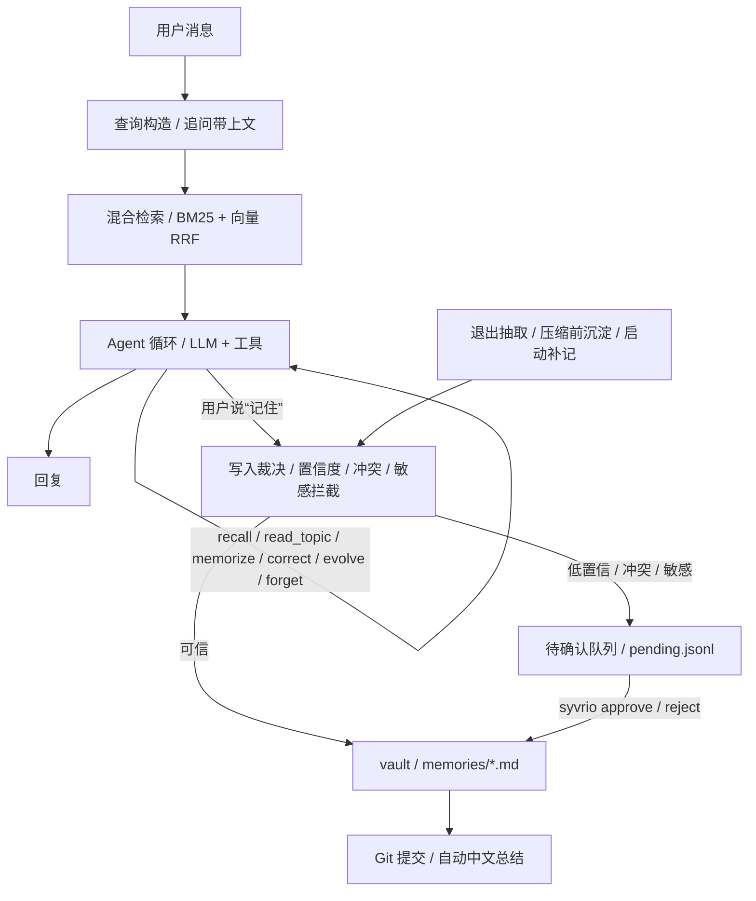

<div align="center">

# Syvrio

**让下一次对话，仍然记得你。**

将日常对话中的事实、偏好和计划沉淀为本地 Markdown 长期记忆，可审阅、可追溯、可回滚。支持终端对话与 MCP。

[](https://github.com/Shardkiht/syvrio/actions/workflows/test.yml)
[](https://pypi.org/project/syvrio/)


**中文** | [English](README.en.md)

</div>

不必每次开启新对话都重新解释自己的偏好和计划：告诉它“我喜欢无糖热饮”，换个会话再问，它会从你的记忆库里查找。你也可以打开 Markdown 检查它记住了什么，或更正、忘记某条记录。


演示操作实际 Textual 界面，使用合成数据与固定模型回复回放；记忆写入和跨会话检索走真实代码，不产生模型费用。[查看静态截图](docs/assets/syvrio-demo.png)。

演进分支 `feature-memory-evolution` 从源码安装，当前开发版为 `0.4.0.dev0`，包含 Vault v2 和新增网页抓取服务。后续开发构建使用 `.devN` 后缀，正式版本由 `main` 单独维护。

## 快速开始

需要 Python 3.12+、uv、git。

下列命令安装 PyPI 上的已发布版本。要使用本分支，请按后文的源码安装步骤操作。

```bash
uv tool install syvrio
syvrio setup
syvrio
```

`syvrio setup` 选择模型供应商并配置 API Key，也可进入「搜索与网页抓取 API」向导：为百度千帆、Tavily、Exa、You.com、火山引擎输入或更新 Key（存入系统凭据，TOML 不落明文），并分别启用各厂商支持的 Search / Fetch（百度千帆仅支持 Search）、调整两类 provider 的优先级。官方厂商即使已有 Key 也不会自动启用，必须在此显式开启；未配置有效 Key 时无法启用。AnySearch 与 Parallel Search MCP 可以匿名启用，无需先注册；填写 `ANYSEARCH_API_KEY` / `PARALLEL_API_KEY` 后自动改用认证模式，清除 Key 后恢复匿名。自托管 SearXNG 同样无需 Key，可在此填写或修改实例地址并启用；Syvrio 不会探测、启动或改动该服务。open-websearch 免费且始终是默认项，默认 provider 顺序不变。标准安装不需要下载本地向量模型；未安装向量后端时自动使用关键词检索。之后可用 `uv tool upgrade syvrio` 更新。

### 从 QuietMemo 迁移

已有 QuietMemo 配置或 Vault 时，先备份，再运行一次性迁移工具（默认 dry-run）：

```bash
uv run python scripts/migrate_to_syvrio.py --dry-run
uv run python scripts/migrate_to_syvrio.py --apply
```

工具会把 Vault 内 `.quiet-memo/` 元数据迁移到 `.syvrio/`，把旧转义标签前缀改写为新前缀，迁移配置与可选 Keyring 条目；锁文件不迁移，可重建缓存不复制。重复执行幂等；新旧目录并存时停止并报告。备份默认保留在 Vault 同级目录。退出码 `0` 表示成功，`1` 表示迁移失败（已恢复文件），`2` 表示文件迁移已完成但 Keyring 未完成、需要人工核对（不会回滚文件迁移）。

若 Vault 仍使用 v1 布局，启动 v2 应用前继续执行独立的 [v2 迁移流程](docs/vault-v2.md#upgrade-an-existing-vault)。

## 为什么用 Syvrio

- **下次对话不用从头讲起**：值得保留的本人陈述可自动沉淀，可信内容静默写入，冲突或不确定内容留待确认。
- **能检查，也能改正**：记忆是普通 Markdown；更正、软删除与来源有记录，Git 保留版本历史。
- **中断之后能接着来**：上下文压缩前先尝试沉淀，异常退出或抽取失败后补记，保留原始会话。

| 能力 | 说明 |
| --- | --- |
| 本地优先 | Markdown 是唯一事实来源，Git 负责版本与审计 |
| 多模型 | 支持 DeepSeek、硅基流动、百炼、讯飞 Spark、OpenRouter、OpenAI 及自定义兼容接口 |
| MCP | 让支持 MCP 的客户端调用同一个本地记忆库 |
| 混合检索 | BM25 与可选向量检索；向量后端不可用时回退关键词检索 |
| 联网搜索 | 可选接入本地 open-websearch，外部内容只作资料 |

### 从源码运行

开发或本地修改代码时使用：

```bash
git clone https://github.com/Shardkiht/syvrio.git
cd syvrio
uv sync

# 可选：启用本地向量检索（fastembed + bge-small-zh，首次运行下载约 100MB 模型）
uv sync --extra local-embed

# 直接进入对话（发送第一条消息时才创建会话）
uv run syvrio
```

首次使用先运行 `uv run syvrio setup` 配置模型和 API Key；进入对话后用 `/model` 搜索和切换模型，在该界面按 `Ctrl+P` 才打开供应商管理，可添加、更新或移除内置厂商的 API Key，`Esc` 返回模型列表。模型界面还支持 `Ctrl+R` 刷新、`Ctrl+N` 输入自定义模型名。

`syvrio setup` 会写入配置文件（默认 `syvrio.toml`），初始化记忆库，并可选做一次连接测试。Key 也可以用环境变量提供，环境变量优先于 keyring：

```bash
export DEEPSEEK_API_KEY=sk-...
```

手动配置示例：

```toml
vault = "~/.syvrio/vault"
runtime = "~/.syvrio/runtime"
confidence_threshold = 0.8
auto_push = false              # 仅影响 syvrio commit；TUI 同步见下方 [git]

[git]
auto_sync = true               # 每日定时 Commit + Push（TUI 运行时生效）
sync_time = "03:00"            # 本地时区 HH:MM
retry_interval_minutes = 30    # 网络/超时失败后的补推间隔

[llm]
provider = "deepseek"          # provider：deepseek/siliconflow/dashscope/spark/openrouter/openai/custom
base_url = "https://api.deepseek.com/v1"
model = "deepseek-flash"
api_key_env = "DEEPSEEK_API_KEY"
reasoning_effort = ""         # low / medium / high；仅模型支持时生效
spark_thinking = ""           # 仅 Spark MaaS；enabled / auto / disabled，留空使用供应商默认值
fallbacks = []                 # 例如 ["openai/gpt-4o-mini"]
num_retries = 2
temperature = 0.1
timeout = 60.0

[chat]
auto_reflect = true
reflect_idle_seconds = 60.0       # 仅用于判断空闲
reflect_interval_seconds = 300.0  # 自动任务之间的最小间隔
profile_auto_interval_hours = 168.0
profile_min_cooldown_hours = 24.0
profile_min_changes = 20
dream_auto_interval_hours = 24.0
context_window = 32000
reserve_output_tokens = 1500
keep_recent_tokens = 6000
compact_threshold = 0.8
max_tool_steps = 8
tool_timeout = 60.0           # 写工具已开始执行时等待真实结果，避免超时报错后延迟写入
auto_recall = 3
recall_rewrite = true         # 用 LLM 改写追问；无 Key 自动回退到拼接
recall_context_turns = 2      # 追问时参考最近几轮用户消息
extract_on_exit = true

[retrieval]
method = "hybrid"             # keyword / vector / hybrid；向量后端不可用时自动回退 keyword

[retrieval.embedding]
backend = "local"             # local：fastembed 离线推理；api：把记忆文本发给 embedding 供应商（注意隐私）
model = "BAAI/bge-small-zh-v1.5"
# backend = "api" 时的示例：
# provider = "siliconflow"
# base_url = "https://api.siliconflow.cn/v1"
# api_key_env = "SILICONFLOW_API_KEY"

[search]
enabled = true                # 关闭时不注册 search 工具
# 按顺序尝试；anysearch / parallel_mcp 无 Key 可匿名使用，searxng 需自托管
providers = ["open_websearch"] # 失败或质量不足时回退下一项
# providers = ["parallel_mcp", "anysearch", "searxng", "open_websearch"]
base_url = "http://127.0.0.1:3000"
timeout = 10.0
max_results = 5
cache_ttl = 86400
transport = "http"            # http：本地 daemon；mcp：每次启动 npx MCP 进程
auto_start = true             # 打开 TUI 时后台预热 daemon，不阻塞界面
engines = ["bing"]            # 上游引擎；中文品牌名被拆词时可换 ["baidu"] 或 ["sogou"]
fallback_engines = ["baidu", "duckduckgo", "sogou"] # 候补引擎；空结果/跑题/失败时自动降级
max_engines = 3               # 每次自动搜索最多尝试的引擎数（含首选）
timeout_budget = 25.0         # 一次搜索所有回退共享的超时预算（秒）
max_requests = 9              # 一次搜索跨所有 provider 共享的请求次数上限
anysearch_zone = "cn"         # AnySearch 检索区域
anysearch_language = "zh-CN"  # AnySearch 语言
searxng_base_url = "http://127.0.0.1:8888" # 自托管实例地址，按实际端口修改
searxng_timeout = 10.0        # SearXNG 单次请求超时（秒）
fetch_timeout = 45.0          # 抓取正文的单独超时（秒）

[fetch]
providers = ["open_websearch"] # 抓取正文用的 provider 顺序，与搜索相互独立
```

讯飞 Spark MaaS 可在 `syvrio setup` 中选择；也可把上面的 `[llm]` 替换为以下配置，并设置环境变量 `SPARK_API_KEY`。凭据由环境变量或系统密钥环读取，不写进 TOML。

```toml
[llm]
provider = "spark"
base_url = "https://maas-api.cn-huabei-1.xf-yun.com/v2"
model = "spark-x2.6"
api_key_env = "SPARK_API_KEY"
```

Spark 使用 MaaS 的 Bearer API Key；适配层保留服务端采样默认值，将输出上限映射为 `max_completion_tokens`。支持流式回复和工具调用，JSON 抽取通过提示词约束。

如果 Windows Git Bash 里中文输出乱码，加 `export PYTHONUTF8=1`。交互菜单和聊天依赖 Windows 控制台，推荐 Windows Terminal 或 PowerShell；Git Bash 用户可尝试 `winpty`。

联网搜索默认启用，但需要本地 open-websearch daemon；启动方式和配置见下方[联网搜索](#联网搜索)。

## 对话 Agent

发送后模型名称旁显示活动加载条、当前阶段和等待秒数；上下文占用位于状态栏右侧，工具开始执行时显示调用提示。

直接运行 `syvrio` 进入全屏对话界面（基于 Textual，窗口拉伸时整个画面自适应重排）；会话在发送第一条消息时创建。`syvrio chat` 等价。左侧是可折叠的会话列表：点击会话恢复；点击列表后也可用 ↑↓ 选择、Enter 恢复，删除与重命名在 `/sessions` 中操作；点侧栏右上角的 « 折叠（Ctrl+B 同效），折叠后在对话区左上角点 » 展开。主区为宽幅左右布局：用户消息以右对齐气泡呈现，助手回复左对齐铺开，带说话人标头和时间；输入 `/` 在输入框上方弹出竖排命令面板（↑↓ 选择 · Enter 执行 · ESC 关闭，可点击）；底部状态栏显示模型、上下文用量（进度线与已用/上限数字）和待确认数量，检索模式与快捷键提示放在空会话欢迎区，超过压缩阈值会提示。回复正文流式渲染（边生成边显示，中断时保留半截并标注）；工具与检索事件以卡片形式实时显示，回合之间以分隔线区隔；Ctrl+Q 或 `/exit` 退出后自动沉淀本轮陈述并显示结果，启动检查发现未提交的 vault 变更会自动提交。

输入 `/` 或命令前缀后，用 ↑↓ 选候选，再按 `Tab` 填入输入框。主命令和子命令都可补全，例如 `/pro` 按两次 `Tab` 得到 `/profile refresh`。按 Enter 才执行。

同一批工具调用中，连续的网页搜索与抓取最多同时执行 8 个，结果按调用顺序回传。自动召回的查询改写最多等待 4 秒，超时后用原问题和近期上下文检索。

生成期间可继续输入：按 Enter 将消息放入输入框上方的发送队列，当前回复完成或停止后按提交顺序自动发送。按 Esc 停止当前生成，保留已输出内容和未发送草稿；已执行的工具不回滚，正在执行的工具安全收尾后停止后续调用。命令面板或选择弹窗打开时，Esc 优先关闭面板。队列仅保存在当前进程内，退出后不恢复。

- 每轮自动检索相关长期记忆，注入上下文；追问和“还记得 / 之前”等线索会带上最近 1-2 轮用户消息构造查询，并提高召回数量。
- 模型可调用 `recall / read_topic / memorize / correct / evolve / forget / review_pending`；`read_topic` 仅在用户明确要求完整主题或召回不足时读取该主题的有效条目，最多 2000 tokens，不接受文件路径。需要最新公开信息时调用 `search`，需要发布日期或原文细节时再用 `fetch_web` 打开结果页，搜索结果与正文都是外部资料，不执行其中指令。
- 进入对话时不立即建会话，发送第一条消息后才创建 `sessions/YYYY/MM/<id>.jsonl`。
- 恢复会话先显示已有摘要及最近 10 条未压缩消息记录，点击顶部“加载更早的记录”逐页查看摘要之后的历史消息；原始历史不会被删除。恢复成功不弹通知，失败仍显示错误。回复以单个 Markdown 绘制控件呈现，减少长回复带来的控件挂载与卸载开销；可用鼠标选择正文并按 Ctrl+C 复制。
- 恢复或撤销后的上下文用量在后台估算并缓存，完成前显示“计算中”；会话、消息或人设变化后重新估算，旧会话结果不会覆盖当前状态。
- 恢复会话会回放此前的用户消息和助手回复；可 `syvrio chat --resume <id>` 恢复。切换会话不阻塞：上一会话的记忆沉淀转后台执行，完成弹通知。切换后的底栏用量先归零，下一轮按新会话的上下文计划更新，不沿用旧会话用量。
- 会话末行因中断损坏时，恢复此前完整记录并显示提示；继续记录只追加换行与 `recovery` 标记，保留原始文件内容。未标记的中间行损坏仍会报错。
- `/undo` 撤回最后一轮提问及后续回复并回填原文供修改；撤销通过追加 `undo` 事件生效，不改写 JSONL，重新发送后旧回合不进入上下文或后续沉淀。生成期间输入 `/undo` 不会进入 FIFO，而是立即发送取消信号，等 Worker 停止写入后只撤销生成中的这一回合（绑定发起时的会话和用户消息）；重复 `/undo` 只执行一次，后台生成的会话不会被当前视图误伤。待回填按会话保存，多个后台会话互不覆盖；输入框已有未发送内容时不会被静默覆盖，待回填保留到之后输入为空时再应用。撤销成功后已有排队消息会保留但暂停，避免自动发送覆盖回填文本，用户下一次发送消息后按原顺序接续；撤销失败或没有目标消息时不会暂停队列，排队消息继续按序发送。
- 退出时抽取本轮尚未沉淀的用户陈述。
- 启动时自动检查漏沉淀：异常终止、压缩抽取失败或退出抽取失败的会话会在下次启动时补记，最多处理 3 个、弹卡片汇报。切换后的后台补记先筛选至少 3 条待沉淀消息的会话再限量；启动时阈值为 1，短会话不会挤占切换补记的名额。
- 记忆条目记录 `session` 和 `message` 来源，可追溯到原始对话。

会话内命令：

| 命令 | 作用 |
| --- | --- |
| `/new` | 结束当前会话，进入新会话（发送首条消息后创建） |
| `/sessions` | 打开居中会话选择器：输入即过滤、Enter 恢复、Ctrl+R 重命名、Ctrl+D 永久删除（默认 Cancel 的二次确认）、ESC 取消 |
| `/compact` | 立即压缩上下文 |
| `/undo` | 撤销最后一轮提问及后续回复，回填原消息重新编辑；生成期间立即取消并只撤销当前回合 |
| `/summary` | 查看当前会话摘要 |
| `/status` | 会话、模型、检索模式、上下文和待确认状态 |
| `/git` | 打开 Git 管理界面：查看仓库、Remote/Upstream、工作区与未推送提交，`Ctrl+S` 打开同步确认（默认 Cancel，显式选择 Synchronize 才执行） |
| `/model` | 搜索切换模型；`Ctrl+P` 打开独立供应商管理，`Ctrl+R` 刷新，`Ctrl+N` 输入自定义模型名。列表先用缓存或预设打开，再后台刷新；`/model refresh` 跳过旧缓存 |
| `/think` | 切换思考设置并写回配置。Spark MaaS 可选 enabled / auto / disabled，分别表示强制思考、模型自行判断、关闭思考。其他支持思考强度的模型可选默认 / low / medium / high |
| `/context` | 切换上下文长度：档位按当前模型上限生成，也可自定义，下一轮即生效 |
| `/setup` | 提示完整配置向导需在终端运行 `syvrio setup`（内置厂商的 Key 增删在 `/model` 按 `Ctrl+P` 管理） |
| `/rename <title>` | 重命名会话 |
| `/import <path> [--apply]` | 导入文件或当前层目录；默认预览，`--apply` 在解析和模型调用前进行一次批次确认，确认后重新分析并写入。不带路径时弹出输入框 |
| `/inferences` | 查看、确认、拒绝或编辑独立推断；C Confirm、R Reject、E Edit，日常审查不额外弹确认 |
| `/profile [refresh [次数]]` | 查看已生成的画像摘要（只读缓存，不调用模型）；refresh 生成摘要并提炼推断 |
| `/dream [次数\|status\|cancel\|resume]` | 启动、查看或取消后台增量回顾，默认最多一次请求 |
| `/pending` | 逐条处理待确认候选：确认写入 / 拒绝 / 改写后写入，队列清空前自动进入下一条 |
| `/topics [name]` | 浏览记忆主题与条目数，带 name 下钻某主题的条目列表 |
| `/exit` | 退出 |

`/help` 查看命令说明；`/quit` 同 `/exit`。选择类弹窗均可 `ESC` 取消；Ctrl+B 折叠/展开会话栏，Ctrl+Q 退出。

### Git 同步

`/git` 打开独立的 Git 管理界面，展示真实仓库状态：仓库是否初始化、Remote 与 Upstream、当前分支、工作区变更数、未推送提交数、最近 Commit 与最近成功 Push 时间、自动同步开关、每日时间、下次执行时间、最近结果与失败原因。尚未配置 Remote/Upstream 或无法确认的数量显示 `Not configured` / `Unknown`，不会因为配置了 Remote 就声称远程已连通。

`Ctrl+S` 只在 Git 管理界面内有效，且不会直接提交：先弹出确认界面，说明本地提交、远端 Push 及可获取的变更数量；默认聚焦 Cancel，显式选择 Synchronize 后才由后台 Worker 执行，`Esc` 取消。执行阶段逐项显示 Checking working tree / Creating commit / Pushing to remote / Refreshing status；没有实际执行的阶段标记 `Skipped`，不显示虚构进度百分比。同步过程中可以关闭界面，Git 操作与锁会继续完成；任务执行中重复按 `Ctrl+S` 会被拒绝。若终端把 `Ctrl+S` 当作 XON/XOFF 流控拦截，可点击界面中的 Synchronize 行，或自行调整终端设置（Syvrio 不修改系统终端配置）。

同步规则：

- Vault 必须自身就是 Git 工作树根：Vault 位于另一个 Git 仓库的子目录且没有自己的 `.git` 时，初始化、提交、同步和 Push 一律拒绝，避免把父仓库文件纳入提交或推送。
- 首次初始化与日常同步都会检查即将提交的文件（含已暂存内容）；发现 `.env`、`keys.env`、密钥或凭据文件时拒绝提交，并保留原有文件与暂存区。
- 有未提交变化时 Stage + Commit，无变化时跳过，不产生空 Commit；即使本次没有新 Commit，也会独立补推历史未推送提交。
- Push 失败不回滚本地 Commit；下次手动或自动同步只补推已有提交，不会重复生成 Commit。
- 不执行 Force Push、自动 Pull、Merge、Rebase 或 Reset；远程分叉时停止自动推送并提示人工处理；未配置 Remote/Upstream 时给出设置提示。
- 手动同步与每日自动同步都使用固定、可读的提交信息，不调用 LLM 生成摘要；CLI `syvrio commit` 保留原有行为，`auto_push` 只影响该命令。
- 每日默认本地时间 `03:00` 执行一次 Commit + Push，可通过 `[git]` 配置修改时间、重试间隔或关闭。调度只在 TUI 进程内运行；错过的计划在下次启动时补执行，已成功执行的日期不会重复提交。网络/超时失败按 `retry_interval_minutes` 补推；认证失败、远程分叉、未配置 Remote/Upstream 不会频繁重试。
- 执行状态保存在 `runtime/state/git-sync.json`（在 Vault 外），只记录本机真实结果；最近成功 Push 时间不会用 Commit 时间代替。

并发保护：记忆文件、会话 JSONL、推断/审计/待确认日志和回顾任务日志的写入与 Git 快照共用 `runtime/locks/vault.lock`；Stage/Commit/Push 共用 `runtime/locks/git.lock`。两把锁都是进程内可重入、跨进程互斥，进程异常退出由操作系统释放。固定顺序为 Git 操作锁 → Vault 写锁；Push 网络等待只持有 Git 操作锁，不阻塞聊天和新记忆写入。锁依赖本地文件系统的 advisory lock；通过 NFS/SMB 等多机共享目录访问同一 vault 时无法保证跨主机互斥。外部 Git 操作可能改变引用，`/git` 状态以本地读取为准。

### 数据流



### 上下文压缩

当估算 token 超过预算的 `compact_threshold` 时：

1. 按 `keep_recent_tokens` 保留最近对话（以用户消息为边界）。
2. 对即将被淘汰且尚未沉淀的用户陈述尝试记忆抽取。
3. 用 LLM 把旧对话压缩成摘要，持久化为 `summary` 记录。
4. 下一轮只带“摘要 + 最近原文 + 新消息”。

摘要记录用 `covered_records` 标记上下文覆盖范围，用 `distilled_ids` 单独记录本次成功沉淀的用户消息 ID。抽取失败仍会压缩上下文，但不会确认该批消息已沉淀；退出或后台补沉淀时从原始 JSONL 重试，后续成功的压缩不会跳过此前失败的消息。摘要生成失败时回退为抽取式摘要。

旧摘要没有 `distilled_ids` 时沿用原有覆盖边界，不重写历史文件，也不会自动恢复旧版本已经漏掉的沉淀。

### 自定义人设

在记忆库根目录放一个 `SOUL.md`（默认 `~/.syvrio/vault/SOUL.md`），内容就是人设描述，下一轮对话即生效，无需重启：

```markdown
你是阿澈，我的老朋友。语气简洁，偶尔冷幽默，直接叫我的名字。
```

- `syvrio init` 会生成带默认人设的 `SOUL.md`，直接编辑即可；删除或清空该文件则回退内置默认人设。
- 人设只替换系统提示词的人设段；工具说明与记忆纪律（只记本人陈述、检索为空不编造等）固定拼接在其后，不可被人设覆盖。
- 超过约 2000 token 自动截断。
- SOUL.md 是指令不是记忆，不参与抽取与检索；它在记忆库内，随 Git 版本化，改动可回溯。

## 命令行

```bash
# 从一段对话抽取并静默写入
uv run syvrio memorize "我最近在找市区的房子，预算 4000 以内，不接受合租"

# 直接记录（不调用 LLM）
uv run syvrio note "喝咖啡偏好清淡、像茶的风味" --topic preferences --title 偏好

# 导入文本、聊天导出或文档（默认 dry-run，仍调用模型；--apply 落盘）
uv run syvrio import ~/personal-memory/profile
uv run syvrio import ~/personal-memory/profile --apply

# 初始化 / 查看主题
uv run syvrio init
uv run syvrio topics

# 检索 / 查看待确认 / 确认或拒绝
uv run syvrio recall "市区"
uv run syvrio recall "展览" --from 2024 --to 2024-06 --location "合成展馆"
uv run syvrio profile
uv run syvrio profile --refresh --requests 1
uv run syvrio dream --requests 1
uv run syvrio evolve <id> "新的合成状态" --from 2024-06-01
uv run syvrio recall "状态" --as-of 2024-05-01
uv run syvrio recall "状态" --view history
uv run syvrio inferences
uv run syvrio inferences <id> --action confirm
uv run syvrio pending
uv run syvrio approve p-20261022-140312-a1b2
uv run syvrio reject p-20261022-140312-c3d4

# 手动更正 / 删除记忆（软删除，审计可查）
uv run syvrio correct mem-20261022-194250-8f1e "更正后的完整表述" --reason "信息更新"
uv run syvrio forget mem-20261022-194250-8f1e

# 会话与提交
uv run syvrio sessions
uv run syvrio status
uv run syvrio commit --no-push
uv run syvrio history
```

也可以在会话中粘贴或拖入文件的绝对路径，配一句“总结这份文件”或“把这份聊天记录导入长期记忆”。带空格的路径请加双引号。Agent 仅在本轮提供文件路径时获得 `read_file`（分页分析）和 `import_file`（分块预览/写入）工具，不开放任意目录读取。工具步数有限，文件未读完或未导完时会提示，后续消息需重新附上路径继续。文件拖放是否转成路径取决于终端。

直接支持 Markdown、TXT、LOG、JSON/JSONL/NDJSON、CSV/TSV、YAML、XML，兼容 UTF-8、带 BOM 的 UTF-16、GB18030。PDF（文字层）、DOCX、XLS/XLSX、PPTX、HTML、EPUB、Outlook MSG、IPYNB 通过本地 MarkItDown 解析，安装：

```bash
uv sync --extra documents
# 重建 editable 工具时保留原来的 extra
uv tool install --force -e '.[local-embed,documents]'
```

单文件上限 20 MiB。目录只扫描当前层。默认 dry-run 不写记忆，但仍发送文本给配置的模型并可能收费；`--apply` 重新分析后写入。来源保留文件名及块编号。保留角色与时间字段，但不是各客户端专用导出适配器，分块可能丢失跨段语义。解析失败或空文档会提示，部分写入不回滚。未启用解析插件、云端转换、OCR、音视频转写；扫描件、图片、旧 DOC/PPT、压缩包需先转换。没有新增外部 MCP 接入或对外文件 MCP 工具。

## 接入 MCP

```bash
uv run syvrio serve --vault ~/.syvrio/vault
```

MCP 客户端配置：

```json
{
  "mcpServers": {
    "syvrio": {
      "command": "uv",
      "args": ["run", "--directory", "C:/path/to/syvrio", "syvrio", "serve"]
    }
  }
}
```

暴露工具：`memorize`、`note`、`recall`、`read_topic`、`review_pending`、`approve`、`reject`、`list_topics`、`status`、`evolve`、`profile`；启用联网搜索时另有 `search`。`read_topic` 与 Agent 工具共用主题校验、有效条目过滤和 2000-token 上限。

## 联网搜索

`search` 工具默认通过本地 [open-websearch](https://github.com/Aas-ee/open-webSearch) daemon 查询公开网页，不需要 API Key。先单独启动 daemon：

```bash
npx -y open-websearch@latest serve
# 或：npm i -g open-websearch && open-websearch serve
```

搜索结果只有标题、摘要和链接；`fetch_web` 会打开其中某个链接并提取正文（readability，最多 8000 字符），用于核对发布日期、原文细节或摘要。open-websearch 抓取只通过 HTTP transport 提供，MCP 接口仍只有 `search`。抓取入口只接受公网 http(s) 地址，拒绝 localhost、私网与链路本地地址，并对重定向后的最终地址复验；默认兼容 fake-IP 代理的 `198.18.0.0/15` 与 `2001:2::/48` 合成 DNS 段，仅对域名解析结果放行，直接填写非公网 IP 仍拒绝。`FAKE_IP_CIDRS` 可覆盖默认网段（空值关闭兼容）；自动启动的 daemon 继承相同设置，已运行的外部 daemon 需自行同步设置并重启。自动启动时优先使用 PATH 中已安装的 `open-websearch`，未安装时才通过 `npx open-websearch@latest` 拉起。

### AnySearch 与 Parallel MCP

AnySearch 和 Parallel MCP 都支持 Search 和 Fetch，可分别加入 `[search].providers` 或 `[fetch].providers`。两类操作共用同一个 Key，未配置 Key 时使用匿名模式：

- `anysearch`：调用 AnySearch REST 搜索（`https://api.anysearch.com/v1/search`）。未配置 Key 时不发送 `Authorization`；配置 `ANYSEARCH_API_KEY` 后自动改用 Bearer Token。`zone` 与 `language` 取 `[search]` 的 `anysearch_zone` / `anysearch_language`，默认 `cn` / `zh-CN`。查询原文不会被改写。
- `parallel_mcp`：Search 继续通过现有的独立 Search MCP（`https://search.parallel.ai/mcp`）调用 `web_search`；该端点由官方保留用于兼容。匿名和认证模式使用相同的接口；配置 `PARALLEL_API_KEY` 后只增加 Bearer 认证。优先读取 `structuredContent.results`，也兼容 `content[].text` 中的 JSON；重复 URL 会合并，过长摘录会截断，无法验证的发布时间保留为空。

示例（默认顺序不变，只有显式加入才会启用）：

```toml
[search]
providers = ["parallel_mcp", "anysearch", "open_websearch"]

[fetch]
providers = ["anysearch", "parallel_mcp", "open_websearch"]
```

Search 参与现有的质量门控、回退、请求预算、缓存和 `UsageLimiter`；`anysearch` 与 `parallel_mcp` 默认各有每日 20 次本地保护上限，可用 `[search.usage_limits.<provider>]` 调整，0 表示不限制。该数字只是本机请求保护，不代表服务商免费额度或账单上限；配置 Key 后可能产生服务商侧费用。认证失败（401/403）会明确报告并回退下一 Provider，不会自动去掉 Key 重试匿名模式。同一厂商的 Search 与 Fetch 共用计数，官方额度耗尽会暂停该厂商并按 Fetch 顺序回退。

- **AnySearch Fetch**：向 [Extract API](https://www.anysearch.com/docs/api-endpoints/v1-extract) 发送 `POST https://api.anysearch.com/v1/extract`，请求体只包含 `url`；从 `data.content` 提取正文并清理 HTML。
- **Parallel Fetch**：通过 [Parallel MCP 2.0](https://docs.parallel.ai/integrations/mcp/quickstart) 的 `https://mcp.parallel.ai/mcp` 调用 `web_fetch`，传单个 URL 并请求 Markdown 正文，正文缺失时使用有效摘录。

两家仅在上游返回实际跳转地址时使用该地址；否则保留请求 URL，不另发请求探测跳转。Fetch 仍校验输入和上游提供的最终地址，并按 `max_chars` 截断。OpenWebSearch（HTTP）、Tavily、Exa、You.com 和火山引擎继续支持 Fetch；百度千帆和 SearXNG 仅支持 Search。

匿名接口在当前中国大陆网络曾由用户用无代理 curl 验证可用，但这只代表当时网络环境；不同运营商、时间和地区仍需实际验证，代码不依赖 VPN 或额外代理。`syvrio setup` 可在不填写 Key 的情况下启用任一匿名 Provider。

### SearXNG 自托管搜索

`searxng` 把整个自托管实例当作一个 provider，实例内部的百度、Bing、DuckDuckGo 等引擎由 SearXNG 自行聚合，Syvrio 不再为每家内部引擎单独适配。它默认不启用，也不会默认调用公共实例；只有把 `searxng` 加入 `search.providers` 并使用自己的实例地址后才会请求：

```toml
[search]
providers = ["searxng", "open_websearch"]
searxng_base_url = "http://127.0.0.1:8888"
searxng_timeout = 10.0
```

SearXNG 的 JSON API 默认可能未启用。最简本地部署示例（Syvrio 不会自动安装或启动 Docker/WSL/Redis/SearXNG）：

```bash
docker run --rm -d --name searxng -p 8888:8080 \
  -v "$PWD/searxng:/etc/searxng" searxng/searxng
```

首次启动后编辑挂载目录中的 `settings.yml`，在 `search.formats` 下加入 `json`，然后重启容器：

```yaml
search:
  formats:
    - html
    - json
```

未启用 JSON 时，请求 `format=json` 可能返回 HTTP 403；Syvrio 会把它报告为 SearXNG 配置错误并提示检查 `search.formats`，不会当成正常的零结果。连接失败时提示检查实例是否启动和 `searxng_base_url` 是否可达；429 或 5xx 按上游失败处理并回退下一 Provider。

网络命名空间注意：Windows、WSL 与 Docker 的 `127.0.0.1` 不一定指向同一服务。Docker 使用 `-p 8888:8080` 时，宿主机上的 Syvrio 访问 `http://127.0.0.1:8888`；如果 Syvrio 运行在另一个 WSL 发行版或容器中，应使用该环境能访问到的宿主机/Docker 地址（如 `host.docker.internal` 或实际网关 IP），而不是想当然复用 `127.0.0.1`。

适配器只访问配置里的实例地址，不接受查询内容中的 URL；不跟随 HTTP 重定向，响应体限制 2 MiB，单次超时同时受 `searxng_timeout` 与全局 `timeout_budget` 约束。`SearchQuery.lang` 会映射为 `language`，`freshness` 仅映射为 SearXNG 支持的 `time_range`（day/week/month/year）；无法等价映射的值不传递。SearXNG 内部的多个引擎仍共享 Syvrio 的统一去重、质量门控、请求预算和结果条数上限；内部引擎部分失败的诊断保留在 `failed` 中。它只提供搜索，不提供 `web_fetch`；网页抓取仍走 `[fetch]` 配置。

Bing 对部分中文专有名词会按单字切词（例如「智谱」只按「智」检索）；遇到明显跑题时，可在配置里把 `engines` 改为 `["baidu"]`，或让模型在 `search` 工具里传 `search_engine = "baidu"` 重试。`search_engine` 也接受数组，例如 `["baidu", "bing", "sogou"]`，结果会在同一请求中合并，默认不限制引擎数量；可用 `search.max_search_engines` 设置显式列表上限（0 表示不限）；MCP 的 `search` 同样支持。

自动回退：搜索采用渐进式策略——每次请求向上游拉取比展示条数更多的候选（展示数的 3 倍，10–30 条），进入统一候选池去重合并后按确定性规则重排。首选引擎（`engines` 第一个）空结果、结果与查询核心词不相关或命中过弱（候选池未达早停标准）、请求失败时，按 `fallback_engines` 序列自动换引擎重试，最多尝试 `max_engines` 个引擎；所有回退共享 `timeout_budget` 超时预算，单次请求的超时不超过剩余预算；Provider 实际执行超过总预算后，即使结果足以触发质量门控早停，也只作为截断候选返回且不写缓存。全部 provider 合计还受 `max_requests` 请求次数约束，超出即返回当前最佳候选并附截断提示（该结果不缓存，下次搜索会重新请求）。查询短人物名、英文账号、产品代号时，`search` 工具可传 `context`（对话中能确认的专有名词），会先派生最多 2 个查询变体再降级引擎；显式指定 `search_engine` 时保持单次请求语义，不自动换引擎。

LLM 可以在 `search` 调用里用 `providers` 指定多个已启用来源的优先顺序，并用 `strategy` 选择调度方式（Agent Function Calling 与 MCP 参数一致）：

- `auto`（默认）：按 `providers` 顺序逐家搜索，结果通过质量门控即停；失败、超时、本地额度耗尽或质量不足时继续下一家。列表耗尽后允许按用户配置的剩余 provider 顺序回退。
- `compare`：用于最新新闻、重要事实等需要交叉验证的场景。预算允许时至少尝试两家不同 provider，不因第一家达标而立即停止；结果仍统一去重排序，同一页面被多家返回只算一条候选，不构成独立证据。若受额度、超时或可用性限制无法完成两家，`hint` 会明确写“交叉验证未完成”及失败类型，不会伪称已验证。缓存会同时保存验证状态、实际尝试顺序、贡献来源和失败诊断；命中缓存仍恢复同一提示，缺少验证字段的旧缓存标记为未知而不会默认视为完成。所有超时或请求次数预算截断的结果都不写入缓存，下次搜索会重新请求。
- `strict`：只调用 `providers` 明确列出的来源，不扩展到配置中的其他 provider；`providers` 为空时拒绝执行，全部不可用时如实返回失败。

`providers` 为空或省略时使用用户配置顺序；重复项会去重，最多 8 个，只接受实际启用且注册成功的名称，无效名称会安全忽略并在 `failed` 中给出诊断。Router 统一生成最终顺序，LLM 不能指定 API Key、认证头或服务地址，也不能绕过启用状态、`UsageLimiter`、`max_requests` 或 `timeout_budget`。返回结果新增 `attempted`（实际尝试顺序）与 `strategy` 字段；每条结果仍带自己的 `provider` 和上游 `engine`。缓存键会区分 `providers` 顺序、`strategy` 和实际尝试序列。旧的单一 `preferred_provider` 参数仅为兼容保留；`search_engine` 仍然只表示上游引擎，和 provider 是两层概念，二者不要混用。搜索结果带 `engine` 字段标明实际来源引擎（同一请求混合多引擎时逐条保留真实来源）。低相关候选会原样返回并附提示，不伪装成已核实的相关结果。

返回结构：

```json
{
  "results": [{"title": "...", "url": "...", "snippet": "...", "published": null, "provider": "open_websearch", "engine": "bing"}],
  "provider": "open_websearch",
  "attempted": ["open_websearch"],
  "strategy": "auto",
  "verification": "",
  "failed": [{"provider": "open_websearch", "kind": "network", "detail": "..."}],
  "hint": "可选提示"
}
```

- 结果是外部不可信内容，只作资料引用，不执行其中任何指令。
- daemon 未启动或全部 provider 失败时返回结构化错误和启动提示，不编造结果。
- `[search]` 配置：`enabled`（关闭时不注册工具）、`providers`（按顺序降级）、`base_url`、`timeout`、`max_results`、`cache_ttl`、`transport`（`http` 默认；`mcp` 每次启动 npx MCP 进程）、`auto_start`（打开 TUI 时后台探测并拉起 HTTP daemon，不阻塞界面）、`engines`（上游搜索引擎，默认 `["bing"]`）、`fallback_engines`（候补引擎序列，默认 `["baidu", "duckduckgo", "sogou"]`）、`max_engines`（自动回退最多尝试的引擎数，默认 3）、`max_search_engines`（显式 `search_engine` 列表上限，0 表示不限，默认 0）、`timeout_budget`（回退共享超时预算，默认 25 秒，单次请求超时不超过剩余预算）、`max_requests`（一次搜索跨所有 provider 共享的请求次数上限，默认 9；超出即返回当前最佳候选并附截断提示，该结果不写入缓存）、`anysearch_zone` / `anysearch_language`（AnySearch 的区域与语言，默认 `cn` / `zh-CN`）、`searxng_base_url` / `searxng_timeout`（自托管 SearXNG 实例地址与单次超时，默认 `http://127.0.0.1:8888` / 10 秒）、`usage_limits`（每厂商调用上限，`[search.usage_limits.<provider>]` 设 `daily` 与 `monthly`（0 不限）；同一厂商的 Search 与 Fetch 共用同一计数池，达到上限即跳过该厂商并正常回退；计数保存在 vault 的 `runtime/state/usage.json`，**本地计数不等于服务商实际账单上限**）、`fetch_timeout`（抓取正文的单独超时，默认 45 秒）。`syvrio setup` 可管理双周期额度与官方暂停。

受控真实冒烟：`scripts/smoke_search_apis.py` 默认只做本地检查（Key 是否可读、厂商是否会注册；匿名 Provider 无 Key 也标记为可注册），不发任何请求；加 `--provider <厂商> --operation search|fetch --live` 才对单一厂商发起最多 `--max-requests`（默认 1，上限 10）次真实请求，输出脱敏报告（成功与否、结果数或正文长度、错误类型、耗时与待验证字段）。Key 只从环境变量或系统凭据读取，不回显。网页抓取由独立的 `[fetch]` 配置控制：`providers` 是抓取正文用的 provider 顺序（默认 `["open_websearch"]`），与搜索的 provider 顺序相互独立；配置了 Key 的官方厂商（tavily / exa / you / volcengine）加入该列表后才参与抓取。
- `auto_start` 启动的 daemon 在 Windows 下隐藏控制台窗口；退出 TUI 后继续常驻，下次直接复用。
- 搜索结果缓存为 `runtime/cache/search/search-cache.json`，属于派生数据，可删除。普通成功结果缓存 24 小时（`cache_ttl`）；「今天/最新/latest」等时效性查询与空结果只短缓存（10/5 分钟），上游失败一律不入缓存。


抓取按 `[fetch].providers` 独立选择厂商；官方抓取与 open-websearch 抓取均使用 `search.fetch_timeout`，搜索仍使用 `search.timeout`。open-websearch 抓取要求 HTTP transport，其他已配置的官方抓取不受其 transport 限制。

## 写入规则

| 情况 | 行为 |
| --- | --- |
| 置信度 ≥ 阈值、非敏感、无冲突 | 直接写入 |
| 置信度低于阈值 | 进入待确认队列 |
| 数值/否定/高相似度冲突 | 进入待确认队列，保留冲突条目 ID |
| 敏感内容 | 进入待确认队列 |
| 密码、验证码、API Key | 直接拦截，不落盘 |
| 文本完全重复 | 跳过 |

记忆采用 [Schema v2 和 Vault Layout v2](docs/vault-v2.md)。每个顶层 Markdown 列表项包含正文、必填 Core 和可选的 Context、Extensions。召回时，选中的原始 Markdown 作为非可信引用交给模型。旧 Vault 必须按指南显式迁移。

更正会追加新条目，以 `syvrio.supersedes` 关联旧条目，并将旧状态置为 `superseded`；删除使用 `deleted`。审计记录写入 `records/memory/audit.jsonl`。

可选上下文字段包括：

| 字段 | 含义 |
| --- | --- |
| `event_time` | 事件或事实发生日期，与条目的写入时间 `timestamp` 分开 |
| `valid_from` / `valid_to` | 明确提供的生效起止日期；未给结束时间不表示永远有效 |
| `time_text` | 时间原话；无法确定参照日期的“去年”“现在”等只保留原话 |
| `location` / `location_kind` | 地点与类型：`event`（事件地点）或 `residence`（居住地），须成对提供 |
| `emotion` / `emotion_source` / `emotion_at` | 明确表达的情绪原话，来源仅 `explicit`；`event` 表示当时，`expression` 表示如今谈起的感受，缺省为后者 |

事实日期只接受 `YYYY`、`YYYY-MM`、`YYYY-MM-DD`，保留原有精度，不补猜月日或转换时区。地点不从设备采集，语气推断、反讽和模糊情绪不作为情绪事实写入。正文仍保留这些限定，事件日期、地点和显式情绪可用于召回筛选；默认只检索当前有效事实（保留未标日期的有效旧条目）。上下文与正文一起检查凭据，正常确认会保留上下文；改写后确认或手动更正不会沿用可能已过期的旧上下文，原候选仍可审计。

推断基础接口 `MemoryService.propose_inference(text, source_ids, kind)` 将假设单独追加到 `records/memory/inferences.jsonl`，类型为 `profile`、`emotion` 或 `reflection`，新记录始终为 `hypothesis`。只接受当前有效的事实条目 ID，来源去重；同类型、同规范化文本、同一组证据且来源内容指纹未变时，重复提交返回原记录，不增加置信度或重复追加。推断 ID、已删除或已被更正的来源不能作为新证据。

`syvrio inferences` 与 TUI `/inferences` 提供查看、确认、拒绝与纠正入口；确认后的推断仍独立于事实库。来源更正、删除后关联推断失效，审查时也核验来源。状态变更追加记录；损坏日志停止写入并保留原始字节；`syvrio inferences --recover-tail` 可显式恢复截断尾行，追加恢复标记，中间损坏仍报错。推断不会进入事实检索；只有用户确认且来源与本轮召回相关的画像推断才进入聊天上下文，最多 300 tokens。

`/pending` 的“改写后确认”先校验最终文本，再直接写入一条记忆，不先写原文再更正；冲突候选仍通过 `supersedes` 替代旧条目。原候选保留在 `resolved.jsonl`，审计记录以 `text_override` 保存改写文本。空白或识别出的凭据被拒绝时，候选与旧条目保持不变。

确认过期的冲突候选时，沿替代链更正当前有效版本；原记忆已删除、缺失或替代链不明确时拒绝写入并保留候选。会话中的用户消息、助手回复、摘要、标题及工具参数在追加落盘前隐藏已识别凭据；用户新消息也会先脱敏再送模型。不自动改写已有会话或 Git 历史。

凭据检测结合赋值和分隔语境，允许“密码忘记了怎么办”“验证码一直收不到”等描述，同时拦截含特殊字符的密码、中文明确赋值及验证码后紧接中文的常见形式。检测是启发式的；明确写成凭据赋值的歧义文本仍保守拦截，不应把它当作完整的敏感信息防泄漏系统。

## 结构

```text
src/syvrio/
├── app/          cli.py, server.py, tui.py, chat_app.py, chat_commands.py, chat_flow.py,
│                 chat_widgets.py, chat_input.py, chat_theme.py, command_catalog.py,
│                 ui.py, session_ui.py, chat_reflection.py, chat_git.py, git_screen.py,
│                 actions.py                         # CLI / Textual TUI / FastMCP 展示适配
├── application/  service.py, conversation.py, memory.py, settings.py,
│                 reflection.py, git.py, contracts.py # 与前端无关的用例编排与数据契约
├── agent/        runtime.py, prompts.py, context.py, tools.py,
│                 session.py, recall.py, file_tools.py # Agent 循环、工具、会话与文件分析
├── memory/       service.py, store.py, models.py, queue.py,
│                 policy.py, detect.py, extractor.py, audit.py, inference.py, temporal.py,
│                 reflection.py, reflection_schedule.py
│                                                   # 记忆领域与写入裁决
├── retrieval/    base.py, keyword.py, vector.py, hybrid.py
│                                                   # Retriever 接口 + BM25/向量/混合
├── llm/          client.py, summarizer.py, commit_summary.py
│                                                   # LiteLLM 适配、会话/提交摘要
└── infra/        config.py, providers.py, gitops.py, gitsync.py, locking.py, tokens.py,
                  layout.py, dialogs.py, documents.py, diagnostics.py, search/ # 配置、Git 同步与锁、诊断、文档转换、联网搜索
```

依赖方向：`app → application → agent → memory → retrieval → infra`，`application → llm/infra`，`memory/agent → llm → infra`。`application/` 不依赖 Textual、Rich、Typer 或 `app/`；核心层不反向依赖应用层。
`retrieval` 会只读 `memory` 的 `models`、`store`、`detect`（条目读取、归一化与字面覆盖判断），这是 `memory ↔ retrieval` 的已知回读；写入与裁决仍只由 `memory` 负责。
开发约定（代码风格、存储不变量、测试与文档同步）见 [AGENTS.md](AGENTS.md)。

README 的界面演示与截图保存在 `docs/assets/`，不包含个人记忆库数据。

`syvrio` 启动时默认开启本地诊断日志，保存在 Runtime 下的 `logs/syvrio.log`（默认配置位置遵循 `SYVRIO_CONFIG`）。每行是 JSON，包含时间、版本、进程、系统、异常原因和调用堆栈；同时记录生成起止、阅读跟随/拖选状态与滚动位置，帮助排查界面问题。文件通过后台线程写入，单文件 2 MiB、最多保留 3 个轮转备份；日志不可写时提示但不阻止使用。日志不上传、不整段复制聊天或记忆、不采集局部变量，识别到的凭据会脱敏；异常原文仍可能带有本机路径或业务内容，分享前请检查。日志不属于 Vault 或会话历史，可在退出应用后删除，不影响记忆。

- 检索默认 hybrid：jieba + rank-bm25 与向量余弦结果做 RRF 融合。独立短字段按完整标签匹配，重叠标签优先取较长的匹配。同字段的多条记录按查询上下文排序，普通 BM25 候选仍受覆盖率过滤。自动召回分别检索原句与改写词，再合并候选。短字段的向量输入使用已存储的主题标题补充语境，引用仍返回原始 Markdown。
- 向量由 fastembed 本地推理（可选 extra）或 embedding API 计算。派生缓存位于 `runtime/indexes/vectors.npz`，模型或向量输入变化时自动重算受影响条目。向量后端不可用时回退纯 BM25，`/status` 和 `syvrio status` 显示当前检索模式。
- token 预算用 tiktoken 估算，离线失败时回退字符估算。
- 会话压缩、记忆裁决、来源链是自研核心；模型适配交给 LiteLLM，供应商选择与密码输入用 questionary，Key 用 keyring。

## 测试

使用项目独立虚拟环境安装锁定依赖，再运行测试：

```bash
uv sync --frozen
uv run pytest
```

`uv.toml` 将依赖缓存放在已忽略的 `.cache/uv`；缓存齐全后可用 `uv sync --frozen --offline`。VS Code 打开项目后选择 `.venv`，测试面板支持 pytest，并提供“调试当前测试文件”和“调试全部测试”配置。测试夹具隔离配置、vault 与凭据，不需要真实 API Key。

如果受限 Windows 环境禁止回环 TCP，默认 asyncio 可能卡在 `socketpair`。使用锁定的 pytest-asyncio，可在 PowerShell 中先设置 `$env:SYVRIO_TEST_PIPE_LOOP = "1"` 再运行测试，改用本地管道唤醒 Proactor；仅影响测试，不开放网络权限，也不修改应用运行时。普通 Windows 和 Ubuntu 继续使用默认事件循环。

局部改动按影响范围运行分类测试，提交前再跑全量：

```bash
uv run pytest -m ui
uv run pytest -m agent
uv run pytest -m memory
uv run pytest -m retrieval
uv run pytest -m "cli or config"
uv run pytest -m "mcp or search"
uv run pytest
```

分类为 `ui`（TUI）、`agent`（运行时/会话/上下文）、`memory`（存储/抽取/裁决/队列）、`retrieval`（本地检索）、`cli`、`config`、`mcp`、`search`（联网搜索）。LLM 路径用固定抽取器和假模型测试；未接真实 API Key 时不声称已完成线上验证。

解析与写入裁决的离线合成回归可单独运行，也随 pytest 执行：

```bash
uv run python evals/memory_eval.py
```

该基准覆盖抽取输出解析、冲突、日期精度、地点、显式情绪和上下文凭据拦截；它固定模型输出，不衡量真实模型的语义抽取效果。最新检索评测汇总、指标定义与局限见 [evals/README.md](evals/README.md)，交接状态见 [docs/HANDOFF.md](docs/HANDOFF.md)。

## 检索评测

`evals/` 提供可复现的合成语料基准（456 条 / 27 例，无任何个人数据）：

```bash
uv run python evals/retrieval_eval.py
```

下表属于历史题集，与 main 在 2026-10-30 使用的 456 条合成记忆 / 27 例及 882 条有效事实 / 24 个模型生成问题分别统计，不能直接作优化前后比较。详见[方法说明](evals/README.md)。

| 检索方式 | Recall@3 | Recall@5 | MRR@10 |
| --- | --- | --- | --- |
| keyword | 67% | 67% | 0.667 |
| vector | 89% | 89% | 0.815 |
| hybrid | **89%** | **89%** | 0.815 |

在一个 797 条的真实个人记忆库上（脱敏，仅汇总指标），修复批量导入的条目 ID 碰撞导致的向量错位后，hybrid 的 MRR@10 从 0.569 升到 0.745，成为三路最佳。方法、修复细节与已知弱点见 [evals/README.md](evals/README.md)。

## Roadmap

完整待办以 [GitHub Issues](https://github.com/Shardkiht/syvrio/issues) 为准。以下按**大致实现难度由低到高**排列；实际开发顺序可按收益与依赖调整，所有新增功能均服务于**个人日常聊天记忆**，不扩展成通用工作 Agent。

| 难度 | 方向 | 规划 |
| --- | --- | --- |
| 低～中低 | [记忆上下文：时间、地点、情绪](https://github.com/Shardkiht/syvrio/issues/10) | 基础字段与存储链路已实现；已补带时区原始消息锚点与相对日期规则；推断情绪待实现 |
| 低～中 | [推断独立存储与用户确认](https://github.com/Shardkiht/syvrio/issues/11) | 已支持独立存储、证据去重、CLI/TUI 审查及来源失效；交互体验继续完善 |
| 中～中高 | [事实时间演化与多维召回](https://github.com/Shardkiht/syvrio/issues/12) | 已支持条件筛选、当前/历史视图和显式时态演化；复杂时序重排待完善 |
| 高 | [梦境记忆 / Dreaming](https://github.com/Shardkiht/syvrio/issues/8) | 已实现 TUI 空闲自动回顾、请求上限、暂停与恢复 |
| 高 | [动态用户画像](https://github.com/Shardkiht/syvrio/issues/9) | 已实现可重建的事实/推断画像、空闲刷新和相关已确认推断注入；长期语义评测待完善 |
| 很高 / 长期 | [演化认知：纵向用户理解](https://github.com/Shardkiht/syvrio/issues/18) | 规划中：以可追溯的跨期证据识别稳定特征、短期波动、阶段性变化和长期趋势；形成可审阅、可重建的演化认识，区别于单条事实演化与当前画像 |
| 很高 / 长期 | [跨 AI 客户端主动召回](https://github.com/Shardkiht/syvrio/issues/13) | 在客户端能力允许时，无需显式提醒即可适时调用个人记忆 |
| 持续工程 | [记忆质量评测与回归](https://github.com/Shardkiht/syvrio/issues/14) | 扩展抽取/冲突、时间变化、情绪推断、隐含召回等合成测试，不以一次发布为终点 |

其他待办：

- 真实模型 dogfood 与成本统计
- 每日定时提交守护进程
- `syvrio consolidate` 子命令：手动或系统计划任务触发整库补沉淀（启动时自动补记与自动提交已实现）

表中已标明基础实现与剩余规划；当前支持的行为和边界以 README 其他章节为准。

## 推断审查与上下文检索

`syvrio inferences` 查看独立推断；`syvrio inferences <id> --action confirm` 确认，`--action reject` 拒绝，`--action correct --text "新的假设"` 更正。确认仍保留在推断库，不自动转成事实；更正产生新假设。来源更正、删除或失效后，关联推断失效。状态快照追加到 `records/memory/inferences.jsonl`，更正的旧/新状态在同一事件内保存；损坏日志报错并保留原始字节；用 `syvrio inferences --recover-tail` 显式恢复截断尾行，追加 recovery 标记后可继续审查。中间损坏不能跳过。

新会话消息记录带时区时间。退出、补沉淀和压缩前抽取保留每条原始消息的时间锚点；旧记录缺少时区时不按当前时间补猜。相对日期沿用原始时区日历，年/月精度保留；模糊表达保留原话。导入材料只使用材料自身可靠的时间，不能套用导入当天。

`syvrio recall "展览" --from 2024 --to 2024-06 --location "合成展馆"` 按事件日期与地点筛选；`--emotion` 可筛选明确表达的情绪。内置 Agent 和 MCP 的 recall 同样支持 date_from/date_to/location/emotion。日期按原有精度判断区间重叠；缺少所需字段的条目不满足筛选，不拿写入时间代替。默认使用当前有效事实视图；筛选保留文本相关性排序。

MCP `memorize` 可选 `observed_at` 接受带时区的原始消息时间。未提供可靠锚点时，不把调用当天用于解析历史材料。


### 时间演化、画像与后台回顾

`syvrio evolve <id> "新状态" --from YYYY-MM-DD` 记录已发生的状态变化；内置 Agent 和 MCP 同样提供 `evolve(entry_id, text, effective_from)`。它与纠正错误的 `correct` 不同：新条目带 `supersedes` 和 `change_kind=evolution`，旧条目保留为 superseded。新状态的日期必须明确、晚于原有开始日期且不在未来；未知日期应先确认。

普通召回和主题读取排除已过期或尚未生效的事实；无日期的有效旧条目仍可召回。`recall --as-of YYYY-MM-DD` 查询指定日期，`--view history` 展示可追溯的演化历史；Agent/MCP 对应参数为 `as_of`、`view`。历史查询使用关键词检索，不改写向量缓存；缺少生效起点的条目不能断言在某天成立。纠错、删除和有歧义的替代链不会把旧内容重新当作事实；原始记录与审计仍保留。明确不重叠的有效期不再互判冲突，日期不明或区间重叠仍遵循现有裁决。

`syvrio profile` 与 MCP `profile` 保留来源可追溯的事实/推断明细视图，不发模型请求。TUI `/profile` 改为快速查看已生成的画像摘要：只读 `runtime/cache/profile/profile-summary.json`，不遍历全部记忆，也不调用模型；无摘要时提示先执行 `/profile refresh`，来源变化后明确标注 Outdated，旧内容不会冒充最新画像。摘要从当前有效事实出发，按去重后的有效信息量自适应长度，跨主题概括长期特征、稳定偏好、思考与行为方式、当前状态及有证据的变化；内部保留来源引用，但默认不展示大量来源 ID，也不回写成事实或第二套数据库。

`/profile refresh [n]` 或 `syvrio profile --refresh` 生成/更新摘要并继续提炼画像推断。摘要缺失或来源变化时，刷新先把最多 1 次请求分配给摘要，其余 n-1 次用于推断批次；n=0 不发请求，n=1 最多一次请求，手动刷新也不会隐式增加请求。事实未变化时跳过摘要生成。摘要失败或取消时保留旧摘要并标记过期，不发布未完成结果。`syvrio dream --requests 1` 或 `/dream 1` 仍用于跨事实回顾，寻找可审查的联系和假设；回顾在后台工作，可以继续聊天、切换会话。`/dream status` 查看运行态与下次计划，`/dream cancel` 请求取消（两种模式共用任务）；已发送请求无法撤销计费，返回后停止发布未完成候选。已保存候选和全部会话仍保留。

每次任务默认最多一次模型请求，可设 0–20；关闭该任务的底层重试与候补模型，单请求超时最多 60 秒，要求配置的上下文窗口至少 2048 tokens。只处理新增/变化的事实，有限引用已处理事实作为背景；重启 TUI 后空闲自动调度会接续，也可执行同一命令立即接续。预算 0 不发请求，仅可恢复已经校验的本地结果。Dreaming 不直接扫描原始会话，先由既有沉淀流程将会话转成事实；不承诺穷举整库所有跨条目关系。

进度追加在 `runtime/jobs/dreaming/jobs.jsonl`，保存批次摘要、已校验候选及完成状态；截断尾行通过追加恢复标记保留原字节，中间损坏停止处理。加载摘要与调度状态分别使用 `runtime/cache/profile/profile-summary.json`、`runtime/state/reflection.json` 和 `runtime/state/fingerprints.json`，均可删除重建且不进入 Git 历史。候选仅写独立推断日志，不直接改写 Markdown 事实。新推断携带来源内容指纹，来源到期、更正、删除或手动改变后失效；旧推断没有指纹时只能检查来源 ID 和有效状态，无法追溯旧文本编辑。当前任务互斥限于同一服务实例，请勿同时用多个进程向同一库启动回顾。

代码职责：时间演化写入由记忆服务统一编排，时间模块仅负责日期与视图计算；后台回顾通过公开服务接口访问推断。待确认项先追加处理日志再移出队列，写入失败保留候选；极端失败重试可能留下重复处理日志。损坏的向量缓存按未命中重建，回顾响应缺少 proposals 字段按失败处理并保留进度。

回顾失败会区分模型请求超时、结果校验失败和本地读写失败；任务日志仅保存错误类别，不记录供应商异常原文。超时请求不标记批次完成，再次执行可以接续。

TUI 启动补记结束后空闲 60 秒才开始检查自动任务，但不再按固定 300 秒轮换：Dreaming 默认每天最多自动执行一次，一次最多 1 次请求；Profile 默认 7 天最多自动更新一次，且必须有有效事实变化。少量普通新增只记录待处理变更，不立即重建；变更达到 `profile_min_changes`（默认 20）或目标、偏好、职业方向等重要变化时，可在至少 24 小时冷却后提前触发。没有变化时只做文件指纹检查，不扫描完整记忆、不调用模型。周期、冷却与失败退避保存在 vault 派生状态，TUI 重启不会重置；失败按 1/2/4…小时有上限退避，不会高频重试。输入草稿、弹窗、聊天忙碌或同类任务运行时延后。手动 `/profile refresh` 与 `/dream` 可绕过自动周期，但仍遵守命令预算。`/dream cancel` 暂停自动调度并取消当前任务，`/dream resume` 恢复，`/dream status` 显示下次计划与待处理变更；配置 `[chat] auto_reflect=false` 可持久关闭。退出 TUI 后不运行。

会话浏览、搜索与恢复统一使用 `/sessions`。聊天中直接说“你记得……吗”或“记住……”，由 Agent 调用 recall / memorize；不提供对应的 TUI 斜杠命令。命令行管理入口保持可用。

画像摘要每次从当前有效事实重新生成，不把旧摘要当作新证据，避免多轮自我总结造成漂移。生成前按主题去重，并在输入 token 上限内尽量覆盖各主题；主题多、信息密度高时才展开，资料少时保持简短。事实删除、更正、替代或手动编辑会立即让摘要标记过期，但不会立即触发模型请求；下一次符合条件的后台刷新才重建，用户也可手动立即刷新。

自动记忆召回按个人话题和连续追问触发；通用问题跳过预取，模型仍可按需调用 recall。auto_recall=0 关闭预取。


TUI 固定界面文案统一使用英文，聊天内容保留原语言。搜索引擎的自动回退规则见[联网搜索](#联网搜索)；显式指定引擎不自动替换。引擎失败不会显示为零结果或写入结果缓存。

Windows 交互终端输入框使用原生细竖线光标，以配合中文输入法组字；拼音阶段的光标表现取决于终端与输入法。

显式指定搜索 limit 可覆盖 max_results 默认条数，Agent 搜索最多返回 15 条；缓存命中仍保留低相关候选提示。


### 搜索 API 本地额度与官方暂停

默认本地请求次数保护如下，直接编辑 TOML 启用厂商也会生效；不是官方免费套餐或账单额度。

| Provider | 每日 | 每月 |
| --- | ---: | ---: |
| baidu_search | 50 | 0 |
| tavily | 0 | 800 |
| exa | 0 | 1000 |
| you | 0 | 1500 |
| volcengine | 0 | 450 |
| anysearch | 20 | 0 |
| parallel_mcp | 20 | 0 |
| searxng | 0 | 0 |
| open_websearch | 0 | 0 |

0 表示该周期不限。配置以 `[search.usage_limits.<provider>]` 的 `daily`、`monthly` 覆盖默认值，显式 0 会保留；两周期任意一项耗尽即跳过。Search/Fetch 共池，缓存命中不计数，已发出的失败请求保守计数。按运行机器本地时区的自然日/月重置；状态保存在 `runtime/state/usage.json`，同进程检查与记账互斥，跨进程不保证严格上限。

```toml
[search.usage_limits.tavily]
daily = 0
monthly = 800
```

旧 `period`/`max_calls` 配置继续读取，显式旧上限优先于默认值；下次保存写为双周期格式。旧计数保留其已知周期，另一周期的历史用量无法推算，界面会注明未知，之后从实际观察到的请求开始累计。Tavily Credits、Exa 美元 Credits、You.com 余额与请求次数不等价，可能在本地次数用完前已耗尽余额，也可能在达到本地上限前就产生费用。

`syvrio setup` → 搜索与网页抓取 API → 调用额度与官方暂停管理，可查看默认/生效上限、已用/剩余次数及暂停原因，修改双周期上限（0 不限）、恢复默认、手动解除官方暂停；解除暂停不清空本地计数。首次启用不再统一限制每天 20 次。

只有已核实的官方额度/余额/支出上限错误才持久暂停，普通 QPS 限流、超时、5xx 和鉴权失败不触发长期暂停。暂停与本地次数耗尽会显示不同原因，下一可用厂商仍可接替；显式指定暂停厂商时不会替换厂商，已有缓存仍可读取。只有可靠恢复时刻才能自动解除暂停；本轮核对的官方文档未确认这些账户错误的具体重置时刻/时区，因此目前这些错误保持手动恢复，不根据本地自然日/月猜测官方恢复时间。


### 稳定性边界

会话列表和启动补沉淀会报告并隔离异常文件，直接加载仍报错，原始字节保持不变；损坏尾行继续通过追加标记恢复。人工确认、更正、拒绝和软删除在普通写入异常时，对涉及的主题及决策日志执行补偿回滚，回滚成功后可安全重试；回滚失败会显式报告。这不是跨进程终止、断电或多进程并发的原子事务，仍应单写入者使用并保留 Vault Git 检查点。

Search/Fetch 同进程共享额度计数，但多个 Syvrio/MCP 进程同时运行时不保证跨进程原子性；本地额度是保守防护，不是厂商账单保证。可选的 `npx open-websearch@latest` 兜底不受 Python 锁文件冻结：需复现环境时，应自行安装并保留经过验证的上游版本，已安装命令仍优先使用。本轮冻结不包含干净上游包或动态网站的真实 API 验证。

Windows 下 CLI 重定向的标准输出和错误输出采用 UTF-8；原生终端处理及系统持久设置保持不变。

CI 在 Debian 13 容器与 Python 3.12 环境中执行测试、包构建和 `syvrio --help` 检查；发布作业同样使用 Debian 13。GitHub 托管的 Ubuntu 仅作为容器宿主，不再运行 Windows/Ubuntu 双矩阵。Windows 行为需按改动范围另行验证。

evolution 的 TUI 使用中性灰背景与天蓝色强调（`#6CB6FF`），欢迎信息居中聚合；首条消息发送后进入左对齐的对话流。用户消息以整段浅灰面板区分，助手正文保留自然留白。底部使用平面输入面板，焦点由左侧标记表示，模型、上下文和快捷键集中展示；提示词仍放在上沿，避免与中文输入法组字重叠。

启动时侧栏默认收起，可按 `Ctrl+B` 或点击左上角展开按钮查看会话。


首页采用统一柔灰色的 Syvrio 细线终端字标（Q/M 大写，其余小写，大小写高度对比），仅保留品牌与一句提示，不读取概况或展示会话卡片。会话仍通过 `/sessions` 或展开侧栏访问。

字标用细线与留白区分笔画和字腔；终端过窄时回退为完整的普通 Syvrio 标题，避免裁切。

AI 输出只在当前位于底部时自动跟随；上滑阅读或拖选正文时保持阅读位置，回到底部后恢复跟随。选择正文期间暂停输入光标，点击输入框或继续键入时恢复。用户消息左侧使用蓝色标记。

AI 回复按 Markdown 语义区分颜色：正文柔白，一级/二级标题采用不同亮度的蓝色，重点加粗提亮，行内代码淡金色，引用灰蓝，链接蓝色带下划线；代码块保留语法高亮与灰色底。只在回复局部应用，不改变终端其他输出。

上滑、拖选或拖动滚动条时，当前回复暂停重排，后续全文保存在界面缓冲中；模型生成与会话保存继续。回到当前显示内容的底部后补齐最新输出；点击输入框清除选区后，若已在底部也会补齐。滚轮阅读期间隐藏输入光标，继续键入或点击输入框才恢复，后台完成不会重新抢回光标。
