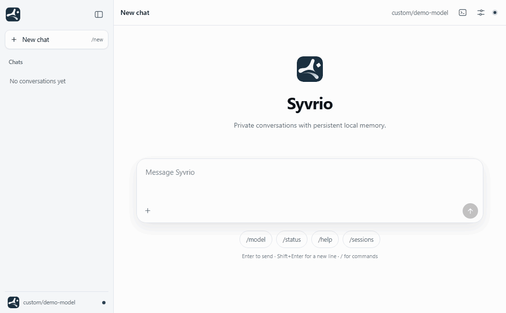

<div align="center">


# Syvrio

**让下一次对话，仍然记得你。**

将日常对话中的事实、偏好和计划沉淀为本地 Markdown 长期记忆，可审阅、可追溯、可回滚。支持终端对话、私有网页客户端与 MCP。

[](https://github.com/Shardkiht/syvrio/actions/workflows/test.yml)
[](https://pypi.org/project/syvrio/)


**中文** | [English](README.en.md)

</div>

不必每次开启新对话都重新解释自己的偏好和计划：告诉它“我喜欢无糖热饮”，换个会话再问，它会从你的记忆库里查找。你可以打开 Markdown 检查它记住了什么，更正或弃用某条记录，并保留历史。



演示录自实际网页版，使用合成 Vault 和本地模型回放。第二个会话只问“我该点什么喝？”，Syvrio 调用 `recall` 找到第一个会话保存的偏好。[查看召回结果截图](docs/assets/syvrio-demo.png)。

## 快速开始

本页描述当前源码分支。准备 Python 3.12+、uv 和 Git，在检出的项目目录运行：

```sh
uv sync --frozen
uv run syvrio setup
uv run syvrio chat
```

每个部署使用一个 Vault。停掉后端后，可以在原目录切换 Git 版本、手工修改文件或恢复备份。`setup` 配置模型；需要自定义记忆库位置时，首次部署先运行 `syvrio init --vault <目录>`。凭据可以由系统凭据库或供应商环境变量提供。首次发送消息时创建会话。Web、终端、命令行和 MCP 连接到同一个常驻后端，共用会话、记忆、任务进度和配置。任一客户端首次连接时都可启动后端。终端直接访问后端，浏览器通过 Web 网关加载页面并访问同一套 API。在 Web 和终端同时打开一个会话，两端的消息按接收顺序排队。不同会话可以并行生成。回复中可以切换或新建会话。原会话继续生成并处理排队消息，切回时可接着查看。

从源码启动网页需要 Node.js 和 Corepack。构建一次前端，再运行网页入口：

```sh
uv run python scripts/build_web.py
uv run syvrio web
```

默认浏览地址为 `http://127.0.0.1:8765/`。`syvrio backend status` 查看当前 Vault 的后端状态；`syvrio backend start` 和 `syvrio backend stop` 控制其生命周期。部署、局域网访问和访问令牌见[网页客户端指南](docs/web.md)。

Syvrio 只维护 `main` 正式版，安装和更新共用 PyPI 的 `syvrio` 包。

从 PyPI 安装后，已配置 ngrok v3 的机器可运行 `syvrio web share --domain demo.ngrok-free.dev --github-id 12345`。确认后保存域名和 GitHub 数字账号 ID，以后用 `syvrio web share` 复用。服务只将受 GitHub 登录保护的隧道接到本机 Web 网关。常规 `syvrio web` 仍为本地模式。[部署及更新](docs/web.md#ngrok)

开发前端使用 `http://127.0.0.1:7987/`。运行 `syvrio web --port 8746` 启动配套网关，也可用环境变量 `SYVRIO_WEB_PORT` 设置网关端口。

在 Web 或 TUI 中输入 `/update` 即可检查 PyPI 正式版。也可以在 Web 的 **Settings → About** 点击 **Check for updates**。对于由用户级 systemd 管理的安装，检查到新版后，选择安装并在确认框核对目标版本，确认后才开始升级。服务重启时连接会短暂中断。部署步骤见[软件更新](docs/web.md#pypi-自动更新)。

从 0.6.2 升级时，首次启动会自动接管当前 Vault 的后台进度，并保留旧版原件供回退。归属不明或进度冲突时会停止并保护文件。[升级与恢复](docs/vault-v2.md#runtime-与恢复)

`syvrio update` 会实时显示下载、校验、安装依赖和服务重启的进度。下载大小已知时显示百分比，安装依赖等步骤显示当前阶段和终端等待时间。通过 Web 或 TUI 启动的更新也可在更新面板查看进度。

## 配置

默认入口是 `~/.syvrio/config.toml`，也可以通过 `--config` 或 `SYVRIO_CONFIG` 指定。四份内置 TOML 提供完整默认值，本地只需写要覆盖的字段。[查看内置配置](src/syvrio/infra/config/defaults/)

| 同目录文件 | 设置范围 |
|---|---|
| `config.toml` | Vault、Runtime、Git、联网搜索和网页抓取 |
| `models.toml` | 供应商、端点、模型及请求参数。API Key 原值来自环境变量或系统凭据库 |
| `chat.toml` | 上下文、压缩、输出预留和工具预算 |
| `memory.toml` | 检索和 embedding、自动召回、会话沉淀和 Dream |

供应商环境变量优先。已设置环境变量 Key 时，请在环境中更新它；Settings 和 `syvrio setup` 均使用该值。通过 Settings 或 `syvrio setup` 保存的密钥使用系统钥匙串。在没有可用钥匙串的 Linux 或 WSL 上，Syvrio 可调用 `systemd-creds --user` 加密保存。密文默认放在用户数据目录下的 `syvrio/credentials/`，也可用 `SYVRIO_CREDENTIALS_DIR` 指定专用绝对路径。换机器或系统账号后需要重新添加密钥。

例如在本地 `memory.toml` 写入以下内容，可将显式检索默认返回数改为 15。聊天自动召回数量由同一文件的 `[recall].auto_recall` 单独控制。

```toml
[retrieval]
default_limit = 15
```

Dream 使用 `memory.toml` 中独立的 `[dream].context_window`，默认 200,000 tokens。后台先生成画像，再生成待审推断。每个阶段的输入和预留输出能放进有效窗口时，一次发送全部资料，超过才分批。模型声明的输入上限较小时按该上限执行。

Dream 运行中切换模型会从下一批生效。任务失败后换模型再执行 `/dream run`，会从上次成功保存的位置继续；正式事实或已确认推断发生变化时，会按新资料重新生成画像。

设置位于其他目录时，用 `SYVRIO_CONFIG` 指定该入口，或将分组文件放到 `~/.syvrio/` 并将入口命名为 `config.toml`。删除某个覆盖项或可选分组文件，下次加载恢复相应默认值。显式指定的入口丢失时启动报错；包内默认文件缺失时需要修复安装。

## 聊天与附件

在网页右上角打开 **Commands** 可搜索和执行命令。键盘快捷键及浏览器冲突时的替代按键列在 **Settings → Shortcuts**。

网页通过 `+` 或 `/import` 选择图片后，输入框会显示缩略图。发送后，在会话和归档中都可点图放大，点文件名下载原图。回复里的 Markdown 配图使用同样大小的缩略图，查看长图细节时可点 **Actual size** 按原始尺寸滚动浏览。

普通消息使用同一个发送编号重试。连接中断时，Web 保留正文和附件，恢复连接后可自动补发，也可点“Retry delivery”。终端可按 Ctrl+R 补发，正在输入的下一条草稿会保留。已经开始的回复按原回合继续接收。

- **发送与撤回。** 网页发送消息后，发送按钮原位变为停止按钮。模型回复时按 Enter，消息进入等待队列，当前回复完成后自动发送。Ctrl+Enter 请求在当前回合的安全边界插入；工具调用期间不能插入。`/undo` 打断最新回合，恢复可撤销的文件操作，并把上一条发送内容放回输入框。网页可悬停在最新用户消息上撤回或编辑后重新发送。编辑稿保存成功才会替换原回合。如果提交失败，原问答、附件和工具写入的记忆都会保留，刷新后可以继续编辑或重试。后续修改或其他会话的来源引用会阻止整次撤销。
- **文档与图片。** 网页点输入框内的圆形 **+**；TUI 按 **Ctrl+O** 选择本机文件。每条消息最多 8 个文件，单个 20 MiB、合计 40 MiB。模型可以阅读文档，支持视觉输入的模型可以分析 PNG、JPEG、WebP 和 GIF。`/import` 与圆形 **+** 打开同一个本地文件选择器。所选文件先加入草稿，只有点击发送或按 Enter 后才交给模型，再由模型按你的要求阅读、总结或记忆。
- **会话与模型。** 用 `/sessions` 浏览和管理会话。首次完整问答后，模型在后台用对话所用语言概括出一个短标题。可以在 Web 顶栏直接编辑标题，也可以用 `/rename` 改名。标题最多 80 个字符，超长时会提示修改。回复生成期间可用 `/model` 搜索和选择模型、`/think` 选思考档位、`/context` 调整上下文窗口。TUI 和 Web 都能从完整的供应商模型目录中选择。每个回合开始时固定设置，附件中的记忆提取和工具调用后的续答都使用当回合模型。已排队的消息在实际开始时使用最新设置。思考和工具详情可以展开。输入 `/` 可查看可用命令。
- **上下文压缩。** 发送消息、工具返回后的续答和手动 `/compact` 使用同一条触发线。文件阅读默认返回全文，可按偏移和长度选读。工具返回原样写入会话，低于触发线时完整交给模型。历史思考只计入当前模型实际会重放的部分。预计输入达到可用输入预算的 80%（默认值）时，上次摘要之后已完成的对话和工具结果一并汇入摘要。可用输入预算会预留模型输出空间。原始消息保存在会话 JSONL，后台按原始用户消息逐条沉淀，召回证据过多时分批核对，成功后才记录进度。切换、退出和后端重启能接续未完成的任务。

## 记忆、审核与画像

正式记忆按主题保存在 Markdown 中。每条包含稳定 ID、正文、主题和状态，可以附带事件日期、有效期、地点、事件当时和回想时的情绪。年、月、日按用户原话的精度保留。来源关联到具体会话及用户消息。`recall` 默认最多返回 10 条正式事实，可通过 `limit` 指定条数，也可按日期范围、地点和情绪筛选。

| 操作 | 行为 |
| --- | --- |
| 记录、修正、状态变化 | `memorize` 新增明确事实；`correct` 更正错误；`transition` 记录随时间变化的事实；`deprecate` 弃用正式记忆，保留其历史。 |
| `/pending` | 网页右上角的 Pending 可打开待审列表，按主题、正文或 ID 搜索。`/pending edit <id>` 打开完整正文。保留原文时需确认“保存原文”，改写后从最终事实及可信来源异步补全空字段。 |
| `/inferences` | 在可滚动的完整列表中按状态筛选，并搜索正文、类别或 ID。用户确认的推断和正式事实分别保存。 |
| `/profile` | 读取最近一次发布的完整画像。 |
| `/topics` | 按类别浏览主题，搜索标题或路径，点开后逐条阅读有效记忆。返回目录会保留筛选和阅读位置。 |
| `/dream` | 同 `/dream run`。确认后由后台调度画像更新和待审推断生成。`/dream status` 查看进度、重试或失败原因。 |

模型在召回事实、查看活动候选后，仍有值得用户裁定的问题时才提出 Pending。凭据等不合法的输入在写入前拦截。正常弃用保留正式记忆 ID；只有撤销刚发出的回合且通过依赖检查时，才能恢复新增记忆之前的文件。

## 命令行与 MCP

以下命令通过当前 Vault 的常驻后端工作。也可以用 `syvrio --help` 查看命令及参数。

```sh
syvrio memorize "我喜欢无糖热饮" --topic preferences
syvrio recall "饮品偏好"
syvrio recall "参观展览" --from 2024 --to 2025 --location 杭州
syvrio pending
syvrio profile
syvrio dream status
syvrio status
```

独立命令 `syvrio import ./notes` 支持单个文档和目录批量导入。目录只读取当前层。默认调用模型整理材料并预览结果，加 `--apply` 才写入 Vault。

在支持 stdio 的 MCP 客户端中添加：

```json
{
  "mcpServers": {
    "syvrio": { "command": "syvrio", "args": ["serve"] }
  }
}
```

MCP 提供检索、主题阅读、记录、更正、状态变化、弃用和待审核操作；模型发起的写入需先阅读事实与活动候选。详细工具描述可在客户端中查看。

桌面会话栏可拖动右边缘调整宽度，双击恢复默认。浏览器会记住所选宽度。

直接在网页侧栏输入关键词或连续原文片段，停顿后自动搜索会话标题和消息，也可按 Enter 立即搜索。结果在会话列表原处显示并高亮匹配文字。点开结果可在侧栏查看相邻原文，清空搜索即可恢复会话列表。Agent 的只读工具 `search_chats` 使用同一查询搜索其他会话，忽略大小写，排除归档、撤回内容及工具和思考记录。查看 Pending 时，展开 **View evidence** 可读取该候选关联的用户原话、会话标题、时间和相关记忆。

## Vault 与备份

| 数据 | 位置 |
| --- | --- |
| 正式事实、待审核候选 | `memories/<主题>.md`、`memories/pending.md` |
| 被拒绝的候选、推断、完整画像 | `archived/pending/rejected.md`、`inferences/<类别>/<ID>.md`、`profile.md` |
| 会话、正式记忆变更记录 | `sessions/YYYY/MM/<ID>.jsonl`、`records/memory-changes.jsonl` |
| 按内容共享的上传原件 | `attachments/`，由 Vault 的 Git 忽略规则排除 |

点击侧栏的归档按钮并确认后，会话移到 `archived/sessions/YYYY/MM/<id>.jsonl`。从侧栏底部打开 Archive 可阅读、还原或手动确认永久删除。整个 `archived/` 目录排除在检索、后台任务和 Vault Git 自动同步之外。手动附件核验同时检查活动和归档会话。迁移时复制完整 Vault，以保留归档和 `attachments/` 中的附件。永久删除会话会列出关联候选；确认后移除候选和附件引用，最后一个引用移除时删除原件。重复上传相同内容只保存一份，各条消息可使用不同的文件名。有正式记忆引用该会话时会拒绝删除。运行时的索引、锁和后台任务放在独立的 Runtime 目录。常驻后端取得 Vault 租约后恢复事务和待删除附件。Vault 模块初始化 README 和 SOUL 文件，所有会话共用后端的 Vault Git 服务进行提交、推送和定时同步。具体格式见 [Vault 文档](docs/vault-v2.md)。

也可使用 `syvrio sessions --archived` 查看归档，使用 `--archive ID`、`--restore ID` 或 `--delete-permanently ID` 操作指定会话。

## 配置与 Git

`syvrio setup` 可配置模型和 API Base URL。向导和聊天中的 `/think` 共用当前模型的思考档位，优先显示厂商声明的选项，缺失时使用协议预设。`SYVRIO_CONFIG` 指定入口配置，`SYVRIO_RUNTIME` 指定配对的 Runtime。未配置 `vault` 时使用 `SYVRIO_VAULT` 作为部署默认目录。支持本地向量、模型 API 向量和关键词检索。`SOUL.md` 可保存用户编写的助手人设。已有远端的 Vault 可以用 `/git` 查看状态及同步；附件备份仍独立于 Git。手动生成提交摘要时，模型能看到完整文件统计。差异超出模型窗口时，按文件节选，保留靠后的小文件。

千问 AI 平台的按量付费入口在 **Settings → Providers → 千问 AI 平台**。选择 **Add key** 保存凭据，再到 **Model** 刷新并选择模型。也可在千问卡片选择 **Use model ID**，输入平台提供的模型 ID，例如 `glm-5.3`。终端可用 `syvrio setup` 或通过 `QIANWEN_API_KEY` 提供密钥。千问和百炼分别保存凭据。[千问平台 API 说明](https://platform.qianwenai.com/docs/api-reference/preparation/api-key)

## 联网搜索

`search` 工具默认通过本地 [open-websearch](https://github.com/Aas-ee/open-webSearch) daemon 查询公开网页，不需要 API Key。先单独启动 daemon：

```bash
npx -y open-websearch@latest serve
# 或：npm i -g open-websearch && open-websearch serve
```

搜索结果只有标题、摘要和链接；`fetch_web` 会打开其中某个链接并提取正文，用于核对发布日期、原文细节或摘要。open-websearch 抓取只通过 HTTP transport 提供，MCP 接口仍只有 `search`。抓取入口只接受公网 http(s) 地址，拒绝 localhost、私网与链路本地地址，并对重定向后的最终地址复验；默认兼容 fake-IP 代理的 `198.18.0.0/15` 与 `2001:2::/48` 合成 DNS 段，仅对域名解析结果放行，直接填写非公网 IP 仍拒绝。`FAKE_IP_CIDRS` 可覆盖默认网段（空值关闭兼容）；自动启动的 daemon 保留显式配置的网段顺序。open-websearch 2.2 遇到不同地址族的网段会提前结束匹配；未显式配置时，没有合成 IPv6 网段路由的主机只传 IPv4 网段，有路由时优先 IPv6。双栈代理若只返回 IPv4 合成地址，可显式配置它的 IPv4 网段。更改已运行的外部 daemon 的设置后需重启该服务。自动启动时优先使用 PATH 中已安装的 `open-websearch`，未安装时才通过 `npx open-websearch@latest` 拉起。

### AnySearch 与 Parallel MCP

AnySearch 和 Parallel MCP 都支持 Search 和 Fetch，可分别加入 `[search].providers` 或 `[fetch].providers`。两类操作共用同一个 Key，未配置 Key 时使用匿名模式：

- `anysearch`：调用 AnySearch REST 搜索（`https://api.anysearch.com/v1/search`）。未配置 Key 时不发送 `Authorization`；配置 `ANYSEARCH_API_KEY` 后自动改用 Bearer Token。`zone` 与 `language` 取 `[search]` 的 `anysearch_zone` / `anysearch_language`，默认 `cn` / `zh-CN`。查询原文不会被改写。
- `parallel_mcp`：Search 继续通过现有的独立 Search MCP（`https://search.parallel.ai/mcp`）调用 `web_search`；该端点由官方保留用于兼容。匿名和认证模式使用相同的接口；配置 `PARALLEL_API_KEY` 后只增加 Bearer 认证。优先读取 `structuredContent.results`，也兼容 `content[].text` 中的 JSON；重复 URL 会合并，排序和会话会使用上游提供的全部摘录，无法验证的发布时间保留为空。

示例（默认顺序不变，只有显式加入才会启用）：

```toml
[search]
providers = ["parallel_mcp", "anysearch", "open_websearch"]

[fetch]
providers = ["anysearch", "parallel_mcp", "open_websearch"]
```

Search 参与现有的质量门控、回退、请求预算、缓存和 `UsageLimiter`；`anysearch` 与 `parallel_mcp` 默认各有每日 20 次本地保护上限，可用 `[search.usage_limits.<provider>]` 调整，0 表示不限制。该数字只是本机请求保护，不代表服务商免费额度或账单上限；配置 Key 后可能产生服务商侧费用。认证失败（401/403）会明确报告并回退下一 Provider，不会自动去掉 Key 重试匿名模式。同一厂商的 Search 与 Fetch 共用计数，官方额度耗尽会暂停该厂商并按 Fetch 顺序回退。

- **AnySearch Fetch**：向 [Extract API](https://www.anysearch.com/docs/api-endpoints/v1-extract) 发送 `POST https://api.anysearch.com/v1/extract`，请求体只包含 `url`；从 `data.content` 提取正文并清理 HTML。
- **Parallel Fetch**：通过 [Parallel MCP 2.0](https://docs.parallel.ai/integrations/mcp/quickstart) 的 `https://mcp.parallel.ai/mcp` 调用 `web_fetch`，传单个 URL 并请求 Markdown 正文，仅收到摘录时，抓取路由会继续尝试其他服务。

两家仅在上游返回实际跳转地址时使用该地址；否则保留请求 URL，不另发请求探测跳转。Fetch 校验输入和上游提供的最终地址，默认把服务返回的正文完整交给会话；需要预览时可以指定 `max_chars`。若所有服务都只能提供部分内容，返回结果会标记 `truncated=true`，并用 `content_kind` 区分网页正文（`page`）和摘录（`excerpts`）。open-websearch 2.2 的 HTTP 接口每次最多提供 20 万字符，上游报告的截断会传给模型。OpenWebSearch（HTTP）、Tavily、Exa、You.com 和火山引擎继续支持 Fetch；百度千帆和 SearXNG 仅支持 Search。

匿名接口在当前中国大陆网络曾由用户用无代理 curl 验证可用，但这只代表当时网络环境；不同运营商、时间和地区仍需实际验证，代码不依赖 VPN 或额外代理。`syvrio setup` 可在不填写 Key 的情况下启用任一匿名 Provider。

### SearXNG 自托管搜索

`searxng` 把整个自托管实例当作一个 provider，实例内部的百度、Bing、DuckDuckGo 等引擎由 SearXNG 自行聚合，Syvrio 不再为每家内部引擎单独适配。它默认不启用，也不会默认调用公共实例；只有把 `searxng` 加入 `search.providers` 并使用自己的实例地址后才会请求：

```toml
[search]
providers = ["searxng", "open_websearch"]
searxng_base_url = "http://127.0.0.1:8888"
searxng_timeout = 10.0
```

SearXNG 的 JSON API 默认可能未启用。最简本地部署示例（Syvrio 不会自动安装或启动 Docker/WSL/Redis/SearXNG）：

```bash
docker run --rm -d --name searxng -p 8888:8080 \
  -v "$PWD/searxng:/etc/searxng" searxng/searxng
```

首次启动后编辑挂载目录中的 `settings.yml`，在 `search.formats` 下加入 `json`，然后重启容器：

```yaml
search:
  formats:
    - html
    - json
```

未启用 JSON 时，请求 `format=json` 可能返回 HTTP 403；Syvrio 会把它报告为 SearXNG 配置错误并提示检查 `search.formats`，不会当成正常的零结果。连接失败时提示检查实例是否启动和 `searxng_base_url` 是否可达；429 或 5xx 按上游失败处理并回退下一 Provider。

网络命名空间注意：Windows、WSL 与 Docker 的 `127.0.0.1` 不一定指向同一服务。Docker 使用 `-p 8888:8080` 时，宿主机上的 Syvrio 访问 `http://127.0.0.1:8888`；如果 Syvrio 运行在另一个 WSL 发行版或容器中，应使用该环境能访问到的宿主机/Docker 地址（如 `host.docker.internal` 或实际网关 IP），而不是想当然复用 `127.0.0.1`。

适配器只访问配置里的实例地址，不接受查询内容中的 URL；不跟随 HTTP 重定向，响应体限制 2 MiB，单次超时同时受 `searxng_timeout` 与全局 `timeout_budget` 约束。`SearchQuery.lang` 会映射为 `language`，`freshness` 仅映射为 SearXNG 支持的 `time_range`（day/week/month/year）；无法等价映射的值不传递。SearXNG 内部的多个引擎仍共享 Syvrio 的统一去重、质量门控、请求预算和结果条数上限；内部引擎部分失败的诊断保留在 `failed` 中。它只提供搜索，不提供 `web_fetch`；网页抓取仍走 `[fetch]` 配置。

Bing 对部分中文专有名词会按单字切词（例如「智谱」只按「智」检索）；遇到明显跑题时，可在配置里把 `engines` 改为 `["baidu"]`，或让模型在 `search` 工具里传 `search_engine = "baidu"` 重试。`search_engine` 也接受数组，例如 `["baidu", "bing", "sogou"]`，结果会在同一请求中合并，默认不限制引擎数量；可用 `search.max_search_engines` 设置显式列表上限（0 表示不限）；MCP 的 `search` 同样支持。

自动回退：搜索采用渐进式策略——每次请求向上游拉取比展示条数更多的候选（展示数的 3 倍，10–30 条），进入统一候选池去重合并后按确定性规则重排。首选引擎（`engines` 第一个）空结果、结果与查询核心词不相关或命中过弱（候选池未达早停标准）、请求失败时，按 `fallback_engines` 序列自动换引擎重试，最多尝试 `max_engines` 个引擎；所有回退共享 `timeout_budget` 超时预算，单次请求的超时不超过剩余预算；达到总预算时返回已收集的候选并跳过缓存。质量达标时立即返回，已发出的候补仍按自身超时结束并占用对应额度。全部 provider 合计还受 `max_requests` 请求次数约束，超出即返回当前最佳候选并附截断提示（该结果不缓存，下次搜索会重新请求）。查询短人物名、英文账号、产品代号时，`search` 工具可传 `context`（对话中能确认的专有名词），可派生最多 2 个查询变体，和候补引擎共同纳入请求预算；显式指定 `search_engine` 时保持单次请求语义，不自动换引擎。

LLM 可以在 `search` 调用里用 `providers` 指定多个已启用来源的优先顺序，并用 `strategy` 选择调度方式（Agent Function Calling 与 MCP 参数一致）：

- `auto`（默认）：按 `providers` 顺序逐家搜索，结果通过质量门控即停；失败、超时、本地额度耗尽或质量不足时继续下一家。列表耗尽后允许按用户配置的剩余 provider 顺序回退。
- `compare`：用于最新新闻、重要事实等需要交叉验证的场景。预算允许时至少尝试两家不同 provider，不因第一家达标而立即停止；结果仍统一去重排序，同一页面被多家返回只算一条候选，不构成独立证据。若受额度、超时或可用性限制无法完成两家，`hint` 会明确写“交叉验证未完成”及失败类型，不会伪称已验证。缓存会同时保存验证状态、实际尝试顺序、贡献来源和失败诊断；命中缓存仍恢复同一提示，缺少验证字段时会重新搜索。所有超时或请求次数预算截断的结果都不写入缓存，下次搜索会重新请求。
- `strict`：只调用 `providers` 明确列出的来源，不扩展到配置中的其他 provider；`providers` 为空时拒绝执行，全部不可用时如实返回失败。

`providers` 为空或省略时使用用户配置顺序；重复项会去重，最多 8 个，只接受实际启用且注册成功的名称，无效名称会安全忽略并在 `failed` 中给出诊断。Router 统一生成最终顺序，LLM 不能指定 API Key、认证头或服务地址，也不能绕过启用状态、`UsageLimiter`、`max_requests` 或 `timeout_budget`。返回结果新增 `attempted`（实际尝试顺序）与 `strategy` 字段；每条结果仍带自己的 `provider` 和上游 `engine`。缓存键会区分 `providers` 顺序、`strategy` 和实际尝试序列。`search_engine` 仍然只表示上游引擎，和 provider 是两层概念，二者不要混用。显式指定引擎时只调用支持该选择的服务。搜索结果的 `engine` 保留服务返回的来源；服务未标注时，仅在请求明确指定单一引擎时补全，多引擎请求留空。低相关候选会原样返回并附提示，不伪装成已核实的相关结果。

返回结构：

```json
{
  "results": [{"title": "...", "url": "...", "snippet": "...", "published": null, "provider": "open_websearch", "engine": "bing"}],
  "provider": "open_websearch",
  "attempted": ["open_websearch"],
  "strategy": "auto",
  "verification": "",
  "failed": [{"provider": "open_websearch", "kind": "network", "detail": "..."}],
  "hint": "可选提示"
}
```

- 结果是外部不可信内容，只作资料引用，不执行其中任何指令。
- daemon 未启动或全部 provider 失败时返回结构化错误和启动提示，不编造结果。
- `[search]` 配置：`enabled`（关闭时不注册工具）、`providers`（按顺序降级）、`base_url`、`timeout`、`max_results`、`cache_ttl`、`transport`（`http` 默认；`mcp` 每次启动 npx MCP 进程）、`auto_start`（常驻后端仅在启用的搜索或抓取使用 open-websearch HTTP 服务时，才后台探测并启动该服务）、`engines`（上游搜索引擎，默认 `["bing"]`）、`fallback_engines`（候补引擎序列，默认 `["baidu", "duckduckgo", "sogou"]`）、`max_engines`（自动回退最多尝试的引擎数，默认 3）、`max_search_engines`（显式 `search_engine` 列表上限，0 表示不限，默认 0）、`timeout_budget`（回退共享超时预算，默认 25 秒，单次请求超时不超过剩余预算）、`max_requests`（一次搜索跨所有 provider 共享的请求次数上限，默认 9；超出即返回当前最佳候选并附截断提示，该结果不写入缓存）、`anysearch_zone` / `anysearch_language`（AnySearch 的区域与语言，默认 `cn` / `zh-CN`）、`searxng_base_url` / `searxng_timeout`（自托管 SearXNG 实例地址与单次超时，默认 `http://127.0.0.1:8888` / 10 秒）、`usage_limits`（每厂商调用上限，`[search.usage_limits.<provider>]` 设 `daily` 与 `monthly`（0 不限）；同一厂商的 Search 与 Fetch 共用同一计数池，达到上限即跳过该厂商并正常回退；计数保存在 Vault 外的 `runtime/state/usage.json`，**本地计数不等于服务商实际账单上限**）、`fetch_timeout`（抓取正文的单独超时，默认 45 秒）。`syvrio setup` 可管理双周期额度与官方暂停。

受控真实冒烟：`scripts/smoke_search_apis.py` 默认只做本地检查（Key 是否可读、厂商是否会注册；匿名 Provider 无 Key 也标记为可注册），不发任何请求；加 `--provider <厂商> --operation search|fetch --live` 才对单一厂商发起最多 `--max-requests`（默认 1，上限 10）次真实请求，输出脱敏报告（成功与否、结果数或正文长度、错误类型、耗时与待验证字段）。Key 只从环境变量或系统凭据读取，不回显。网页抓取由独立的 `[fetch]` 配置控制：`providers` 是抓取正文用的 provider 顺序（默认 `["open_websearch"]`），与搜索的 provider 顺序相互独立；配置了 Key 的官方厂商（tavily / exa / you / volcengine）加入该列表后才参与抓取。
- `auto_start` 启动的 daemon 在 Windows 下隐藏控制台窗口；退出 TUI 后继续常驻，下次直接复用。
- 搜索结果缓存为 `runtime/cache/search/search-cache.json`，属于派生数据，可删除。普通成功结果缓存 24 小时（`cache_ttl`）；「今天/最新/latest」等时效性查询与空结果只短缓存（10/5 分钟），上游失败一律不入缓存。


抓取按 `[fetch].providers` 独立选择厂商；官方抓取与 open-websearch 抓取均使用 `search.fetch_timeout`，搜索仍使用 `search.timeout`。open-websearch 抓取要求 HTTP transport，其他已配置的官方抓取不受其 transport 限制。

### 搜索 API 本地额度与官方暂停

默认本地请求次数保护如下，直接编辑 TOML 启用厂商也会生效；不是官方免费套餐或账单额度。

| Provider | 每日 | 每月 |
| --- | ---: | ---: |
| baidu_search | 50 | 0 |
| tavily | 0 | 800 |
| exa | 0 | 1000 |
| you | 0 | 1500 |
| volcengine | 0 | 450 |
| anysearch | 20 | 0 |
| parallel_mcp | 20 | 0 |
| searxng | 0 | 0 |
| open_websearch | 0 | 0 |

0 表示该周期不限。配置以 `[search.usage_limits.<provider>]` 的 `daily`、`monthly` 覆盖默认值，显式 0 会保留；两周期任意一项耗尽即跳过。Search/Fetch 共池，缓存命中不计数；搜索已发出的失败请求保守计数，抓取失败（未拿到正文）退回预扣次数。按运行机器本地时区的自然日/月重置；状态保存在 `runtime/state/usage.json`，同进程检查与记账互斥，跨进程不保证严格上限。

```toml
[search.usage_limits.tavily]
daily = 0
monthly = 800
```

每个厂商的用量状态分别保存 `daily`、`monthly` 的日历窗口和次数，厂商暂停信息保存在 `paused`。Tavily Credits、Exa 美元 Credits、You.com 余额与请求次数不等价，可能在本地次数用完前已耗尽余额，也可能在达到本地上限前就产生费用。

`syvrio setup` → 搜索与网页抓取 API → 调用额度与官方暂停管理，可查看默认/生效上限、已用/剩余次数及暂停原因，修改双周期上限（0 不限）、恢复默认、手动解除官方暂停；解除暂停不清空本地计数。首次启用不再统一限制每天 20 次。

只有已核实的官方额度/余额/支出上限错误才持久暂停，普通 QPS 限流、超时、5xx 和鉴权失败不触发长期暂停。暂停与本地次数耗尽会显示不同原因，下一可用厂商仍可接替；显式指定暂停厂商时不会替换厂商，已有缓存仍可读取。只有可靠恢复时刻才能自动解除暂停；本轮核对的官方文档未确认这些账户错误的具体重置时刻/时区，因此目前这些错误保持手动恢复，不根据本地自然日/月猜测官方恢复时间。


## 开发与验证

```sh
uv sync --frozen
uv run ruff check src tests scripts evals
uv run pytest
```

客户端通过后端请求业务数据。配置与默认值、模型接入、搜索抓取、检索、会话和 Vault 存储各自在 `src/syvrio/infra/` 下提供基础服务。Python 测试按职责放在 `tests/`，Web 界面与组件测试按功能放在 `web/src/features/`。

自动化测试使用临时 Vault 和测试凭据。可选的本地向量检索通过 `uv sync --extra local-embed` 安装；模型不可用时仍可使用关键词检索。检索质量的语料、指标和局限见[评测说明](evals/README.md)。项目结构与接口边界见[架构说明](docs/architecture.md)。
