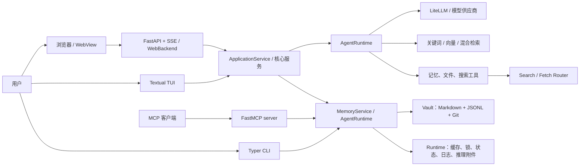
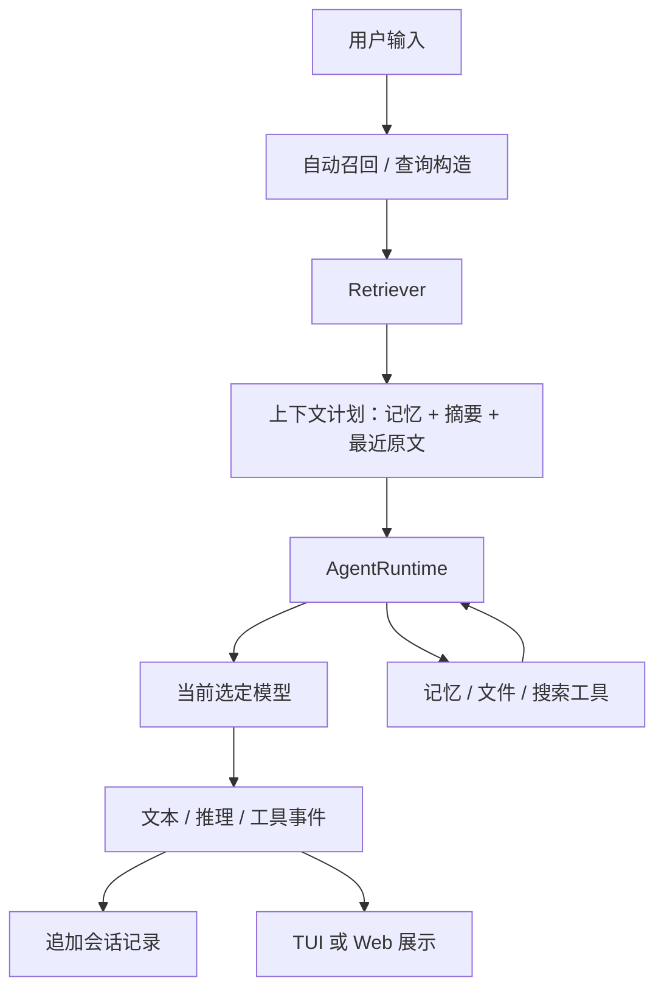
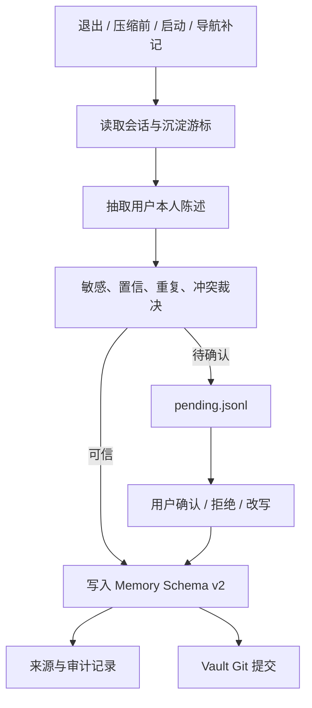

# Syvrio Foundation 架构设计

- 文档状态：现行技术基准
- 更新日期：2026-11-15
- 适用范围：Foundation 稳定源码
- 产品边界见 [PRD.md](PRD.md)，实施顺序见 [ROADMAP.md](ROADMAP.md)

本文描述当前代码的实际分层、运行时组装、数据流、存储和分支同步规则。它不是重新设计一套理想架构，也不把 Evo 的目录直接当作 Foundation 现状。

## 1. 架构目标

1. 多个入口复用同一套会话、记忆、检索和设置规则。
2. Foundation 的记忆行为可独立演进和验收，不被 Web/TUI 或 Evo 基础设施同步意外改变。
3. Vault 长期数据与 Runtime 派生/本地状态严格分离。
4. 浏览器断线、显式停止、Undo、后台沉淀和进程退出有明确的不同生命周期。
5. 模型、搜索、Git 和 HTTP 资源的所有权及关闭路径明确。
6. 共享基础设施便于与 Evo 合并，有意的产品差异有代码和测试边界。

## 2. 系统上下文



### 外部边界

- 模型供应商通过 LiteLLM 接入，密钥来自环境变量或 keyring。
- 搜索可以调用本地 open-websearch daemon 或已配置的外部 provider。
- Git 只管理 Vault；系统不默认依赖远程 Git、云数据库、遥测或账号服务。
- Web 默认监听 loopback，当前无登录认证。

## 3. 分层与依赖方向

```text
app → application → agent → memory → retrieval → infra
memory/agent → llm → infra
```

| 层 | 当前目录 | 责任 | 不应承担的职责 |
| --- | --- | --- | --- |
| 入口层 | `app/` | CLI、TUI、Web、FastMCP 的参数解析、界面和协议编排 | 重写记忆裁决或存储规则 |
| 应用层 | `application/` | 会话、命令、记忆和设置的跨界面用例 | 直接拼接模型流或绕过领域服务写 Vault |
| Agent 层 | `agent/` | Agent 循环、上下文计划、工具注册、会话事件流 | 拥有界面状态或供应商 UI |
| 记忆领域 | `memory/` | 抽取、裁决、存储、队列、审计、来源链 | 依赖 Web/TUI |
| 检索层 | `retrieval/` | Retriever 接口、BM25、向量、RRF 混合 | 修改记忆或执行写入裁决 |
| 模型层 | `llm/` | LiteLLM 适配、流式累积、摘要 | 决定界面如何展示错误 |
| 基础设施 | `infra/` | 配置、供应商、锁、Git、诊断、搜索、路径 | 反向依赖 app/application |

`retrieval` 只读 `memory` 的 models、store 和 detect 是已知例外；写入与裁决仍由 `memory` 负责。新增代码不应扩大这个例外。

## 4. 模块职责

### 4.1 `app/`

- `cli.py`：Typer 命令入口和一次性管理操作。
- `tui.py`、`chat_app.py`、`chat_flow.py`、`chat_widgets.py` 等：Textual 界面、输入队列、流式展示、思考面板、选择和会话操作。
- `server.py`：FastMCP 工具入口，直接围绕 `MemoryService` 和搜索路由暴露工具。
- `web/server.py`：FastAPI 路由、请求/响应模型、异常映射、Host/Origin 中间件和静态资源。
- `web/backend.py`：Web 活动回合、事件泵、会话和命令协调。
- `web/models.py`：Web API 契约。
- `web/hosts.py`：允许主机和 Origin 边界。

### 4.2 `application/`

- `service.py`：组合 `ConversationUseCases`、`MemoryUseCases`、`SettingsUseCases`，提供启动补记、搜索预热和关闭。
- `conversation.py`：当前会话、活动 turn、取消事件、FIFO 队列、Undo、切换、删除守卫和启动/导航补记。
- `commands.py`：斜杠命令解析、忙碌安全规则、确认要求和 Web 命令目录。
- `memory.py`：面向入口层的记忆查询与管理用例。
- `settings.py`：供应商、模型、思考强度和上下文设置。
- `contracts.py`：跨层快照和结果结构。部分契约可能为 Evo 能力保留兼容形状，不等于 Foundation 已开放相应产品功能。

### 4.3 `agent/`

- `runtime.py`：装配检索、模型、工具、记忆沉淀和会话生命周期。
- `context.py`：token 预算、上下文计划与压缩。
- `session.py`：追加式会话 JSONL、恢复标记、Undo、摘要、排序和推理附件索引。
- `tools.py`：Agent 工具注册和结果契约。
- `recall.py`：召回查询与追问上下文策略。
- `file_tools.py`：当前消息明确提供文件的分析边界。

### 4.4 `memory/`

- `service.py`：领域服务组合、锁、Git 提交、初始化和主要写入入口。
- `store.py`：Memory Schema v2 读写、状态编辑和原子写。
- `schema.py` / `legacy.py`：V2 解析渲染与 V1 迁移读取。
- `models.py`：Pydantic 领域模型和时间/字段校验。
- `extractor.py`、`policy.py`、`detect.py`：候选抽取、写入裁决、重复与敏感检测。
- `queue.py`、`audit.py`、`inference.py`：待确认、处理记录、审计和独立推断存储。

### 4.5 `retrieval/`、`llm/`、`infra/`

- `retrieval/keyword.py`、`vector.py`、`hybrid.py`：BM25、向量与 RRF；向量不可用时回退关键词。
- `llm/client.py`：普通/流式 LiteLLM 请求、推理片段累积、取消和资源关闭。
- `llm/summarizer.py`、`commit_summary.py`：会话摘要和提交摘要。
- `infra/config.py`、`providers.py`：配置读取/写回、供应商与模型目录。
- `infra/paths.py`：Vault/Runtime 路径绑定与派生数据失效。
- `infra/locking.py`：客户端、Vault 和 Git 锁。
- `infra/gitops.py`：Git 边界、原子 stage、提交和脱敏错误。
- `infra/diagnostics.py`：自托管诊断日志。
- `infra/search/`：Search/Fetch 契约、适配器、router、缓存、预算和用量限制。

## 5. 运行时组装

### TUI / CLI

TUI 和需要的 CLI 命令创建配置、`MemoryService`、会话存储与 `AgentRuntime`。需要跨界面用例时由 `ApplicationService` 组合 conversation、memory 和 settings。进程关闭必须执行运行时收尾，处理待沉淀并释放客户端锁。

### Web

```text
Browser
  → FastAPI routes
  → WebBackend / ActiveTurn / EventPump
  → ApplicationService
  → ConversationUseCases
  → AgentRuntime
  → SessionStore / MemoryService / LiteLLM
```

- 首次聊天允许 `session_id: null`，由后端创建并返回会话。
- `ActiveTurn` 表示服务端活动回合，`EventPump` 将后台事件分发给当前 SSE 连接。
- SSE 连接断开只代表消费者离开，不自动设置取消事件；后台继续并持久化。
- `/api/chat/cancel` 是显式停止入口，设置取消并产生 interrupted 结果。
- 重连通过会话历史读取已保存正文和状态，不依赖旧 SSE 连接仍在。
- 同一 Vault 的 TUI/Web 交互客户端由客户端锁互斥；同一后端的冲突活动请求返回 409。

### MCP

`app/server.py` 直接围绕 `MemoryService` 和 `SearchRouter` 注册工具，不经过 Web HTTP，也不复制一套记忆写入实现。MCP 暴露的是记忆与搜索工具，不是完整 TUI 会话状态机。

## 6. 关键数据流

### 6.1 对话与召回



- 自动召回只提供带来源的记忆资料，不代替模型回复。
- 上下文压缩追加 `summary`，不删除原始消息。
- 流式循环不做会重复 delta 的整轮回放重试。
- 失败直接反馈当前模型错误，不自动切换候补模型。

### 6.2 记忆沉淀与写入



**一致性约束**：

1. 后台任务只有一个有效 worker。
2. 会话快照校验和记忆发布之间持有同一 Vault 写锁。
3. 会话被 Undo、重开、删除或替换后，旧快照不得继续发布。
4. 只有实际成功处理的 message ID 才推进游标。
5. 已执行工具不回滚，但后续工具调用在取消后停止。
6. Git 提交和模型摘要失败不能伪装成记忆写入失败；各阶段结果分别呈现。

### 6.3 模型失败与手动切换

```text
当前模型请求 → 成功：流式/非流式返回
             → 失败：资源关闭 → 向用户显示错误
                                  → 用户打开模型选择器
                                  → 显式切换并持久化
```

- `num_retries` 只表示当前模型的受控重试，不表示跨模型故障转移。
- Foundation 不再读取或写回 `llm.fallbacks`，旧配置中的该键被忽略。
- 搜索 `fallback_engines`、Search/Fetch provider 回退和向量检索回退不受影响。

## 7. 存储设计

### 7.1 Vault 与 Runtime

| 内容 | 位置 | 是否进入 Git | 丢失影响 |
| --- | --- | --- | --- |
| 长期记忆 | `vault/memories/<category>/<topic>.md` | 是 | 长期事实丢失，必须备份 |
| 会话事件 | `vault/sessions/YYYY/MM/<id>.jsonl` | 是 | 原始对话丢失 |
| 待确认/处理/审计/推断 | `vault/records/memory/*.jsonl` | 是 | 审查和来源链受损 |
| 可选人设 | `vault/SOUL.md` | 是 | 回退内置人设 |
| 向量索引 | `runtime/indexes/vectors.npz` | 否 | 可重建 |
| 搜索缓存 | `runtime/cache/search/` | 否 | 可重建 |
| 用量和绑定状态 | `runtime/state/` | 否 | 本地计数/绑定信息丢失 |
| 锁 | `runtime/locks/` | 否 | 停止进程后可重建 |
| 推理附件 | `runtime/session-reasoning/<sid>/<rid>.json` | 否 | 失去历史思考展示，正文仍在 |
| 诊断日志 | `runtime/logs/` | 否 | 失去本地诊断信息 |

Runtime 必须位于 Vault 外且不在任何 Git 工作树中。配置查找顺序为 `SYVRIO_CONFIG`、本地 `syvrio.toml`、`~/.config/syvrio/syvrio.toml`；`SYVRIO_RUNTIME` 可覆盖 Runtime。

### 7.2 Memory Schema v2

- 每个顶层无序列表项是一条记录，正文之后依次是 Core、可选 Context 和 Extensions。
- Core 只有 `id`、`status`、`source`、`confidence`。
- ID 全局稳定；状态为 `active`、`superseded` 或 `deleted`。
- 更正和软删除保留历史；无关记录字节与换行风格尽量不变。
- 详细语法和迁移顺序见 [vault-v2.md](vault-v2.md)。

### 7.3 会话与推理隔离

- 会话是追加式事件流，损坏尾行只能在合法恢复标记覆盖时跳过。
- 新推理正文只写 Runtime 附件，Vault 仅保存 `reasoning_local: true`。
- 推理不进入模型回放、压缩摘要、沉淀输入或 Git 提交摘要输入。
- 旧会话和旧 Git 历史中的内联推理不因新代码自动消失，也不重新注入模型。

### 7.4 时间

- 绝对时间持久化为带显式 UTC 偏移的 ISO 8601。
- 界面使用用户本地时区和 24 小时制；纯日期保持日历语义。
- 会话排序在 limit 截断前完成，Undo 后按最后有效消息计算。
- 字段清单与迁移规则见 [time.md](time.md)。

## 8. 锁与资源所有权

| 资源 | 所有者 / 锁 | 收尾要求 |
| --- | --- | --- |
| 交互 Vault 客户端 | client lock | TUI/Web/进程退出释放 |
| 记忆和会话写入 | Vault write lock | 快照校验与发布同锁，异常释放 |
| Git stage/commit | Git lock | 失败恢复暂存区，不污染其他改动 |
| Web 活动回合 | ActiveTurn + cancel Event | 断线不取消，显式停止取消 |
| 模型 HTTP client | 请求或外部调用者明确所有 | 请求创建则请求关闭，外部共享不擅自关闭 |
| 搜索 daemon | 配置与启动方 | 自动启动只管理自身生命周期 |
| 后台沉淀 | worker + Vault lock | 停机、异常、重试和游标均有收尾 |

真实代理、私有 CA 和外部共享 client 组合仍需单独验收，不能仅凭 mock 宣称全部覆盖。

## 9. 安全与隐私边界

- 配置只写环境变量名，不写 API Key；Key 来自环境变量或 keyring。
- 会话追加前递归隐藏已识别凭据。
- 文件工具只访问当前消息明确提供的文件，网页与工具内容均视为不可信资料。
- 搜索抓取拒绝本地、私有和 link-local 地址，并复核重定向目标。
- Web 默认 loopback，校验 Host/Origin；无认证时不提供公网多用户承诺。
- 自托管 Runtime 诊断日志可包含异常对象文本，这是已确认设计；部署者仍需控制访问权限、保留周期和外发内容。
- 测试和文档使用合成数据，真实 Vault 和凭据不进入仓库。

## 10. 构建与测试结构

### 构建

- Python 使用 uv 和 hatchling，CLI 入口由 wheel 提供。
- Web 使用 Node.js 22+、pnpm、TypeScript 和 Vitest；`scripts/build_web.py` 构建并暂存静态资源。
- sdist/wheel 不包含 Vault、本地配置、`node_modules`、探针或缓存。
- 一次性迁移脚本位于 `scripts/`，按项目约定不随包发布。

### 测试

- pytest 按 ui、agent、memory、retrieval、cli、config、mcp、search 分类。
- 测试夹具强制隔离配置、Vault 和本机凭据；普通测试禁止真实付费模型调用。
- 定向测试用于局部变更，跨模块核心变更执行全量。
- Web 还需要 TypeScript、Vitest、真实 HTTP/SSE 和真实浏览器验收；这些层级不能互相替代。
- 真实模型、搜索、GUI 和手机验收在报告中分别标记，不把“单元测试通过”写成“所有平台通过”。

## 11. Foundation 与 Evo 同步策略

| 组件 | 同步策略 |
| --- | --- |
| Web 通用前端、HTTP/SSE、通用会话用例 | 尽量保持同实现；共享缺陷双向评估 |
| TUI 通用交互和生命周期 | 通用修复对齐，保留已确认的界面差异 |
| Application 通用用例 | 对齐接口；Evo 专属能力不因契约存在就自动开放 |
| 模型接入 | 通用资源与供应商修复对齐；Foundation 无自动模型候补是有意产品差异 |
| Search / Fetch | 目标是减少分叉；当前仍是主要后续合并成本之一 |
| 构建、CI、锁、时间、路径、诊断 | 通用实现优先对齐 |
| 记忆检索、抽取、裁决、压缩、来源链 | Foundation 独立验收，不整目录覆盖 |
| 画像、Dreaming、推断审查、Evo Git 同步 | Evo 产品范围，Foundation 默认不接入 |

同步前先判断是共享基础设施缺陷、Foundation 产品缺陷还是 Evo 专属行为。禁止为了减少 diff 而修改记忆业务语义。

## 12. 当前已知限制与架构风险

- Web smooth scroll 的中间事件可能误停自动跟随，需要修复并补真实浏览器验证。
- 手机 WebView 的返回首页、后台、锁屏和进程生命周期尚未完成实机验收。
- 其他模型供应商、真实搜索、代理、私有 CA 和外部共享 client 未形成完整真实矩阵。
- Foundation 与 Evo 的搜索实现仍有较大分叉，是后续合并成本重点。
- 当前工作树和 CI/发布状态必须与测试报告分开判断；本地通过不等于已经替代 main。

## 13. 文档与代码变更规则

- 依赖方向、模块职责、存储布局、锁或资源所有权变化时更新本文。
- 存储字段变化同时更新 `vault-v2.md` / `time.md`、迁移脚本和中英文 README。
- 产品边界变化先更新 PRD，实施优先级变化更新 Roadmap。
- [HANDOFF.md](HANDOFF.md) 记录当前开发与验证入口。历史实现和取舍可在 Git 中查阅。
