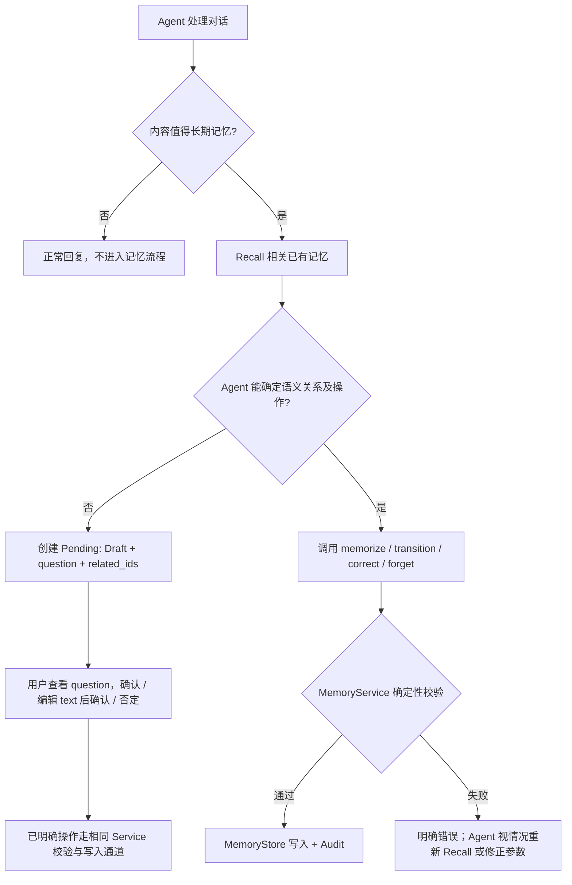

# Syvrio 记忆系统重构：设计决策与架构构想归档

> **日期**：2026-11-18  
> **阶段**：设计讨论；**未实施、未授权修改代码**  
> **仓库**：[Shardkiht/Syvrio](https://github.com/Shardkiht/Syvrio)  
> **关联讨论**：[Issue #30 — 统一记忆字段语义与 Agent 写入决策流程](https://github.com/Shardkiht/Syvrio/issues/30)  
> **定位**：整理截至本次讨论已确定的结论，同时记录架构层面的初步构想和后续待定问题。本文以**本次最新讨论**为准；Issue #30 中部分早期方案已经被修正。

## 0. 阅读约定与范围

文中使用三个标识，避免把设想误认为定稿：

- **[已确定]**：讨论中明确接受的业务定义、模型边界或交互规则。
- **[架构构想]**：方向基本一致，但接口、参数、流程细节尚未审定。
- **[待讨论]**：仍有明显语义边界或实现决策未确定。

本阶段仅将本文档提交至 GitHub 仓库；**不修改 Issue、现有 Vault、历史数据、代码或发布版本**。

## 1. 设计目标与基本原则 [已确定]

1. **Agent LLM 负责语义理解与业务决策**：识别值得记录的长期事实，结合 Recall 判断语义重复、冲突、事实变化与纠错，决定调用哪种记忆工具。
2. **MemoryService 只做确定性校验和可靠执行**：仅拦截能明确证明不合法的操作，不通过相似度阈值等启发式规则猜测两个事实是否矛盾。
3. **Pending 只用于 LLM 无法判断、需要用户确认的情形**：它不是低置信度候选池，也不是 Service 校验失败的兜底队列。
4. **一旦 Agent 决定需要记录某条事实，先 Recall，再决策写入操作**；不要求对每一轮无记忆价值的聊天都检索。
5. **消除二次 LLM 抽取**：Agent 已理解并组织好事实时，`memorize` 不应再接收整段对话并另调 LLM 做一遍抽取。
6. **存储、运行时模型、检索结果分层**：需要持久化的审计与追溯信息可以保留，但不应全部暴露给 LLM 或参与向量/关键词索引。
7. **沿用原有人工审核体验**：用户可确认、只编辑正文后确认或否定 Pending；普通审核不额外调用 LLM。

> **已废弃的旧方向**：让 MemoryService 在写入前自行按自然语言相似度/冲突阈值复核语义，再用 `confidence`、`kind`、`sensitive` 决定自动入库或 Pending。该方案不再作为目标架构。

## 2. 领域模型 [已确定]

### 2.1 MemoryDraft：待记录事实

```python
class MemoryDraft(BaseModel):
    text: str
    topic: str
    context: MemoryContext | None = None
```

| 字段 | 含义 | 约束 |
|---|---|---|
| `text` | 准备记录的事实正文 | 必填；内容不为空 |
| `topic` | 记忆分类／对应主题文件 | 必填；已有分类优先复用，不存在时可创建；程序校验路径安全 |
| `context` | 事实的可选上下文 | 可为空；参照下文 `MemoryContext` |

- `MemoryDraft` 是准备落盘的**内容模型**，不是带置信度的候选列表。
- **删除旧 Candidate 字段**：`title`、`confidence`、`sensitive`、`kind`、`reason`；不再允许用这些字段驱动下游 `policy` 判定。
- `topic` 已承担分类/文件定位职责，不在 Draft 中额外定义 `title`。
- 来源追溯、创建时间、审计信息由程序维护，不要求 Agent 自行填写。

### 2.2 PendingItem：无法裁决的 Draft

**业务语义：`Pending = MemoryDraft + 待确认问题 + 相关记忆引用`。**

```python
class PendingItem(MemoryDraft):
    question: str
    related_ids: list[str] = Field(default_factory=list)
```

| 新增字段 | 含义 |
|---|---|
| `question` | LLM 无法确定、需要用户确认的问题；展示给用户 |
| `related_ids` | Recall 找到的相关旧记忆 ID；仅供关联，不代表自动覆盖它们 |

- Pending 复用 Draft 的 `text/topic/context`，不另造第二套候选内容结构。
- Pending 的队列 ID、`created_at`、来源引用及处理记录是**队列/持久化层元数据**，不必放到这个业务模型，也无需 LLM 生成。
- Pending **不进入正常记忆 Recall 的事实集合**，`question` 不拼接进正式记忆正文或语义索引。
- 不保留 `confidence`、`sensitive`、`kind` 等旧候选判定字段。
- 采用继承表达概念关系；具体持久化包装格式可按实现需要设计，业务上不重复存储 Draft 字段。

### 2.3 MemoryEntry：已经持久化的事实

```python
class MemoryEntry(MemoryDraft):
    id: str
    status: Literal["active", "deprecated"] = "active"
    recorded_at: datetime
```

- 直接继承 Draft 的三个内容字段，**不重复声明** `text/topic/context`。
- 新增 `id`、`status`、`recorded_at`；它们由程序管理。
- `recorded_at` 表示**何时记录事实**，与 `event_time` / `valid_from` / `valid_to` 的事实时间语义不同。
- `active` 表示记录仍可作为事实使用（可能是历史事实，需结合 Context 判断）；`deprecated` 表示记录已弃用，不再用于正常事实检索，但保留原文与操作审计。
- 删除正式事实模型中的 `confidence`；不将 `supersedes`、`change_kind` 等操作历史塞回 Entry 业务模型。
- `raw_markdown`、文件路径、行号、字段偏移等属于 **Markdown 解析/存储结构**，不是正式记忆的业务内容；具体拆分由实现阶段处理。

### 2.4 MemoryContext：事实上下文 [已确定方向，细节仍需校对]

目标字段：

| 字段 | 语义 |
|---|---|
| `event_time` | 事件发生时间 |
| `valid_from` | 事实开始有效的时间 |
| `valid_to` | 事实有效期结束的时间 |
| `location` | 相关地点 |
| `emotion` | 用户实际表达的情绪 |
| `emotion_at` | 情绪关联的时间语义；此前讨论倾向只标注确实属于事件当时的情绪 |

- 从旧模型中移除 `time_text`、`location_kind`、`emotion_source` 等冗余字段。
- 不把 LLM 猜测出的情绪当作用户事实；时间精度、区间校验应保持明确。
- **来源（`source`）由程序管理，不由 LLM 填写。**此前曾讨论在 Context 中保留来源字段，但它与 Extensions 的溯源职责存在重叠；**最终落在哪层仍待确认**，不在此处强行定稿。

### 2.5 最终简化后的模型关系

```text
MemoryDraft
├─ text
├─ topic
└─ context?
    │
    ├── PendingItem
    │   ├─ question
    │   └─ related_ids[]
    │      + 队列元数据（在队列层维护）
    │
    └── MemoryEntry
        ├─ id
        ├─ status: active | deprecated
        └─ recorded_at
```

> 这是**目标领域模型**，不是当前仓库已落地的实现。GitHub `main` 在归档时仍使用旧 `Candidate`、`Entry`、`Core` 等结构。

## 3. Markdown 与数据分层 [已确定方向]

**保留 Vault Markdown 作为长期记忆的事实来源（source of truth）**，保留已有的 `Content / Core / Context / Extensions` 整体框架，但精简职责：

| 存储区域 | 目标职责 | 结论 |
|---|---|---|
| **Content** | 可被理解和检索的事实正文 | 保留 |
| **Core** | 记录身份与生命周期：`id`、`status` | 已确定精简目标 |
| **Context** | 可选的事实语义（时间、地点、情绪等） | 保留；具体字段见 2.4 |
| **Extensions** | `recorded_at`、session/message 引用等程序维护的来源信息；其他扩展字段按需 | 保留；逐字段细节尚未全部定稿 |
| **Audit** | 纠错、事实变化、弃用、用户审核等操作过程 | 与事实正文分离 |

- `topic` 映射主题文件或分类，不必在每条 Markdown Core 中重复存储。
- 原始对话已有 sessions JSONL；记忆只需指向必要的 `session_id/message_id`，**不再复制一遍完整对话作为 evidence**。
- 纠错或状态变化由历史记录和事实有效期表达，不能凭 `related_ids` 自动设置任何旧记忆为弃用。
- 不为了精简业务模型而丢弃 Markdown 无损解析能力：源码位置、未知扩展字段、手工编辑内容仍由 Schema/Store 处理。

## 4. Pending 产生条件和用户体验 [已确定]

### 4.1 唯一业务定位

LLM 已判断某项事实具有记忆价值，但在对话和 Recall 结果中**无法确定应怎样处理**，且需要用户作出事实确认时，创建 Pending。

例如：旧记忆是“在 A 公司工作”，新对话提到了“在 B 公司工作”。不能仅据此确定是跳槽、兼职、曾经任职还是旧记忆错误。LLM 可先生成暂定 Draft，并提出：

> 你目前仍在 A 公司工作，还是已经离职并加入 B 公司？

这里 `related_ids` 只是把相关事实联系起来，**不等于自动弃用/修改旧条目**。

### 4.2 保持现有审核方式

| 用户动作 | 结果 | 默认是否再调用 LLM |
|---|---|---|
| **确认** | 接受当前 `text`，执行相应已明确的写入操作，并走 Service 确定性校验 | 否 |
| **编辑后确认** | 用户仅修改 `text`，采用修改后的正文，继续确定性校验 | 否 |
| **否定** | 拒绝并关闭该 Pending；保留必要处理记录 | 否 |

- UI **展示 `question`**，并提供 **仅 `text` 的编辑入口**；`topic/context` 不必向用户呈现复杂表单。
- 修改正文时不应无条件沿用与新正文不再匹配的 Context；如何清除或检查受影响字段，见待讨论项。
- 审批状态及队列 ID、时间、来源应由 PendingQueue 等持久化机制管理，不额外污染 Draft。
- **Service 校验失败不自动转 Pending**；确定性错误直接返回错误。
- 若用户提供了需要进一步语义理解的新信息（而非单纯确认/编辑），可交由 Agent 再判断；**正常审批不默认进行第二次 LLM 调用**。

### 4.3 必须守住的语义边界

- **确认一条新事实 ≠ 确认覆盖任何已有事实。**
- Pending 如果涉及 `transition` / `correct`，具体操作及目标必须足够明确；目前“队列项只存 Draft + question + related_ids”如何承载待执行意图，**仍待设计**。在解决前不可把审批实现为盲目新增后自动替代旧记录。
- 不因内容编辑而默认让旧的目标引用、时间上下文或操作意图继续有效。

## 5. Agent / Recall / MemoryService 职责 [已确定]

| 组件 | 应负责 | 不应负责 |
|---|---|---|
| **Agent LLM** | 判断记忆价值、事实提炼、语义重复/冲突、变化/纠错、是否需要用户确认；选择工具 | 直接修改 Vault；自评置信度作为写入依据 |
| **Recall** | 检索相关正式记忆并返回事实及必要 ID/上下文 | 决定事实之间的业务关系 |
| **MemoryService** | 确定性参数/状态/凭据/并发约束，协调可靠写入 | 自己推断语义冲突、根据阈值决定 Pending、重复调用 LLM 提取 |
| **MemoryStore / Schema** | Markdown 无损解析、路径校验、持久化、身份和状态修改 | 记忆价值判断或语义裁决 |
| **PendingQueue** | Pending 的创建、取回、确认/拒绝及处理记录 | 对自然语言进行二次理解 |
| **Audit** | 记录操作历史以便追溯 | 替代事实正文或承担 Recall 语义检索 |

**确定性校验举例**：

- ID 不存在、目标记录状态不允许操作；
- `topic` 路径不合法、字段格式或事实有效时间区间不合法；
- 内容包含 API Key、密码、Token、私钥等凭据；
- 完全相同的写入请求在幂等规则下已执行（此处不是**语义**去重）；
- Recall 后目标记录已被其他写入修改，导致操作基于过期状态；
- 存储和审计不能保证一组写入原子完成。

**不能靠简单规则擅自决定的内容**：

- “用户喜欢咖啡”与“用户喜欢清爽中烘咖啡”是否应合并；
- “目前在 A 公司”“现在在 B 公司”是否必然冲突；
- 新说法是事实变化还是旧事实错误；
- 相似度/覆盖率低是否代表不能保存。

**安全策略 [已确定]**：只限制记忆存储中的敏感**凭据**（密码、密钥、Token、私钥等）；普通个人事实如姓名、住址、健康、收入等，不因“敏感信息”标签被额外拒绝。仍需遵循 Vault 的私有边界，不得意外公开。

## 6. 目标架构与操作流 [架构构想]

### 6.1 Agent 主路径



- 这是**逻辑职责流**，不是规定所有入口都必须生成完全相同的执行栈。
- 确认/编辑等普通 Pending 操作默认不再调用 LLM；“用户新回答一个语义问题”可能触发一次新的 Agent 解释。
- `Recall` 必须实际发生，但“如何可靠追踪相关检索已执行”尚未确定；先避免为此设计过度复杂的凭证体系。
- Recall 未命中不代表 Vault 中绝对不存在相关记忆；用检索质量评测优化，而不是让 Service 再开发一套自然语言理解规则。

### 6.2 各层的拟议边界

```text
App / Agent / Tools / CLI / TUI / Web / MCP
  ├─ Agent：提取事实、调用 Recall、决定操作
  └─ Pending 审核 UI：question 只读展示，text 可编辑
          ↓
Application / MemoryService（确定性用例、参数、并发、状态）
          ├─ MemoryStore + Markdown Schema（原文无损读写）
          ├─ Retrieval（关键词 / 向量 / 混合，返回过滤后的视图）
          ├─ PendingQueue（持久化待确认项）
          └─ Audit / Sessions（操作历史与来源回溯）
```

建议的边界调整（均未进入实施）：

- **`extract_candidates()`**：从正常 `memorize()` 链路移出；非对话的导入/后台沉淀另行决定如何利用同一套 Draft 语义。
- **`_adjudicate()` / `policy.decide()`**：移除基于 `kind` / `confidence` / `sensitive` 的旧裁决；能复用的确定性安全检查下沉到共用写入通道。
- **`find_conflicts()`**：不再作为阻断新增的通用语义阈值裁决；真正的关系判断由 Agent 基于 Recall 完成。
- **`manual_add()`、`approve()` 和其他入口**：不再绕过统一的确定性验证、状态约束与审计。
- 对同一 Vault 的写入保持可恢复性，避免事实文件、状态及审计只完成一部分。

### 6.3 工具词汇与事实生命周期

讨论中的主要工具：

| 工具 | 目标语义 | 状态 |
|---|---|---|
| `recall` | 读取相关事实及必要 ID | 已确定保留 |
| `memorize` | 添加新长期事实 | 已确定保留；目标参数改为已整理的 Draft |
| `transition` | 真实世界中的状态变化，保留历史时间关系 | 已确定采用此命名，替代 `evolve` |
| `correct` | 原事实错误；保留新事实，弃用错误旧记录 | 已确定保留 |
| `forget` | 用户要求不再使用相关记忆 | 工具保留方向，彻底删除还是逻辑弃用的边界待审 |

事实变化和纠错**不是同一件事**：

- **事实变化**：旧事实以前成立，新事实后来成立；可通过 `valid_from/valid_to` 表述，两者在历史意义上都可能 `active`。
- **纠错**：旧事实本来就不正确；将错误记录设为 `deprecated`，新事实独立保存，保留审计。
- **冲突**：是 Agent 对证据关系的判断或未确定的状态，不预设要额外开发一个 `conflict` 工具。

## 7. 检索视图与模型上下文精简 [已确定方向 + 架构构想]

### 7.1 LLM 最小必要输出

正常 Recall 给 LLM 的结果应以**事实正文和必要 Context**为核心，并保留后续操作所需的 `id`。

| 字段 | 是否语义索引 | 是否默认交给 LLM |
|---|---|---|
| `text` | 是 | 是 |
| `topic` | 可按检索机制选择增强/过滤 | 是 |
| 相关 `context` | 有选择地索引 | 是（按需） |
| `id` | 不参与语义索引 | 是（用于 `correct` / `transition` / `forget`） |
| `status` | 用于查询过滤 | 视需要 |
| `recorded_at` | 可用于排序，不应误作事实发生时间 | 默认无需 |
| `session_id/message_id` | 不参与普通语义索引 | 默认无需，溯源时再读取 |
| Audit、原始 Markdown、文件路径与行号 | 不参与 | 默认无需 |
| Pending `question`、队列处理信息 | 不参与正式记忆检索 | 不应混入 |

### 7.2 改进检索文本生成 [架构构想]

当前 `Entry.index_text` 会拼入大量 Context/Extensions 字段并采用**排除名单**过滤内部元数据。建议改为**允许名单**：只纳入 `text` 和明确具有语义检索价值的 Context 字段，扩展元数据默认不索引。这样新增 Extensions 字段也不会意外污染向量或关键词内容。

检索命中后按操作场景提供“精简事实视图”或“溯源详情视图”；不要为减少上下文而丢掉持久化元数据本身。

## 8. 历史数据与实现约束 [已确定原则 / 待细化]

- 现有仓库仍使用 `Candidate`、旧 `Entry`、`Core.source/confidence`、`active/superseded/deleted`、基于阈值的 `policy` 和旧 Pending 审批逻辑；**本文描述的是目标设计，并不声称已实现**。
- 旧 Vault 数据无需通过永久兼容层长期维护，但**改动持久化 Schema 前必须备份、显式迁移、验证**，包括 Pending JSONL、正式 Markdown、历史状态与索引重建。
- 不得使用、上传或提交真实私有 Vault 资料；实现与自动化验证应以隔离的合成 Vault 为主。
- 检索索引、缓存视作可重建派生数据；Markdown 正文和人工编辑不能因迁移或后台任务被覆盖。
- Draft 字段删减必须同步调整所有 Service 参数验证、导入器、工具 Schema、Pending 审核、存储、前端 UI 与测试，不能只修改 Pydantic 类。
- 在设计讨论结束、明确授权以前，**不提交或推送实现代码、不发版，也不编辑 Issue #30**；本文档的归档提交不代表实施授权。

## 9. 尚未定稿的问题清单 [待讨论]

| 优先级 | 问题 | 已知边界 |
|---|---|---|
| 高 | **MemoryService 的统一写入 API** | Service 仅确定性校验；如何组织 `memorize/transition/correct/forget` 的具体命令与返回结果未定 |
| 高 | **Pending 审批与原计划操作的映射** | `Draft + question + related_ids` 已确定为最小业务内容；但若涉及旧记录变化/纠错，如何保留明确且安全的操作意图尚未定 |
| 高 | **Agent 的 Recall 前置约束** | 逻辑上必须 Recall；如何追踪一次写入关联的检索和 Vault 是否已变化，未定 |
| 高 | **`transition` 的时间处理与历史事实检索** | 不猜生效日期、区分纠错；部分日期/区间精度和有效期更新规则待明确 |
| 中 | **修改 Pending.text 后的 Context 处理** | 不能盲目沿用可能失效的旧 Context；是清除全部还是只清除受影响字段，未定 |
| 中 | **`source` 的字段位置与溯源形态** | 必须由程序提供；Context / Extensions 如何避免重复，未定 |
| 中 | **`forget` 与 `deprecated` 的边界** | 逻辑弃用和真正删除、隐私要求及 Git/审计留痕的关系，未定 |
| 中 | **Inference 的生命周期与事实证据失效** | 不应机械套用事实 Entry 的新状态枚举；旧 `superseded` 的多义性需另审 |
| 中 | **导入、后台沉淀等非实时 Agent 入口** | 不能继续走旧二次抽取 + 阈值裁决；是否使用单独 Agent/提取流程及如何共享校验，未定 |
| 中 | **扩展字段与检索允许名单** | 原始字段应能保留；哪些 Context 进入索引、是否按检索类型不同配置，未定 |
| 低 | **Python 继承与队列持久化包装细节** | 目标模型语义已确定，具体文件组织/序列化结构可实现时决定 |
| 低 | **迁移发布顺序与旧 JSONL 状态映射** | 必须有备份与验证，不默认旧状态可一一等价映射 |

## 10. 后续设计审查顺序 [建议]

1. **MemoryService 用例与工具接口**：统一确定性校验、写入事务和错误返回。
2. **Pending 确认的操作语义**：保持三种 UI 操作，同时保证不会误覆盖旧事实。
3. **transition / correct / forget 的状态边界与时间语义**。
4. **Recall 的最小输出与检索文本生成**。
5. **非 Agent 入口、Inference 和迁移/验收方案**。

---

### 决策摘要

**已确定**：`MemoryDraft(text, topic, context?)`；`PendingItem = Draft + question + related_ids`（队列元数据另存）；`MemoryEntry = Draft + id + status + recorded_at`；`status = active/deprecated`；Core `id/status`；Markdown Content/Core/Context/Extensions 分层；Agent 主导语义判断；Service 只做确定性校验；Recall 是有记忆意图时的前置步骤；Pending 仅用于 Agent 无法判断的情况；用户确认/仅编辑 text 后确认/否定；普通审批不再额外调用 LLM；程序只阻止凭据写入长期记忆。

**构想但未定稿**：具体工具参数与服务流程、Pending 审批的操作目标、安全的 Recall 追踪机制、Extensions 来源字段落点、编辑正文后的 Context 处理、真实数据迁移策略及检索视图细节。