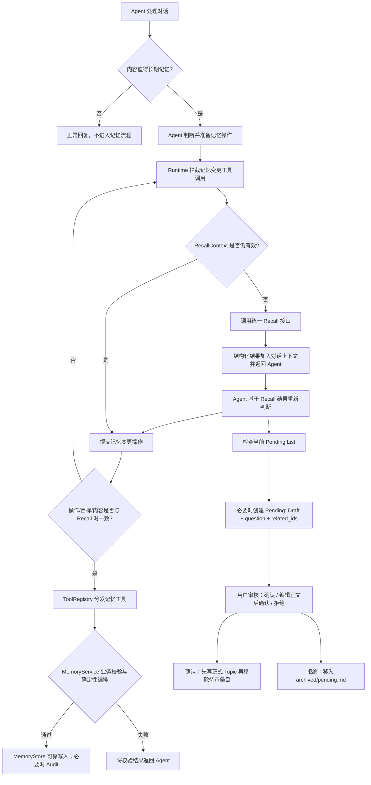

# Syvrio 记忆系统重构：设计决策与架构构想归档

> **日期**：2026-11-18；**最近同步**：2026-11-19  
> **阶段**：目标架构职责已具备分阶段实施条件；**尚未修改实现代码，详细事件契约和质量维护策略可在各实施阶段细化**  
> **仓库**：[Shardkiht/Syvrio](https://github.com/Shardkiht/Syvrio)  
> **关联讨论**：[Issue #30 — 统一记忆字段语义与 Agent 写入决策流程](https://github.com/Shardkiht/Syvrio/issues/30)  
> **定位**：整理截至本次讨论已确定的结论，同时记录架构层面的初步构想和后续待定问题。本文以**本次最新讨论**为准；Issue #30 中部分早期方案已经被修正。

## 0. 阅读约定与范围

文中使用三个标识，避免把设想误认为定稿：

- **[已确定]**：讨论中明确接受的业务定义、模型边界或交互规则。
- **[架构构想]**：方向基本一致，但接口、参数、流程细节尚未审定。
- **[待讨论]**：仍有明显语义边界或实现决策未确定。

本阶段仅将本文档提交至 GitHub 仓库；**不修改 Issue、现有 Vault、历史数据、代码或发布版本**。

## 1. 设计目标与基本原则 [已确定]

1. **Agent LLM 负责语义理解与业务决策**：识别值得记录的长期事实，结合 Recall 判断语义重复、冲突、事实变化与纠错，决定调用哪种记忆工具。
2. **MemoryService 集中实现记忆工具业务**：负责 `memorize/transition/correct/deprecate` 等具体工具方法的业务参数校验、确定性操作编排与可靠执行；只拒绝能够确定不合法的操作，不通过相似度阈值猜测自然语言事实之间是否冲突。
3. **Pending 只用于 LLM 无法判断、需要用户确认的情形**：它不是低置信度候选池，也不是 Service 校验失败的兜底队列。
4. **一旦 Agent 决定需要记录某条事实，先 Recall，再决策写入操作**；不要求对每一轮无记忆价值的聊天都检索。
5. **消除二次 LLM 抽取**：Agent 已理解并组织好事实时，`memorize` 不应再接收整段对话并另调 LLM 做一遍抽取。
6. **存储、运行时模型、检索结果分层**：需要持久化的审计与追溯信息可以保留，但不应全部暴露给 LLM 或参与向量/关键词索引。
7. **沿用原有人工审核体验**：用户可确认、只编辑正文后确认或否定 Pending；人工审核的**同步路径**不额外调用 LLM。正文实际修改后确认属于例外：先完成确认与持久化，再后台独立调用一次 LLM 提取 Context，不阻塞用户。
8. **System Prompt 统一引导主动澄清**：当信息不足以可靠判断事实、关系或记忆操作时，Agent 优先在当前对话中向用户反问，必要时多轮澄清；不凭空补充未知信息。仅缺少日期、地点等非关键 Context 时不强制追问，可按已知精度记录或留空；具体工具约束仍放在各工具 Description 中。
9. **Pending 创建前检查**：强制 Memory Recall + Pending List 检查；Confirmed Inference 仅作可选参考，不自动拒写。
10. **Memory 不物理删除**：即使错误记忆也有历史价值；只标记为 `deprecated`，不设计硬删除能力。
11. **不物理删除，按业务角色迁移**：Memory 保留被弃用的旧事实；Inference 不维护完整编辑版本史，变更事件另行追加记录；Pending 确认后写入正式 Memory 再从待审文件移除，拒绝后保留原内容到 `archived/pending.md`，不单独建立 Pending 审核日志。
12. **Change Tracking 是独立机制 [已确定]**：统一记录 Memory、Inference 等知识内容的变化，为后台任务提供可靠增量；只追踪变化，不执行维护、语义复核或任务调度。
13. **Dream 仅负责知识衍生 [已确定]**：生成完整 Profile 和新的 Inference；不复核、修订、弃用已有 Inference，也不检测 Profile 过期或决定刷新时机。
14. **Vault Maintenance 仅负责既有知识维护 [已确定]**：检查 Memory、Inference、Pending、Profile 及其引用和索引的正确性、一致性与有效性；必要时调用 LLM 复核，经既定业务通道处理；不自行追踪变化、调度 Dream 或发现新的推断。
15. **后台调度是应用 Runtime 的职责 [已确定]**：调度、并发、取消、重试和任务续跑由应用层 Runtime 统一管理；Scheduler 不是与 Runtime 平级的领域模块，后台调度也不放入专门负责对话的 AgentRuntime。

> **已废弃的旧方向**：让 MemoryService 在写入前自行按自然语言相似度/冲突阈值复核语义，再用 `confidence`、`kind`、`sensitive` 决定自动入库或 Pending。该方案不再作为目标架构。

## 2. 领域模型 [已确定]

### 2.1 MemoryDraft：待记录事实

```python
class MemoryDraft(BaseModel):
    text: str
    topic: str
    context: MemoryContext | None = None
```

| 字段 | 含义 | 约束 |
|---|---|---|
| `text` | 准备记录的事实正文 | 必填；内容不为空 |
| `topic` | 记忆分类／对应主题文件 | 必填；已有分类优先复用，不存在时可创建；程序校验路径安全 |
| `context` | 事实的可选上下文 | 可为空；参照下文 `MemoryContext` |

- `MemoryDraft` 是准备落盘的**内容模型**，不是带置信度的候选列表。
- **删除旧 Candidate 字段**：`title`、`confidence`、`sensitive`、`kind`、`reason`；不再允许用这些字段驱动下游 `policy` 判定。
- `topic` 已承担分类/文件定位职责，不在 Draft 中额外定义 `title`。
- 来源追溯、创建时间、审计信息由程序维护，不要求 Agent 自行填写。

### 2.2 PendingItem：无法裁决的 Draft

**业务语义：`Pending = MemoryDraft + 待确认问题 + 相关记忆引用`。**

```python
class PendingItem(MemoryDraft):
    question: str
    related_ids: list[str] = Field(default_factory=list)
```

| 新增字段 | 含义 |
|---|---|
| `question` | LLM 无法确定、需要用户确认的问题；展示给用户 |
| `related_ids` | Recall 找到的相关旧记忆 ID；仅供关联，不代表自动覆盖它们 |

- Pending 复用 Draft 的 `text/topic/context`，不另造第二套候选内容结构。
- Pending 的队列 ID、`created_at`、来源引用及处理记录是**队列/持久化层元数据**，不必放到这个业务模型，也无需 LLM 生成。
- Pending **不进入正常记忆 Recall 的事实集合**，`question` 不拼接进正式记忆正文或语义索引。
- 不保留 `confidence`、`sensitive`、`kind` 等旧候选判定字段。
- 采用继承表达概念关系；具体持久化包装格式可按实现需要设计，业务上不重复存储 Draft 字段。

### 2.3 MemoryEntry：已经持久化的事实

```python
class MemoryEntry(MemoryDraft):
    id: str
    status: Literal["active", "deprecated"] = "active"
    recorded_at: datetime
```

- 直接继承 Draft 的三个内容字段，**不重复声明** `text/topic/context`。
- 新增 `id`、`status`、`recorded_at`；它们由程序管理。
- `recorded_at` 表示**何时记录事实**，与 `event_time` / `valid_from` / `valid_to` 的事实时间语义不同。
- `active` 表示记录仍可作为事实使用（可能是历史事实，需结合 Context 判断）；`deprecated` 表示记录已弃用，不再用于正常事实检索，但保留原文与必要审计。**不提供物理删除**，错误记忆仍可用于追溯纠错。
- 删除正式事实模型中的 `confidence`；不将 `supersedes`、`change_kind` 等操作历史塞回 Entry 业务模型。
- `raw_markdown`、文件路径、行号、字段偏移等属于 **Markdown 解析/存储结构**，不是正式记忆的业务内容；具体拆分由实现阶段处理。

### 2.4 MemoryContext：事实上下文 [时间精度已确定，其他字段按原方向]

目标字段：

| 字段 | 语义 |
|---|---|
| `event_time` | 事件发生时间 |
| `valid_from` | 事实开始有效的时间 |
| `valid_to` | 事实有效期结束的时间 |
| `location` | 相关地点 |
| `emotion` | 用户实际表达的情绪 |
| `emotion_at` | 情绪关联的时间语义；此前讨论倾向只标注确实属于事件当时的情绪 |

- 从旧模型中移除 `time_text`、`location_kind`、`emotion_source` 等冗余字段。
- 不把 LLM 猜测出的情绪当作用户事实。`event_time`、`valid_from`、`valid_to` 允许三种**自然精度**：`YYYY`（年）、`YYYY-MM`（年月）、`YYYY-MM-DD`（年月日）；不确定时可为 `None`，不伪造月份或日期。
- `transition` 可在明确事实发生变化、但变化时间未知时执行；不要求一定提供精确生效日期。时间筛选需要按所存精度处理，例如 `2026-08` 表示八月内某个尚不精确的日期，**不能当作确切的 8 月 1 日**；边界计算细节在实现测试中验证。
- **Context 只保留记忆形成时的事实语义上下文**；来源分类 `source` 不属于 Context，目标设计中删除该字段，不要求 LLM 或程序为每条 Memory 维护来源类型。

### 2.5 事实与待确认模型关系

```text
MemoryDraft
├─ text
├─ topic
└─ context?
    │
    ├── PendingItem
    │   ├─ question
    │   └─ related_ids[]
    │      + 队列元数据（在队列层维护）
    │
    └── MemoryEntry
        ├─ id
        ├─ status: active | deprecated
        └─ recorded_at
```

> 这是**目标领域模型**，不是当前仓库已落地的实现。GitHub `main` 在归档时仍使用旧 `Candidate`、`Entry`、`Core` 等结构。

### 2.6 Inference：可追溯的推断 [已确定]

Inference 与 MemoryDraft/Pending 分离：它是 LLM 基于既有事实得出的**推断**，即使经用户确认，也不自动变成正式 Memory。

```python
InferenceStatus = Literal["hypothesis", "confirmed", "deprecated"]

class Inference(BaseModel):
    id: str
    text: str
    kind: str
    source_ids: list[str]
    status: InferenceStatus = "hypothesis"
    created_at: datetime
    updated_at: datetime
```

- `kind` 表示**对用户哪一方面的推断**，与 `MemoryDraft.topic` 的动态分类原则一致：LLM 可复用已有类型，也可创建新类型；不采用固定枚举。生成方式 `reflection`/`dream` 和用途 `profile` 不应被强制当作推断分类。
- `source_ids` 必须指向真实 Memory，保留可追溯证据；不使用其他 Inference 作为推断证据，防止假设层层自证。
- `hypothesis` 为未确认假设；`confirmed` 为用户确认、但仍属于推断；`deprecated` 为已弃用。用户否定、改写旧推断或后台复核判定不再成立等情形可弃用；不单独保留 `rejected/superseded` 状态。**来源状态变化仅触发待复核，不立即自动弃用 Inference**。
- 来源指纹等确定性证据校验信息可用于程序追踪变更，但不放入给 LLM 的核心业务字段；来源变化交给统一后台 Vault 维护流程复核，由 LLM 判断语义有效性，**程序不以指纹或单条来源的 `deprecated` 状态直接替 Inference 作最终弃用决定**。
- 推断的编辑与审核应沿用已有交互体验；用户确认不会自动写入事实 Markdown。
- **Inference 不保留每次编辑的完整历史正文版本**：Markdown 保存最新正文与状态；弃用时保留最后内容。独立 Change Tracking 通过 `records/inference-changes.jsonl` 记录推断本身的新增、修订、审核与状态变化（不复制完整正文）。来源 Memory 的变化由同一追踪机制记录，供 Maintenance 关联受影响推断；维护进度和复核结果与原始变化事件分开管理。

## 3. Markdown 与数据分层 [已确定方向]

**Memory、Pending、Inference 全部使用 Markdown**，统一按 **Core / Context / Extensions** 组织，**不单独设置 Content 区域，正文直接放在 `Core.text`**；三者 Schema 不必完全相同。原始 Session 与 Audit 属于追加式事件，继续使用 JSONL。

| 存储区域 | 职责 | 约束 |
|---|---|---|
| **Core** | ID、状态、正文等业务字段 | **Memory Core 仅含 `id/status/text`**，`topic` 由文件路径确定；Pending/Inference 也将正文存入 `Core.text`，另按自身语义保留必要业务字段 |
| **Context** | 时间、地点、情绪等可选事实语义 | Memory 与 Pending 的 Draft 复用；允许没有 Context 的记录 |
| **Extensions** | `recorded_at`、真实来源关联等程序元数据 | 会话衍生 Memory 必存 `session_id/message_id`；不保存独立 `source` |
| **Audit** | 需要审计的正式 Memory 等操作事件 | JSONL 可保留；**Pending 审核不额外记录 Audit** |

| 数据 | 目标位置/用途 | 结论 |
|---|---|---|
| Memory | `vault/memories/**/*.md`；按 topic 分类 | 已确定 |
| Inference | `vault/inferences/**/*.md`；按 kind 分类 | Markdown 已确定，文件粒度实现时决定 |
| Pending | **单文件** `vault/memories/pending.md`，仅存未确认 Draft | 已确定；正式 Memory 扫描须排除该文件 |
| Pending 归档 | **单文件** `vault/archived/pending.md`，保留被拒绝的原始条目 | 已确定；仅未来质量维护可按需只读参考，不视为正式事实 |
| Profile | 唯一 `vault/profile.md`；下次 Dream 可覆盖人工修改 | 已确定 |
| Sessions | 原始消息与 `distilled/up_to` 等事件 | JSONL |
| Audit | 操作事件与必要审计 | JSONL；不强制存完整推断版本快照 |
| Memory 变更事件 | 独立 Change Tracking 记录 Memory 的新增、有效内容变化及弃用 | 可采用 `vault/records/memory-changes.jsonl`；最终路径、事件 Schema 及与 Audit 的关系在实现阶段确定 |
| Inference 变更事件 | **`vault/records/inference-changes.jsonl`**；由 Change Tracking 写入 | 追加式事件，不是第二份 Inference 内容库，不保存正文历史快照 |
| Dream / Maintenance 调度及消费进度 | 由应用 Runtime 管理执行与已处理游标 | Runtime 状态/任务数据，和知识正文、变化事件区分；具体文件名待实现设计 |

**类型识别 [已确定方向]**：Memory 按 Topic、Inference 按 Kind 分类为 Markdown；Pending 固定为 `memories/pending.md`（拒绝项集中在 `archived/pending.md`），可在一级标题明确标注类型，例如 `# Pending`。程序以**具体路径和 Schema** 判断类型，不能依靠可编辑标题，也不能把 `memories/pending.md` 当作正式 Memory 索引。主题文件和 Pending 文件都可含多条独立 ID 的记录。

**单条 Memory 的示例结构 [Core.text 位置已确定；排版细节为示例]**：

```markdown
# Memory · Career

## mem-001

### Core
- id: mem-001
- status: active
- text: 用户于2026年8月入职A公司。

### Context
- valid_from: 2026-08

### Extensions
- recorded_at: 2026-08-20T09:00:00+08:00
- session_id: session-001
- message_id: msg-001
```

- 每条 Memory 的正文直接归属于 `Core.text`，**取消独立 Content 区域**；完整内容在领域模型中仍对应 `MemoryDraft.text`，不是另建一份数据。
- `Core` 以 `id/status/text` 为最小固定字段，`topic` 不必在每条记录重复，因为文件路径已确定分类；`recorded_at` 和来源关联属于 Extensions。
- `text` 一般是简短、原子化事实，但 Markdown Schema **须支持多行正文**；具体转义、续行及无损解析规则在实施阶段确定，不把多行正文强制转换为标题。
- Pending、Inference 同样将正文存为 `Core.text`，但它们仍采用各自业务字段和状态约束，不能把三者强行合成完全相同的 Schema。

**来源与数据边界 [已确定]**：

- 前台 Agent 对话和后台 Session 沉淀生成的 Memory，**必须在 Extensions 中关联真实 `session_id`、`message_id`**；外部导入不强制要求这两个 ID。它们不由 LLM 自行编造。
- `distilled/up_to` 是后台处理进度游标，**不能代替每条 Memory 的原始消息 ID**；由 Runtime 负责将批量沉淀结果逐条关联到原始消息，再把可信来源交给 Service。具体关联与传递机制属于实现阶段的验证重点。
- 原始对话保存在 Sessions JSONL，不复制全文进 Memory；可据来源 ID 回查。Extensions **不参与 BM25、向量索引、正常 Recall 或 `read_topic` 的 LLM 返回**。
- 不设置独立 `source` 类型字段，不把写入来源和纠错/审核操作混为一个字段。
- Memory 历史变化与错误记录继续保留；Inference 仅维护 Markdown 中的当前正文/状态，不保留完整版本史；Memory/Inference 的变化由独立 Change Tracking 记录，供不同后台任务增量消费。Pending 确认后正文晋升到正式 Memory，**确保 Memory 成功持久化后才从活动 Pending 中移除**；拒绝的原始 Pending 进入 `archived/pending.md`。不另存已确认 Pending 的重复副本，也不保留单独的 Pending 审核操作日志。
- `topic` 负责主题文件定位，不必在每条 Markdown Core 中重复存储；Schema/Store 仍需无损保留手工编辑与未知扩展字段。
- `profile.md` 与 `SOUL.md` 分别是用户画像和助手约束；Profile 不反向覆盖 Memory/Inference。纠错、变更和弃用不能凭 `related_ids` 自动覆盖旧 Memory。

## 4. Pending 产生条件和用户体验 [已确定]

### 4.1 唯一业务定位

Agent 认为某项信息值得记忆，但经过 Recall 和当前对话澄清仍无法确定事实内容或处理方式，且有延后人工确认价值时，才创建 Pending。Pending **不是低置信度候选池**，也不是 Service 校验失败的兜底队列。

- Agent 可在正常对话中先向用户多轮追问，不为补齐非关键 Context 强制提问；此**通用原则写入 System Prompt**，具体创建条件仍放在 Pending 工具 Description 中。
- 相关旧 Memory 的 `related_ids` 只表示关联，**不是自动纠错或弃用指令**。
- 行为引导优先写在 Pending 工具自身 description 中，不为具体情况硬编码复杂规则。

### 4.2 创建 Pending 前的强制检查

| 检查对象 | 规则 |
|---|---|
| **Memory Recall** | **强制**；与其它记忆写入使用相同的 Runtime 前置 Recall 和 RecallContext 检查 |
| **当前 Pending List** | **强制**；避免重复待审核，完全一致可以确定性幂等拦截；语义相似仍由 Agent 判断 |
| Confirmed Inference | **仅可选参考**；不强制检索，不作为禁止写入的事实依据 |
| Hypothesis Inference | 不作为强制检查依据 |

- 即使存在高度相似的 confirmed Inference，也不能机械禁止用户明确陈述的事实写入 Memory。Agent 可以在已知某条 confirmed Inference 高度相似时，判断是否仍有必要创建 Pending；不引入固定相似度阈值。
- Pending **不参与普通 Memory Recall** 的事实集合；因此必须额外检查待审核 Pending List。
- 当前实际问题包括无关紧要内容被写入、重复内容进入 Pending；先优化工具描述与上述检查，不建复杂拒绝历史库或语义阈值裁决。

### 4.3 人工审核与单文件迁移 [已确定]

Pending 只存尚未审核的 `MemoryDraft + question + related_ids`，集中于 `vault/memories/pending.md`；保留独立 Pending ID 和必要来源/时间元数据，不需要完整状态机或单独审核历史。

| 用户操作 | 处理 | 默认额外调用 LLM |
|---|---|---|
| 确认 | 将 Draft 转为正式 MemoryEntry，写入对应 Topic Markdown；**成功后才从 `memories/pending.md` 移除条目** | 否 |
| 编辑正文后确认 | 使用用户修改的 `text` 创建正式 Memory；若正文确有变化，先以空 Context 写入，成功后移除 Pending，再后台补全 Context | **仅后台异步一次** |
| 拒绝 | 将**原 Pending** 转移至 `vault/archived/pending.md`，不再进入活动 Pending List | 否 |

- 确认 Pending 属于**事实晋升**：正文及合法 Context 进入 Memory，不另行长期保存包含 `question/related_ids` 的已确认 Pending 副本；不视为删除已保留的事实数据。
- 拒绝后的 Pending 保留原始正文和必要来源；不物理删除、不增加 `rejected/confirmed` 生命周期状态或编辑版本快照、**不额外记录审核 Audit**。
- `archived/pending.md` 不参与常规 Recall、Dream、创建 Pending 前的 List 检查或自动恢复；未来定期质量维护 Agent 可以按需**只读参考被拒绝记录**，不能把它们当成事实；目前**不实现**这项维护功能。
- 确认写入正式 Topic + 活动 Pending 移除、拒绝归档 + 活动 Pending 移除，都必须具备失败回滚/一致性与幂等保证；不能因为中途失败丢失 Draft，也不能重复确认产生多条 Memory。
- UI 展示 `question`，仅开放 `text` 编辑；按**实际正文内容**是否变化而不是是否提交 `text_override` 判断：未变化沿用原 Context，无需额外 LLM；正文变化时不沿用可能失效的旧 Context。
- **正文变化后的后台 Context 补全 [已确定]**：Memory 先以已确认的最终 `text`、原 `topic`、空 Context 完成合法写入；原 Pending 成功移除后，提交一个独立后台任务，额外调用**一次 LLM**，仅基于最终确认内容及可用可靠来源提取日期、地点、情绪等 Context，不猜测未知字段。
- **后台结果落盘**：仍由 Service 的统一确定性校验与 `apply(updates=[...])` 通道填充原本为空的 Context 字段；不得改变用户确认的 `text/topic` 或覆盖已有非空 Context。落盘前确认对应 Memory ID、当前正文/版本及状态仍符合提交任务时的条件，避免过期任务影响新修改。
- **前台体验**：后台 LLM 不阻塞当前确认操作或后续交互；后台失败或未提取到有效字段不回滚已确认 Memory，Context 可以保持为空。后台任务调度、重试/恢复等归实现设计和测试，不另造一套记忆业务层。
- 用户提供新的语义信息时可由 Agent 重新判断；普通审核不在同步路径额外调用 LLM。Service 确定性校验失败直接报错，不自动转 Pending。

### 4.4 与旧记忆及长期维护的边界

- **确认 Pending 不等于自动修改或弃用相关旧 Memory**；不得凭 `related_ids` 猜测 `correct/transition` 的操作及目标。
- Memory、Inference、Pending 的重复、语义不一致与旧错误交由未来**统一定时 Vault Maintenance** 综合维护：程序负责确定性扫描，LLM 负责语义复核，经既定业务写入通道及必要人工确认处理。活动 Pending 规模小，维护时直接全量扫描 `memories/pending.md`；不需要为 Pending 单独维护变更事件文件。**该系统只完成架构设计，暂不实施。**
- Pending 是待审核工作区：确认后晋升 Memory；用户明确拒绝的原条目保留在 `archived/pending.md`，无需额外 Audit、历史版本或归档状态机。归档仅供人工查看，未来质量维护可只读参考，**不能成为事实证据**。

## 5. Agent / Recall / MemoryService 职责 [已确定]

| 组件 | 应负责 | 不应负责 |
|---|---|---|
| **Agent LLM** | 判断记忆价值、事实提炼、语义重复/冲突、变化/纠错、是否需要用户确认；选择工具 | 直接修改 Vault；自评置信度作为写入依据 |
| **AgentRuntime** | 统筹会话、LLM 与工具调用；对写入/创建 Pending 执行强制 Recall 与 Pending List 检查；关联可信 `session_id/message_id` 并交给记忆业务执行；协调后台 Session 沉淀 | 实现记忆业务校验、解析或写入 Markdown；替 Agent 判断自然语言语义关系 |
| **ToolRegistry** | **保留全部工具的注册**（含记忆、搜索、网页与文件工具），维护工具 Schema、可调用目标、超时/取消和通用执行机制；将工具调用分发给对应实现 | 记忆专属参数/状态校验、纠错/变化编排；引入独立的记忆业务 Handler 层 |
| **Recall** | 提供统一的记忆检索应用接口，返回结构化事实及必要 ID/Context | 判断事实之间的语义关系 |
| **MemoryService** | 直接实现 `memorize/transition/correct/deprecate` 等记忆工具；承担其业务参数校验、状态/凭据/并发校验、确定性编排及结果返回；在内部复用 `add()/apply()` 完成一致性写入，并负责 Pending 审核业务 | 注册/调度通用工具、获取或推断 Session/Message ID、管理 LLM 循环、用阈值作语义裁决或重复调用 LLM 抽取 |
| **MemoryStore / Schema** | Markdown 无损解析、路径校验和持久化；执行 Service 下发的底层记录操作 | 记忆价值判断、工具注册或业务流程编排 |
| **Pending Store** | 管理 `memories/pending.md` 与 `archived/pending.md` 中的条目读写、转移、原子性；不维护单独审核历史；未来维护任务直接全量扫描活动 Pending | 对自然语言进行二次理解或将归档记录当作事实 |
| **Change Tracking** | 独立追踪 Memory、Inference 等数据变更，提供事件/关联 ID 的增量读取；写入事件与正式操作保持一致性 | 知识维护、LLM 复核、后台调度、替消费者管理复核结论 |
| **应用 Runtime（后台任务能力）** | 统一管理 Dream/Maintenance 的调度、资源预算、取消、重试与恢复；维护各消费者进度 | AgentRuntime 的单轮对话职责；知识衍生与语义维护 |
| **Dream** | 仅生成完整 Profile 和新的 Inference，发布时核对输入是否仍有效 | 已有推断的审核/修订/弃用、内容质量维护、变化追踪、调度 |
| **Vault Maintenance** | 消费变化增量，对已有 Memory/Inference/Pending/Profile/Session/索引执行有效性与质量检查、必要 LLM 复核和安全修正 | 变化事件生产、Dream 新推断生成、后台任务调度 |
| **Audit** | 保留有必要的正式事实操作事件；Pending 审核不额外记 Audit | 替代事实正文或承担 Recall 语义检索 |

**确定性校验举例**：

- ID 不存在、目标记录状态不允许操作；
- `topic` 路径不合法、字段格式或事实有效时间区间不合法；
- 内容包含 API Key、密码、Token、私钥等凭据；
- 完全相同的写入请求或已存在的相同 Pending 可按幂等规则拒绝重复（此处不是**语义**去重）；
- Recall 后目标记录已被其他写入修改，导致操作基于过期状态；
- 存储和审计不能保证一组写入原子完成。

**不能靠简单规则擅自决定的内容**：

- “用户喜欢咖啡”与“用户喜欢清爽中烘咖啡”是否应合并；
- “目前在 A 公司”“现在在 B 公司”是否必然冲突；
- 新说法是事实变化还是旧事实错误；
- 相似度/覆盖率低是否代表不能保存。

**安全策略 [已确定]**：只限制记忆存储中的敏感**凭据**（密码、密钥、Token、私钥等）；普通个人事实如姓名、住址、健康、收入等，不因“敏感信息”标签被额外拒绝。仍需遵循 Vault 的私有边界，不得意外公开。

## 6. 目标架构与操作流 [架构构想]

### 6.1 Agent 主路径



- 这是**逻辑职责流**，不是规定所有入口都必须生成完全相同的执行栈。
- **所有 Memory 写入/变更与 Pending 创建**都必须经过 Runtime 的前置 Memory Recall 检查；Pending 创建还必须检查当前 Pending List。不能依赖提示词保证 Agent 一定主动 Recall。
- 如果没有可复用的有效 RecallContext，Runtime 在执行变更工具前拦截调用，直接调用统一 Recall 接口，并把结果交回 Agent；Agent 结合结果重新判断后再提交操作。
- 如果操作类型、目标或内容发生变化，必须重新 Recall；操作与目标内容未变、证据未变化且上下文未压缩时，复用已有 Recall，一次即可。
- LLM 主动调用 Recall 与 Runtime 自动 Recall 共用同一个接口和结果格式；两者不需要额外的触发来源参数或独立 Recall Tool Handler。
- 确认/编辑等普通 Pending 操作默认不再调用 LLM；用户新回答语义问题时可由 Agent 重新解释。Confirmed Inference 只是可选参考，不纳入强制前置检查。
- Recall 未命中不代表 Vault 中绝对不存在相关记忆；用检索质量评测优化，而不是让 Service 再开发一套自然语言理解规则。
### 6.2 各层的职责边界 [已确定]

```text
LLM：事实提炼、语义判断、选择工具
  │ Tool Call（只包含业务参数，不包含 session_id/message_id）
  ▼
AgentRuntime：对话/工具调度、强制 Recall、Pending List 检查
  │ 关联当前 Session/Message 的可信来源信息；控制工具执行时机
  ▼
ToolRegistry：注册全部工具（包括记忆工具）、Schema、超时/取消、分发
  │ 通过通用适配把工具调用映射到已注册的业务方法
  ▼
MemoryService：直接实现记忆工具方法、业务校验、确定性编排、返回结果
  │ memorize → add；transition / correct / deprecate → apply
  ▼
MemoryStore + Markdown Schema：文件解析、持久化及底层原子操作
```

- **并非所有工具都经过 MemoryService**：搜索、网页、文件等非记忆工具仍由 ToolRegistry 分发给各自实现。
- 工具注册表里的 `handler` 只表示一个可调用目标，**不要求存在单独的记忆业务 Handler 层**。记忆工具可以注册到 MemoryService 的对应方法；Registry 保留必要的通用参数绑定和结果转换。
- **记忆业务参数校验及服务编排放在工具实现中**（MemoryService），不放在 Registry 或 `tools.py` 中的专用包装函数。Schema 的声明与通用协议转换仍由工具注册/执行机制负责。
- **Runtime 提供来源，不由 Service 查找 Session**：Runtime 负责提供准确的 `session_id/message_id` 等可信调用上下文；Service 负责接收并持久化到 Extensions。来源上下文的具体传递方式（如内部绑定/参数）交给实现阶段，不暴露为 LLM 工具参数；后台批次必须逐条关联真实消息，不能以游标代替。
- Pending 人工审核前端仍展示只读 `question` 与可编辑 `text`（不开放 Context 编辑）；审核业务由 Service 处理，Pending Store 管理 `memories/pending.md` 和 `archived/pending.md`，确认/拒绝转移不另外写审核 Audit。正文实际变化时异步调用一次 LLM 补全 Context，独立于同步确认流程。

建议的边界调整（均未进入实施）：

- **`extract_candidates()`**：从正常 `memorize()` 链路移出；非对话的导入/后台沉淀另行决定如何利用同一套 Draft 语义。
- **`_adjudicate()` / `policy.decide()`**：移除基于 `kind` / `confidence` / `sensitive` 的旧裁决；能复用的确定性安全检查下沉到共用写入通道。
- **`find_conflicts()`**：不再作为阻断新增的通用语义阈值裁决；真正的关系判断由 Agent 基于 Recall 完成。
- **`manual_add()`、`approve()` 和其他入口**：不再绕过统一确定性验证和状态约束；正式 Memory 的必要审计继续保留，Pending 审核不额外生成 Audit 事件。
- 对同一 Vault 的写入保持可恢复性，避免事实文件、状态及审计只完成一部分。
- `read_topic` 与正常 Recall 采用一致的 LLM 数据边界：不直接返回带 Extensions 的原始 Markdown，只返回筛选后的正文、Context 与必要 ID。

### 6.3 工具词汇与事实生命周期

讨论中的主要 Agent 工具：

| 工具 | 目标语义 | 对应 MemoryService | 状态 |
|---|---|---|---|
| `recall` | 读取相关事实及必要 ID | 统一 Recall 接口 | 已确定保留 |
| `memorize` | 添加新长期事实 | `add(draft)` | 已确定保留；参数为整理好的 Draft |
| `transition` | 真实世界中的状态变化，保留历史时间关系 | `apply(add=..., updates=...)` | 已确定采用此命名，替代 `evolve` |
| `correct` | 原事实错误；新增正确事实并弃用错误旧记录 | `apply(add=..., updates=...)` | 已确定保留 |
| `deprecate` | 将不再使用的旧记忆标记为弃用 | `apply(updates=...)` | 已确定命名，替代 `forget` |

MemoryService 直接实现已注册的记忆工具方法，**在内部统一复用两个底层写入入口** `add()` 与 `apply()`；它们不是额外暴露给 LLM 的工具：

```python
class MemoryUpdate(BaseModel):
    id: str
    context: MemoryContext | None = None
    status: Literal["active", "deprecated"] | None = None


def add(draft: MemoryDraft) -> ToolResult: ...

def apply(
    add: MemoryDraft | None = None,
    updates: list[MemoryUpdate] | None = None,
) -> ToolResult: ...
```

- `memorize` 工具方法校验 Draft 后调用 `add()`；`transition/correct/deprecate` 在各自业务方法内校验参数、编排操作，再调用 `apply()`。Pending 确认/拒绝等审核业务也由 Service 处理。
- ToolRegistry 仍注册上述所有记忆工具，但**不另写记忆专用 Handler 来重复校验、拼接业务结果或编排 Service 调用**；保留必要的通用协议适配。
- `apply()` 的 `add` 是可选的新 Draft；`updates` 是按旧记忆 ID 指定的修改列表。
- `MemoryUpdate.context` 只允许补充旧记录中原本为空的 Context 字段，不覆盖已有非空值；`status` 可以按允许的状态值变更。此入口也供编辑 Pending 正文后的**后台 LLM Context 补全**复用，写入前检验关联 Memory 的当前状态与任务预期一致。
- 旧记忆的 `text`、`topic` 和已有非空 Context 不允许原地覆盖；纠错通过新增正确事实并弃用旧记录完成。
- `deprecate` 只改变状态，不提供物理删除入口。`transition` 的事实变化时间允许 `YYYY`、`YYYY-MM`、`YYYY-MM-DD` 或空，不要求填写伪造的精确日期。**来源职责已定**：Runtime 提供可信 `session_id/message_id`，Service 校验并写入 Extensions；LLM 不负责这些 ID。具体内部传参/上下文绑定属于实现细节。

事实变化和纠错**不是同一件事**：

- **事实变化**：旧事实以前成立，新事实后来成立；可通过 `valid_from/valid_to` 表述，两者在历史意义上都可能 `active`。
- **纠错**：旧事实本来就不正确；将错误记录设为 `deprecated`，新事实独立保存，保留审计。
- **冲突**：是 Agent 对证据关系的判断或未确定的状态，不预设要额外开发一个 `conflict` 工具。

### 6.4 非实时入口与后台 Session 沉淀 [方向已确定，接口待落实]

- **前台 Agent**：对话中直接形成 `MemoryDraft`，不再为同一事实调用第二次 LLM 候选抽取。
- **后台 Session 沉淀**：保留按 `distilled/up_to` 游标增量处理未沉淀消息的能力；可继续利用后台 LLM 提取，但应复用新的 Recall、语义决策及 `MemoryService.add/apply` 写入通道，而不是旧 `_adjudicate` 阈值裁决。通过 Recall 避免重复保存前台已写入的事实。
- **精确来源**：游标不等于单条 Memory 的来源消息；每条会话衍生 Memory 必须关联真实 `message_id`，由 Runtime 负责提供，由 Service 落盘。批次内逐条映射及传递方式在实现阶段落实并验证。
- **外部导入**：可保留独立 ImportExtractor 组织 Draft，后续复用校验与写入层；外部导入无须 Session/Message ID。
- 以上为职责与数据约束，不预设新的通用抽取框架。

## 7. Recall 接口、结果与上下文管理 [已确定]

### 7.1 统一 Recall 接口与调用方式

Recall 只有一套应用接口，供两种调用方式复用：

- **LLM 主动 Recall**：通过 Agent 暴露的 Recall 工具调用该接口。
- **Runtime 自动 Recall**：Runtime 拦截记忆变更工具调用后，程序直接调用同一个 Recall 接口。

两者使用相同的请求参数、检索实现和结构化结果。**不增加独立的 Recall Tool Handler，也不增加用于区分触发来源的参数**；Runtime 的职责是前置拦截和状态管理，不是再包装一层 Recall 业务接口。

Recall 请求参数：

| 参数 | 必需 | 默认值 | 语义 |
|---|---|---|---|
| **query** | 是 | — | 检索所需的语义查询 |
| **limit** | 否 | **7** | 最多返回的记忆条数 |
| **time_range** | 否 | — | 一个时间区间，用于按事实发生时间或有效期筛选 |
| **location** | 否 | — | 地点筛选条件 |
| **emotion** | 否 | — | 情绪筛选条件 |

- 删除 **view** 参数，不再提供多种 Recall 视图。
- 时间筛选只接收一个 **time_range**，不再把多个时间字段暴露成独立请求参数。
- **time_range** 命中规则：**event_time** 落在查询区间内，或记忆的 **valid_from/valid_to** 有效区间与查询区间重叠。
- **recorded_at** 表示记录写入时间，不参与 **time_range** 过滤；它不代表事实发生或有效时间。
- 时间数据精度已确定为 `YYYY`、`YYYY-MM`、`YYYY-MM-DD` 或空；部分精度需要在时间范围检索中按对应**可能日期区间**理解，不得将未知月/日补为确定的一天。边界计算和性能在实现阶段测试，不增加额外 Recall 参数。

### 7.2 结构化结果与 MemoryDraft 复用

Recall 返回结构化数据，不再把 Markdown 原文作为正常工具结果交给 LLM，也不为 Recall 重新设计一套重复的事实字段模型。

**RecallEntry 复用 MemoryDraft，并只增加 id 与 status：**

```python
class RecallEntry(MemoryDraft):
    id: str
    status: Literal["active", "deprecated"]
```

其中 MemoryDraft 已定义 **text**、**topic**、**context**；RecallEntry 只补充已持久化记录的 **id** 与 **status**。

**返回范围：Core + Context 全部返回，Extensions 不返回。**

- Core：返回全部核心字段，包括 **id**、**status**、**text**。
- 分类字段：**topic** 复用 Draft 的属性，由 Markdown 的主题路径恢复，不必在 Core 中重复存储。
- Context：当前定义的 Context 字段全部返回，包括 **event_time**、**valid_from**、**valid_to**、**location**、**emotion**、**emotion_at**；字段不存在时按可选字段处理。
- Extensions：**全部不返回**，包括 `recorded_at`、会话衍生 Memory 必存的 `session_id/message_id` 及其他程序维护信息；这些 ID 不向 LLM 暴露。
- 检索分数、Markdown 原文、文件路径、行号、Audit 和 Pending 队列信息也不属于 RecallEntry，不放入正常 Recall 结果。

Recall 不调用 LLM 对存储内容进行二次提取或改写；只将已有 MemoryEntry 的 Core 与 Context 提取为上述结构化结果。

### 7.3 原始对话查阅工具 [架构构想]

未来如需让 Agent 核实某条记忆的原始对话依据，可考虑增加一个独立的查阅工具：

```python
def read_memory_source(memory_id: str) -> ToolResult:
    ...
```

- LLM 只传入 Recall 已返回的 `memory_id`；不需要知道或传入 `session_id`、`message_id`。
- 对会话衍生的 Memory，程序从 Extensions 获取真实 `session_id/message_id`，**直接读取对应 Session/Message**，无需靠正文相似度或时间猜测。
- 外部导入的 Memory 可以没有这些 ID；没有会话来源时明确返回无对应会话，不虚构关联。
- 这一工具仍是**未来构想，本次不新增**。Runtime 提供来源、Service 写入 Extensions 的职责已确定；具体技术传递方式留待实现。

### 7.4 RecallContext 与强制前置 Recall

**RecallContext** 是 Agent Runtime 内部的运行时状态类，**不是记忆内容，也不是对话上下文本身**。它用于判断当前操作是否仍可复用之前的 Recall 结果。

目标记录的信息：

| 字段 | 用途 |
|---|---|
| **operation** | Recall 对应的记忆操作类型 |
| **target_id** | 操作目标记录 ID |
| **payload_hash** | 操作内容的指纹 |
| **evidence_version** | Recall 所依据的记忆证据版本 |
| **context_generation** | 对话上下文代次，用于识别上下文压缩 |

复用与失效规则：

- 操作类型、目标、操作内容均未变化，证据版本未变化，且上下文代次未变化时，复用已有 Recall。
- 操作类型、目标或操作内容变化时，原 Recall 不再适用于新操作，必须重新 Recall。
- Recall 之后相关记忆证据发生变化时，必须重新 Recall。
- 对话上下文发生压缩时，当前 RecallContext 失效，后续记忆变更操作必须重新 Recall。

**Recall 结果与 RecallContext 分开管理：**

- Recall 的结构化结果直接加入 Agent 对话上下文，供 LLM 理解和决策；不是只存放在一个对 LLM 不可见的独立缓存中。
- RecallContext 只保存用于判断结果能否复用的元数据，不复制或替代 Recall 事实内容。
- 上下文压缩时，Recall 结果随对话上下文一起处理；但压缩会使 RecallContext 失效，不能继续把压缩前的 Recall 当作当前操作的有效证据。

### 7.5 Recall 上下文预算与检索文本

**不另设 Recall 专用 Token 预算、逐条结果裁剪或 LLM Reranker。** 默认 `limit=7`，Agent 可自行调整条数，检索结果按排序完整返回；整体容量由现有 Agent 上下文管理和压缩机制控制。检索效果仍需评测。

当前 **Entry.index_text** 会拼入大量 Context/Extensions 字段并采用**排除名单**过滤内部元数据。目标设计已确定改为按检索方式区分的**明确允许名单**：

| 数据来源 | BM25 关键词检索文本 | 向量 Embedding 文本 |
|---|---|---|
| Memory 正文 `text` | 包含 | **仅包含此项** |
| Context `location` | 包含 | 不包含 |
| Context `emotion` | 包含 | 不包含 |
| 其余 Context（时间、有效期、情绪时间等） | 不包含 | 不包含 |
| Extensions（包括新增内部字段） | **全部不包含** | **全部不包含** |
| Core ID / 状态 / 审计元数据 | 不包含 | 不包含 |

- BM25 按 **正文 + 存在的地点 + 存在的情绪** 组装文本；**不增加语义去重规则**。正文与 Context 中相同/关联的语义可能重复，程序无法可靠判断自然语言同义、上下位或隐含关系，先保留简单确定的拼接逻辑。
- 向量检索保持 **纯正文**，不再把 Context 或 Extensions 拼进 Embedding；不添加与事实正文无关的主题/元数据文本。
- Context 的时间、地点、情绪等字段**仍作为结构化检索条件和 Recall 结果的一部分**，不进入文本索引不意味着丢弃或不返回。
- Extensions 是程序判断与维护使用的内部元数据，**不用于全文检索或向量相似度**；后续增加字段也不得自动进入索引。
- 不为减少上下文而丢掉持久化元数据本身；持久化结构与交给 LLM 的 Recall 投影是两回事。
- 改动效果**尚未经实测**。以原实现为基线，在相同查询集上对比 Hit@3、Hit@5、MRR，覆盖短正文、地点、情绪、时间查询；根据结果调整检索方案，不预设改动必然提升所有指标。
## 8. 后台 Runtime、Change Tracking、Dream 与 Vault Maintenance [职责边界已确定]

### 8.1 总体架构与 Runtime 边界 [已确定]

应用 Runtime 统一编排后台任务；**Scheduler 是应用 Runtime 的内部能力，不额外成为平级业务模块**。AgentRuntime 只处理对话循环、工具调用、前置 Recall 与可信来源上下文，不承担整个应用的后台任务调度。

```text
App (TUI / Web / CLI / MCP)
  └── Application / Runtime
        ├── AgentRuntime → ToolRegistry → MemoryService → Stores / Vault
        ├── 后台任务编排（调度、取消、重试、续跑、资源预算）
        │     ├── Dream（只生成完整 Profile 和新的 Inference）
        │     └── Vault Maintenance（只维护已有知识）
        └── Recall / Retrieval

MemoryService / Inference 写入 → Change Tracking（独立机制）
Change Tracking → Runtime（触发输入）及 Maintenance（变更证据）
Dream / Maintenance 的合法写入 → Stores / Service → Change Tracking
```

- **Change Tracking** 只回答「发生了什么变化」；**Runtime** 只决定「什么时候、执行什么任务」；**Dream** 只负责「衍生什么新内容」；**Maintenance** 只负责「已有内容是否仍然正确、如何维护」。
- Dream 和 Maintenance 可共享数据读取、LLM 适配以及既定持久化能力，但不能互相吞并业务职责。
- Dream 产生新的 Inference 也必须记录变化，但不能把该事件再当作自动 Dream 的新增 Memory 触发，防止自激循环。

### 8.2 Change Tracking：独立的变化追踪 [已确定边界，Schema 待实现]

- 通过统一写入路径记录 Memory 的新增、Context/状态变化、弃用，以及 Inference 的新增、正文/引用/审核状态变化。事件只包含必要实体 ID、操作类型、时间及用于判断版本的标识，不另存一套知识正文。
- Inference 自身变更沿用已确定的 `vault/records/inference-changes.jsonl`；Memory 可采用 `vault/records/memory-changes.jsonl`，具体路径和是否复用已有 Audit 仍需实施阶段验证，避免双写重复的权威事件日志。
- 来源 Memory 的变化由 Change Tracking 记录；Maintenance 根据 Inference 的 `source_ids` 查找受影响对象。**不要求每次 Memory 变化再复制一条 Inference 事件**，避免变化语义重复。
- 事件持久化必须与原业务写入保持可恢复的一致性；不同消费者按自身进度读取，同一实体的连续变化允许合并处理。消费游标、失败重试和任务状态归 Runtime，不与事件内容混存。
- 手工编辑 Vault Markdown 等绕开 Service 的变更可由轻量文件版本/指纹校验补充发现，但外部编辑不能直接驱动 LLM 自动裁决。

### 8.3 Dream：只负责新的知识衍生 [已确定]

Dream 只有两个输出：

1. **Profile**：基于有效 Memory 与可用的 confirmed Inference，原则上一次 LLM 调用生成完整 `vault/profile.md`，成功后原子替换。它是整体衍生产物，下一次生成可覆盖人工修改。
2. **新的 Inference**：Profile 成功后，分批分析有效 Memory，发现带 `kind/source_ids` 的新 `hypothesis`；不把它们直接提升为事实。新生成的假设不会反向进入本轮 Profile。

- Dream **不负责**已有 Inference 的语义复核、修订、弃用，也不负责 Profile 过期检测、变化追踪、刷新策略或后台任务调度。
- 不应因「重新生成完整 Profile」这一覆盖写入行为，就把维护现有知识的职责归给 Dream；是否需要重新生成由 Runtime 根据任务触发信息协调。
- 生成/发布时仍需核验输入证据版本；这是防止发布过期产物的**写入一致性约束**，不是后台质量维护。
- Profile 完成后立即可用，不等待 Inference 批次；后续推断失败或取消时保留 Profile 与已完成进度，由 Runtime 负责续跑。
- 前端 Profile 只读展示现有 `profile.md`；手动完整 Dream 可从推断审核入口触发，不新增独立的 Profile 生成按钮。

### 8.4 Vault Maintenance：只负责已有知识维护 [已确定边界，策略待实现]

Vault Maintenance 是一个统一的维护业务模块，不按 Memory/Inference/Pending 再拆出多套独立调度服务。工作范围为：

- **Memory**：已保存事实的冗余、过时、矛盾、缺失 Context 等质量检查；无法确定的语义问题交由 LLM/用户确认，实际修正复用 MemoryService。
- **Inference**：来源变化、来源证据不足、推断重复或语义失效的复核；由 Change Tracking 触发候选，按当前有效证据复查，不能仅依据指纹改变就直接弃用。
- **Pending**：活动 Pending 规模小，直接全量检查 `memories/pending.md` 的积压、重复与一致性；拒绝归档仅供只读参考，不作为事实证据，不另建 Pending 变更日志。
- **Profile**：检查现有画像是否因事实或 confirmed Inference 变化而过期，向 Runtime 提交需要再次运行 Dream 的信号；**Maintenance 不亲自生成 Profile**。
- **Session/索引**：核查来源引用、数据一致性和可重建派生索引，必要时协调既有修复能力。

维护过程按变更证据选择受影响的对象；LLM 负责语义复核，程序负责确定性检查及并发约束。复核后必须经已有业务写入/Store 通道落盘，不能绕过 Service 直接修改正式事实。

**Inference 状态约束保持不变**：`hypothesis/confirmed/deprecated`。来源变化只意味着待复核；受影响的 confirmed Inference 在复核前暂不进入 Profile 和正常上下文注入，不新增生命周期状态。复核认为仍成立就保留，证据确实不足时按既定通道弃用，无法裁决时交用户确认。不物理删除知识。

### 8.5 与现有实施的差异及分阶段落地

- 旧 `ReflectionEngine` 的 `profile/dream` 双模式收敛成单一 Dream：先 Profile 后批量生成新 Inference；原独立 Profile 调度归应用 Runtime，Profile 摘要缓存不再作为最终画像。
- 原来源指纹检查可以作为 Change Tracking/并发校验的底层能力，但不能继续作为 Inference 的自动语义失效裁决。
- 前台 Agent 与后台 Session 沉淀仍复用新 MemoryService/Recall 契约；Memory、Pending、Inference 的 Markdown 迁移与来源引用验证属于核心重构。
- **架构已经足够明确，可以启动分阶段实施**：先落实领域模型、Store、Service、Recall/Pending 及数据迁移；再实现独立 Change Tracking 与 Runtime 的后台任务接线；随后实现 Dream；最后分阶段落实 Vault Maintenance 的实际复核策略。各阶段应采用合成 Vault 验证，不能把此设计文档的更新等同于已完成实现。
- 变化事件 Schema、Memory 事件具体存储、跨文件提交恢复、Maintenance 的 LLM 评估策略、调度阈值与预算仍是**实施级问题**；它们不阻止核心重构开始，但相关功能上线前必须分别完成设计和验收。此阶段不因归档文件变更而自动修改代码、真实 Vault 或发布版本。

## 9. 历史数据与实现约束 [已确定原则 / 待细化]

- 现有仓库仍使用 `Candidate`、旧 `Entry`、`Core.source/confidence`、`active/superseded/deleted`、基于阈值的 `policy` 和旧 Pending 审批逻辑；**本文描述的是目标设计，并不声称已实现**。
- 现有 Vault 数据量不大，采用**强模型辅助分析 + 显式迁移脚本 + 人工核验**的一次性迁移，不建立长期兼容层；必须先备份，再核验原文、条目数量、状态、引用及可重建索引。旧 Pending/Inference JSONL 转为 Markdown，旧 `superseded/deleted` 状态须结合具体历史语义处理，不能直接机械映射。
- 不得使用、上传或提交真实私有 Vault 资料；实现与自动化验证应以隔离的合成 Vault 为主。
- 检索索引、缓存视作可重建派生数据；**Memory 正文及 Inference 当前人工编辑**不得因迁移或无关后台任务被覆盖。Inference 不要求保存所有编辑前正文的完整历史版本。**例外：Profile 已明确允许 Dream 定期整体重建并覆盖人工修改。**
- Draft 字段删减必须同步调整所有 Service 参数验证、导入器、工具 Schema、Pending 审核、存储、前端 UI 与测试，不能只修改 Pydantic 类。
- 在设计讨论结束、明确授权以前，**不提交或推送实现代码、不发版，也不编辑 Issue #30**；本文档的归档提交不代表实施授权。

## 10. 尚未定稿的问题清单 [待讨论]

这里仅列真实未定的**语义与接口边界**，不再重复列出已经确定的软弃用、Pending 单文件存储及拒绝归档、时间精度、工具分层和 Recall 预算方案。

| 优先级 | 问题 | 已知边界 |
|---|---|---|
| 低（实施） | **来源 ID 的内部传递与批量逐条关联** | 职责已定：Runtime 提供可信 `session_id/message_id`，Service 落盘，LLM 不参与；具体参数/上下文绑定及后台逐条准确性需实现测试 |
| 低（实施） | **Pending 改写后的异步 Context 补全** | 正文实际变化：先以空 Context 确认入库，后台独立调用一次 LLM，复用 Service `apply()` 补全空字段；不阻塞前台，失败不回滚，须验证竞争更新与任务失败行为 |
| 低（实施） | **部分精度时间的筛选与边界测试** | 允许年份、年月、年月日及空值已定；范围查询须尊重不确定精度，具体比较算法在实现时验收 |
| 低（实施） | **Pending 单文件转移与幂等性** | `memories/pending.md` 确认后晋升对应 Topic、拒绝后进入 `archived/pending.md`；不另留审核 Audit；写入原子性和幂等性须验证 |
| 中（后续） | **Vault Maintenance 复核策略与执行机制** | 维护与追踪、调度已分离；来源变化只触发待复核。LLM 审核策略、增量复核阈值及任务恢复在后续阶段完成 |
| 低（实施） | **应用 Runtime 调度与 Dream 续跑、Profile 大输入处理** | 调度属应用 Runtime；Dream 先 Profile 后分批新 Inference；批次、失败续跑、Token 输入选取留待实现 |
| 中（实施） | **Change Tracking 事件契约与一致性** | 已确定独立模块；Memory 事件文件位置、与 Audit 的关系、事件 ID/游标、崩溃恢复和外部编辑补偿需实现设计与测试 |
| 低（验收） | **检索策略评测** | BM25=正文+地点+情绪；向量=正文；用 Hit@3、Hit@5、MRR 验证效果 |
| 低（实施） | **Markdown 文件组织、并发原子性及迁移核验** | 方向与类型标题已定，细节交由重构阶段设计和测试 |

## 11. 后续设计审查顺序 [建议]

1. **当前记忆重构剩余的实现/验收边界**：来源 ID 传递、Pending 文件迁移、后台 Context 填充的一致性，以及索引/迁移评测；具体实现审查时处理。
2. **独立变化追踪与应用 Runtime**：制定事件 Schema、可靠提交/游标、后台调度/取消/恢复，然后接线 Dream 的 Profile 与新 Inference 生成。
3. **Vault Maintenance**：职责已定为已有知识维护，不承担变化追踪或任务调度；核心重构稳定后单独细化复核策略并实施。

---

### 决策摘要

**领域模型与工具**：`MemoryDraft(text,topic,context?)`；`PendingItem = Draft + question + related_ids`；`MemoryEntry = Draft + id + status + recorded_at`；Inference 独立为 `id/text/kind/source_ids/status/created_at/updated_at`。Memory 仅 `active/deprecated`，不物理删除；Inference 为 `hypothesis/confirmed/deprecated`，确认推断不自动转 Memory。时间字段支持 `YYYY`、`YYYY-MM`、`YYYY-MM-DD` 或空，`transition` 不强制补精确生效日期。System Prompt 增加主动澄清通用原则：事实或操作关键语义不明确时反问用户，非关键 Context 缺失不强制追问。Agent 负责语义判断，Runtime 负责对话与工具调度、强制 Recall、Pending 检查及可信来源注入；ToolRegistry 保留所有工具注册、Schema、超时/取消和分发；MemoryService **直接实现** `memorize/transition/correct/deprecate` 等记忆业务方法及其参数校验/确定性编排，并在内部使用 `add(draft)` 与 `apply(add?, updates?)` 完成写入；无独立的记忆专用 Handler 业务层，也不额外进行 LLM 候选抽取或阈值语义裁决。

**Markdown 与来源**：Memory、Inference、Pending 均采用 Markdown，**取消独立 Content 区域，正文写入 `Core.text`**；Memory Core 固定 `id/status/text`，Topic 从路径获取，Pending/Inference 使用各自 Schema；按路径与一级标题区分类型；Profile 为唯一 `profile.md`；Session、Audit 使用 JSONL。会话衍生 Memory 在 Extensions 必存真实 `session_id/message_id`，外部导入可无；Extensions 不用于 Recall、`read_topic`、BM25 或 Embedding。记录保留历史错误与变更；Inference 不需要完整正文版本史；推断自身的变化由独立 Change Tracking 追加到 `records/inference-changes.jsonl`，Memory 变化由同一追踪机制单独记录，Maintenance 消费增量开展复核。Pending 集中存 `memories/pending.md`，确认后先成功写入对应 Topic 再从待审文件移除；拒绝则保留原内容至 `archived/pending.md`，不单独写审核 Audit、不维护完整版本史，归档仅供未来后台质量维护按需只读参考。

**Recall 与 Pending**：统一 Recall 接口，`query` 必填，`limit=7` 默认，另可按事实时间范围、地点、情绪过滤；不按记录时间做语义时间过滤。Runtime 拦截 Memory 变更和 Pending 创建，保证前置 Memory Recall；**创建 Pending 前强制再检查当前 Pending List**。Confirmed Inference 仅可选参考；高度相似时 Agent 可考虑是否仍有 Pending 价值，但不因为推断存在就禁止用户事实入库。Recall 返回 `RecallEntry(MemoryDraft)` 加 `id/status`，不含 Extensions 和底层文件信息；不设单独 Recall Token 预算或重排序器。Pending 审核可确认、仅编辑正文后确认或拒绝；正文实际未改则保留 Context，实际改写后先以空 Context 正式入库，后台独立调用一次 LLM 提取 Context，经 Service 补充空字段，不阻塞用户或修改确认的正文。

**后台 Runtime、变化追踪、Dream 与维护**：前台 Agent 直接生成 Draft，后台 Session 沉淀保留增量游标，均复用 Recall + 语义决策 + Service。Change Tracking 独立记录 Memory/Inference 变化；应用 Runtime 内部管理 Scheduler、取消和恢复，AgentRuntime 不承担全局调度。Dream 仅生成完整 Profile 与新的 Inference，先 Profile 后分批推断，不复核或修改已有推断。Vault Maintenance 独立检查并维护已有 Memory/Inference/Pending/Profile/Session/索引；来源变化仅触发复核，不能直接弃用推断，受影响 confirmed 推断在复核前不参与 Profile/正常注入。维护可以提出 Profile 重建需求，由 Runtime 触发 Dream 执行，不在 Maintenance 内自行生成。

**实施准备与未决**：核心领域与分层职责已明确，具备分阶段实施基础；旧 Vault 先备份，以强模型辅助、显式脚本和人工核验完成一次性迁移，禁止处理或提交真实私有数据。来源传递、Pending 后台 Context 补全、部分精度时间检索、原子性/幂等性需实施验收。Change Tracking 的事件 Schema、独立 Memory 事件存储、与 Audit 的关系、Runtime 消费游标和 Maintenance 复核策略可按阶段设计、测试后上线。本文档更新不代表授权直接修改实现代码、真实 Vault、Issue #30 或发布版本。
