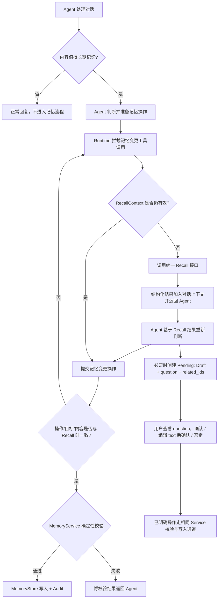
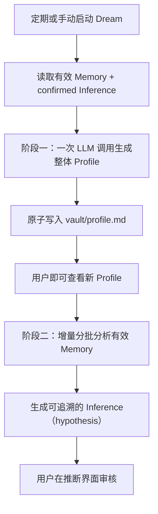

# Syvrio 记忆系统重构：设计决策与架构构想归档

> **日期**：2026-11-18  
> **阶段**：设计讨论；**未实施、未授权修改代码**  
> **仓库**：[Shardkiht/Syvrio](https://github.com/Shardkiht/Syvrio)  
> **关联讨论**：[Issue #30 — 统一记忆字段语义与 Agent 写入决策流程](https://github.com/Shardkiht/Syvrio/issues/30)  
> **定位**：整理截至本次讨论已确定的结论，同时记录架构层面的初步构想和后续待定问题。本文以**本次最新讨论**为准；Issue #30 中部分早期方案已经被修正。

## 0. 阅读约定与范围

文中使用三个标识，避免把设想误认为定稿：

- **[已确定]**：讨论中明确接受的业务定义、模型边界或交互规则。
- **[架构构想]**：方向基本一致，但接口、参数、流程细节尚未审定。
- **[待讨论]**：仍有明显语义边界或实现决策未确定。

本阶段仅将本文档提交至 GitHub 仓库；**不修改 Issue、现有 Vault、历史数据、代码或发布版本**。

## 1. 设计目标与基本原则 [已确定]

1. **Agent LLM 负责语义理解与业务决策**：识别值得记录的长期事实，结合 Recall 判断语义重复、冲突、事实变化与纠错，决定调用哪种记忆工具。
2. **MemoryService 只做确定性校验和可靠执行**：仅拦截能明确证明不合法的操作，不通过相似度阈值等启发式规则猜测两个事实是否矛盾。
3. **Pending 只用于 LLM 无法判断、需要用户确认的情形**：它不是低置信度候选池，也不是 Service 校验失败的兜底队列。
4. **一旦 Agent 决定需要记录某条事实，先 Recall，再决策写入操作**；不要求对每一轮无记忆价值的聊天都检索。
5. **消除二次 LLM 抽取**：Agent 已理解并组织好事实时，`memorize` 不应再接收整段对话并另调 LLM 做一遍抽取。
6. **存储、运行时模型、检索结果分层**：需要持久化的审计与追溯信息可以保留，但不应全部暴露给 LLM 或参与向量/关键词索引。
7. **沿用原有人工审核体验**：用户可确认、只编辑正文后确认或否定 Pending；普通审核不额外调用 LLM。
8. **允许 Agent 主动澄清**：当影响事实内容或操作选择的关键信息不明确时，LLM 可以在当前对话中向用户追问，经过多轮补充后再判断和记录；不为补齐非必要 Context 强制追问，也不把具体场景硬编码成 Service 规则。

> **已废弃的旧方向**：让 MemoryService 在写入前自行按自然语言相似度/冲突阈值复核语义，再用 `confidence`、`kind`、`sensitive` 决定自动入库或 Pending。该方案不再作为目标架构。

## 2. 领域模型 [已确定]

### 2.1 MemoryDraft：待记录事实

```python
class MemoryDraft(BaseModel):
    text: str
    topic: str
    context: MemoryContext | None = None
```

| 字段 | 含义 | 约束 |
|---|---|---|
| `text` | 准备记录的事实正文 | 必填；内容不为空 |
| `topic` | 记忆分类／对应主题文件 | 必填；已有分类优先复用，不存在时可创建；程序校验路径安全 |
| `context` | 事实的可选上下文 | 可为空；参照下文 `MemoryContext` |

- `MemoryDraft` 是准备落盘的**内容模型**，不是带置信度的候选列表。
- **删除旧 Candidate 字段**：`title`、`confidence`、`sensitive`、`kind`、`reason`；不再允许用这些字段驱动下游 `policy` 判定。
- `topic` 已承担分类/文件定位职责，不在 Draft 中额外定义 `title`。
- 来源追溯、创建时间、审计信息由程序维护，不要求 Agent 自行填写。

### 2.2 PendingItem：无法裁决的 Draft

**业务语义：`Pending = MemoryDraft + 待确认问题 + 相关记忆引用`。**

```python
class PendingItem(MemoryDraft):
    question: str
    related_ids: list[str] = Field(default_factory=list)
```

| 新增字段 | 含义 |
|---|---|
| `question` | LLM 无法确定、需要用户确认的问题；展示给用户 |
| `related_ids` | Recall 找到的相关旧记忆 ID；仅供关联，不代表自动覆盖它们 |

- Pending 复用 Draft 的 `text/topic/context`，不另造第二套候选内容结构。
- Pending 的队列 ID、`created_at`、来源引用及处理记录是**队列/持久化层元数据**，不必放到这个业务模型，也无需 LLM 生成。
- Pending **不进入正常记忆 Recall 的事实集合**，`question` 不拼接进正式记忆正文或语义索引。
- 不保留 `confidence`、`sensitive`、`kind` 等旧候选判定字段。
- 采用继承表达概念关系；具体持久化包装格式可按实现需要设计，业务上不重复存储 Draft 字段。

### 2.3 MemoryEntry：已经持久化的事实

```python
class MemoryEntry(MemoryDraft):
    id: str
    status: Literal["active", "deprecated"] = "active"
    recorded_at: datetime
```

- 直接继承 Draft 的三个内容字段，**不重复声明** `text/topic/context`。
- 新增 `id`、`status`、`recorded_at`；它们由程序管理。
- `recorded_at` 表示**何时记录事实**，与 `event_time` / `valid_from` / `valid_to` 的事实时间语义不同。
- `active` 表示记录仍可作为事实使用（可能是历史事实，需结合 Context 判断）；`deprecated` 表示记录已弃用，不再用于正常事实检索，但保留原文与操作审计。
- 删除正式事实模型中的 `confidence`；不将 `supersedes`、`change_kind` 等操作历史塞回 Entry 业务模型。
- `raw_markdown`、文件路径、行号、字段偏移等属于 **Markdown 解析/存储结构**，不是正式记忆的业务内容；具体拆分由实现阶段处理。

### 2.4 MemoryContext：事实上下文 [已确定方向，细节仍需校对]

目标字段：

| 字段 | 语义 |
|---|---|
| `event_time` | 事件发生时间 |
| `valid_from` | 事实开始有效的时间 |
| `valid_to` | 事实有效期结束的时间 |
| `location` | 相关地点 |
| `emotion` | 用户实际表达的情绪 |
| `emotion_at` | 情绪关联的时间语义；此前讨论倾向只标注确实属于事件当时的情绪 |

- 从旧模型中移除 `time_text`、`location_kind`、`emotion_source` 等冗余字段。
- 不把 LLM 猜测出的情绪当作用户事实；时间精度、区间校验应保持明确。
- **Context 只保留记忆形成时的事实语义上下文**；来源分类 `source` 不属于 Context，目标设计中删除该字段，不要求 LLM 或程序为每条 Memory 维护来源类型。

### 2.5 事实与待确认模型关系

```text
MemoryDraft
├─ text
├─ topic
└─ context?
    │
    ├── PendingItem
    │   ├─ question
    │   └─ related_ids[]
    │      + 队列元数据（在队列层维护）
    │
    └── MemoryEntry
        ├─ id
        ├─ status: active | deprecated
        └─ recorded_at
```

> 这是**目标领域模型**，不是当前仓库已落地的实现。GitHub `main` 在归档时仍使用旧 `Candidate`、`Entry`、`Core` 等结构。

### 2.6 Inference：可追溯的推断 [已确定]

Inference 与 MemoryDraft/Pending 分离：它是 LLM 基于既有事实得出的**推断**，即使经用户确认，也不自动变成正式 Memory。

```python
InferenceStatus = Literal["hypothesis", "confirmed", "deprecated"]

class Inference(BaseModel):
    id: str
    text: str
    kind: str
    source_ids: list[str]
    status: InferenceStatus = "hypothesis"
    created_at: datetime
    updated_at: datetime
```

- `kind` 表示**对用户哪一方面的推断**，与 `MemoryDraft.topic` 的动态分类原则一致：LLM 可复用已有类型，也可创建新类型；不采用固定枚举。生成方式 `reflection`/`dream` 和用途 `profile` 不应被强制当作推断分类。
- `source_ids` 必须指向真实 Memory，保留可追溯证据；不使用其他 Inference 作为推断证据，防止假设层层自证。
- `hypothesis` 为未确认假设；`confirmed` 为用户确认、但仍属于推断；`deprecated` 为已弃用。用户否定、改写旧推断、来源失效等情形都可弃用；**具体原因进 Audit**，不单独保留 `rejected/superseded` 状态。
- 来源指纹等确定性证据校验信息继续保留机制，但由存储层维护，不放入给 LLM 的核心业务字段；来源变化可以由程序检测，推断是否在语义上仍然成立不由程序猜测。
- 推断的编辑与审核应沿用已有交互体验；用户确认不会自动写入事实 Markdown。

## 3. Markdown 与数据分层 [已确定方向]

**保留 Vault Markdown 作为长期记忆的事实来源（source of truth）**，保留已有的 `Content / Core / Context / Extensions` 整体框架，但精简职责：

| 存储区域 | 目标职责 | 结论 |
|---|---|---|
| **Content** | 可被理解和检索的事实正文 | 保留 |
| **Core** | 记录身份与生命周期：`id`、`status` | 已确定精简目标 |
| **Context** | 可选的事实语义（时间、地点、情绪等） | 保留；具体字段见 2.4 |
| **Extensions** | `recorded_at` 等必要的程序维护元数据；不保存独立的 `source` 字段，也不要求 Memory 固定保存 `session_id/message_id` | 保留；按实际需要使用，不为来源分类预留字段 |
| **Audit** | 纠错、事实变化、弃用、用户审核等操作过程 | 与事实正文分离 |

**长期数据组织方案**：

| 数据 | 目标存储与用途 | 决策状态 |
|---|---|---|
| Memory | `vault/memories/**/*.md`，按 topic 存事实 | 已确定保持 Markdown |
| Inference | 倾向 `vault/inferences/**/*.md`，按 kind 分类管理推断 | **架构构想**：尚需落实 Schema、状态/证据审计与 JSONL 迁移 |
| Profile | **唯一的** `vault/profile.md`，整体用户画像，允许人工编辑 | **已确定** |
| Sessions / Pending / Audit | 继续用 JSONL 表达对话、审核和操作事件 | 方向保持 |
| Dream 调度与任务进度 | Runtime 的状态/事件数据，不是知识正文 | 架构构想 |

`profile.md` 与 `SOUL.md` 都可作为 LLM 的参考材料，但语义不同：前者描述用户，后者约束助手自身。Profile **不是新的事实来源**，不反向覆盖 Memory/Inference；允许用户直接编辑且下次 Dream 自动重建时覆盖这些编辑，不额外维护保护、合并或锁定区域。

- `topic` 映射主题文件或分类，不必在每条 Markdown Core 中重复存储。
- 原始对话已有 Sessions JSONL；目标 Memory 模型不要求保存 `session_id/message_id` 引用，也不复制完整对话作为 evidence。未来如需回查原始对话，可由程序根据 Memory ID 定位，不要求 LLM 直接处理底层会话/消息 ID。
- 纠错或状态变化由历史记录和事实有效期表达，不能凭 `related_ids` 自动设置任何旧记忆为弃用。
- 不为了精简业务模型而丢弃 Markdown 无损解析能力：源码位置、未知扩展字段、手工编辑内容仍由 Schema/Store 处理。

## 4. Pending 产生条件和用户体验 [已确定]

### 4.1 唯一业务定位

LLM 已判断某项事实具有记忆价值，但在对话和 Recall 结果中**无法确定应怎样处理**，且需要用户作出事实确认时，创建 Pending。

例如：旧记忆是“在 A 公司工作”，新对话提到了“在 B 公司工作”。不能仅据此确定是跳槽、兼职、曾经任职还是旧记忆错误。LLM 可先生成暂定 Draft，并提出：

> 你目前仍在 A 公司工作，还是已经离职并加入 B 公司？

这里 `related_ids` 只是把相关事实联系起来，**不等于自动弃用/修改旧条目**。

### 4.2 Pending 工具描述中的使用引导

不额外增加复杂的全局 System Prompt 规则；将具体引导写入 **Pending 工具自身的 description**：

- Pending 用于把已经整理出的 Draft 和待确认问题交给用户后续审核，**不是 Agent 遇到歧义时立即调用的提问工具**。
- 当事实或操作存在关键歧义，且有机会通过当前对话解决时，Agent 应先直接向用户追问；必要时可以多轮澄清，再结合回答和 Recall 结果决定是否记录及调用哪个工具。
- 只有当前对话仍无法解决、且确实需要用户延后确认/审核时，才创建 Pending。
- 不为补齐非关键 Context 而强制追问，也不把每个不确定情况都转成 Pending。
- 仍无法判断时，不猜测、不擅自修改旧记忆；可以暂不记录，或在确有后续确认价值时创建 Pending。

这只是工具描述中的行为指引，不新增工具、状态字段、对话管理机制或额外架构层。

### 4.3 保持现有审核方式

| 用户动作 | 结果 | 默认是否再调用 LLM |
|---|---|---|
| **确认** | 接受当前 `text`，执行相应已明确的写入操作，并走 Service 确定性校验 | 否 |
| **编辑后确认** | 用户仅修改 `text`，采用修改后的正文，继续确定性校验 | 否 |
| **否定** | 拒绝并关闭该 Pending；保留必要处理记录 | 否 |

- UI **展示 `question`**，并提供 **仅 `text` 的编辑入口**；`topic/context` 不必向用户呈现复杂表单。
- 修改正文时不应无条件沿用与新正文不再匹配的 Context；如何清除或检查受影响字段，见待讨论项。
- 审批状态及队列 ID、时间、来源应由 PendingQueue 等持久化机制管理，不额外污染 Draft。
- **Service 校验失败不自动转 Pending**；确定性错误直接返回错误。
- 若用户提供了需要进一步语义理解的新信息（而非单纯确认/编辑），可交由 Agent 再判断；**正常审批不默认进行第二次 LLM 调用**。

### 4.4 必须守住的语义边界

- **确认一条新事实 ≠ 确认覆盖任何已有事实。**
- Pending 如果涉及 `transition` / `correct`，具体操作及目标必须足够明确；目前“队列项只存 Draft + question + related_ids”如何承载待执行意图，**仍待设计**。在解决前不可把审批实现为盲目新增后自动替代旧记录。
- 不因内容编辑而默认让旧的目标引用、时间上下文或操作意图继续有效。

## 5. Agent / Recall / MemoryService 职责 [已确定]

| 组件 | 应负责 | 不应负责 |
|---|---|---|
| **Agent LLM** | 判断记忆价值、事实提炼、语义重复/冲突、变化/纠错、是否需要用户确认；选择工具 | 直接修改 Vault；自评置信度作为写入依据 |
| **Agent Runtime** | 拦截所有记忆变更工具调用，确保执行前已有有效 Recall；维护 RecallContext；必要时直接调用统一 Recall 接口并把结果交回 Agent | 替 Agent 判断事实之间的语义关系 |
| **Recall** | 提供唯一的记忆检索接口，返回结构化事实及必要 ID/Context | 决定事实之间的业务关系 |
| **MemoryService** | 确定性参数/状态/凭据/并发约束，协调可靠写入 | 自己推断语义冲突、根据阈值决定 Pending、重复调用 LLM 提取 |
| **MemoryStore / Schema** | Markdown 无损解析、路径校验、持久化、身份和状态修改 | 记忆价值判断或语义裁决 |
| **PendingQueue** | Pending 的创建、取回、确认/拒绝及处理记录 | 对自然语言进行二次理解 |
| **Audit** | 记录操作历史以便追溯 | 替代事实正文或承担 Recall 语义检索 |

**确定性校验举例**：

- ID 不存在、目标记录状态不允许操作；
- `topic` 路径不合法、字段格式或事实有效时间区间不合法；
- 内容包含 API Key、密码、Token、私钥等凭据；
- 完全相同的写入请求在幂等规则下已执行（此处不是**语义**去重）；
- Recall 后目标记录已被其他写入修改，导致操作基于过期状态；
- 存储和审计不能保证一组写入原子完成。

**不能靠简单规则擅自决定的内容**：

- “用户喜欢咖啡”与“用户喜欢清爽中烘咖啡”是否应合并；
- “目前在 A 公司”“现在在 B 公司”是否必然冲突；
- 新说法是事实变化还是旧事实错误；
- 相似度/覆盖率低是否代表不能保存。

**安全策略 [已确定]**：只限制记忆存储中的敏感**凭据**（密码、密钥、Token、私钥等）；普通个人事实如姓名、住址、健康、收入等，不因“敏感信息”标签被额外拒绝。仍需遵循 Vault 的私有边界，不得意外公开。

## 6. 目标架构与操作流 [架构构想]

### 6.1 Agent 主路径



- 这是**逻辑职责流**，不是规定所有入口都必须生成完全相同的执行栈。
- **所有记忆变更操作**都必须经过 Runtime 的前置 Recall 检查；不能依赖系统提示词保证 Agent 一定主动调用 Recall。
- 如果没有可复用的有效 RecallContext，Runtime 在执行变更工具前拦截调用，直接调用统一 Recall 接口，并把结果交回 Agent；Agent 结合结果重新判断后再提交操作。
- 如果操作类型、目标或内容发生变化，必须重新 Recall；操作与目标内容未变、证据未变化且上下文未压缩时，复用已有 Recall，一次即可。
- LLM 主动调用 Recall 与 Runtime 自动 Recall 共用同一个接口和结果格式；两者不需要额外的触发来源参数或独立 Recall Tool Handler。
- 确认/编辑等普通 Pending 操作默认不再调用 LLM；用户新回答一个语义问题可能触发一次新的 Agent 解释。
- Recall 未命中不代表 Vault 中绝对不存在相关记忆；用检索质量评测优化，而不是让 Service 再开发一套自然语言理解规则。
### 6.2 各层的拟议边界

```text
App / Agent / Tools / CLI / TUI / Web / MCP
  ├─ Agent：提取事实、判断语义、选择记忆操作
  └─ Pending 审核 UI：question 只读展示，text 可编辑
          ↓
Agent Runtime
  ├─ Tool-call interception：拦截每个记忆变更操作
  ├─ RecallContext：保存本轮 Recall 的有效性元数据
  └─ Recall：显式工具调用或 Runtime 直接调用同一个接口
          ↓
Application / MemoryService（确定性用例、参数、并发、状态）
  ├─ MemoryStore + Markdown Schema（原文无损读写）
  ├─ Retrieval（关键词 / 向量 / 混合）
  ├─ PendingQueue（持久化待确认项）
  └─ Audit / Sessions（操作历史与来源回溯）
```

建议的边界调整（均未进入实施）：

- **`extract_candidates()`**：从正常 `memorize()` 链路移出；非对话的导入/后台沉淀另行决定如何利用同一套 Draft 语义。
- **`_adjudicate()` / `policy.decide()`**：移除基于 `kind` / `confidence` / `sensitive` 的旧裁决；能复用的确定性安全检查下沉到共用写入通道。
- **`find_conflicts()`**：不再作为阻断新增的通用语义阈值裁决；真正的关系判断由 Agent 基于 Recall 完成。
- **`manual_add()`、`approve()` 和其他入口**：不再绕过统一的确定性验证、状态约束与审计。
- 对同一 Vault 的写入保持可恢复性，避免事实文件、状态及审计只完成一部分。

### 6.3 工具词汇与事实生命周期

讨论中的主要工具：

| 工具 | 目标语义 | 状态 |
|---|---|---|
| `recall` | 读取相关事实及必要 ID | 已确定保留 |
| `memorize` | 添加新长期事实 | 已确定保留；目标参数改为已整理的 Draft |
| `transition` | 真实世界中的状态变化，保留历史时间关系 | 已确定采用此命名，替代 `evolve` |
| `correct` | 原事实错误；保留新事实，弃用错误旧记录 | 已确定保留 |
| `forget` | 用户要求不再使用相关记忆 | 工具保留方向，彻底删除还是逻辑弃用的边界待审 |

事实变化和纠错**不是同一件事**：

- **事实变化**：旧事实以前成立，新事实后来成立；可通过 `valid_from/valid_to` 表述，两者在历史意义上都可能 `active`。
- **纠错**：旧事实本来就不正确；将错误记录设为 `deprecated`，新事实独立保存，保留审计。
- **冲突**：是 Agent 对证据关系的判断或未确定的状态，不预设要额外开发一个 `conflict` 工具。

## 7. Recall 接口、结果与上下文管理 [已确定]

### 7.1 统一 Recall 接口与调用方式

Recall 只有一套应用接口，供两种调用方式复用：

- **LLM 主动 Recall**：通过 Agent 暴露的 Recall 工具调用该接口。
- **Runtime 自动 Recall**：Runtime 拦截记忆变更工具调用后，程序直接调用同一个 Recall 接口。

两者使用相同的请求参数、检索实现和结构化结果。**不增加独立的 Recall Tool Handler，也不增加用于区分触发来源的参数**；Runtime 的职责是前置拦截和状态管理，不是再包装一层 Recall 业务接口。

Recall 请求参数：

| 参数 | 必需 | 默认值 | 语义 |
|---|---|---|---|
| **query** | 是 | — | 检索所需的语义查询 |
| **limit** | 否 | **7** | 最多返回的记忆条数 |
| **time_range** | 否 | — | 一个时间区间，用于按事实发生时间或有效期筛选 |
| **location** | 否 | — | 地点筛选条件 |
| **emotion** | 否 | — | 情绪筛选条件 |

- 删除 **view** 参数，不再提供多种 Recall 视图。
- 时间筛选只接收一个 **time_range**，不再把多个时间字段暴露成独立请求参数。
- **time_range** 命中规则：**event_time** 落在查询区间内，或记忆的 **valid_from/valid_to** 有效区间与查询区间重叠。
- **recorded_at** 表示记录写入时间，不参与 **time_range** 过滤；它不代表事实发生或有效时间。
- 时间区间的具体序列化形式及边界精度在实现阶段确定，不在本次设计中额外扩展参数。

### 7.2 结构化结果与 MemoryDraft 复用

Recall 返回结构化数据，不再把 Markdown 原文作为正常工具结果交给 LLM，也不为 Recall 重新设计一套重复的事实字段模型。

**RecallEntry 复用 MemoryDraft，并只增加 id 与 status：**

```python
class RecallEntry(MemoryDraft):
    id: str
    status: Literal["active", "deprecated"]
```

其中 MemoryDraft 已定义 **text**、**topic**、**context**；RecallEntry 只补充已持久化记录的 **id** 与 **status**。

**返回范围：Core + Context 全部返回，Extensions 不返回。**

- Core：返回全部核心字段，包括 **id**、**status**。
- 内容字段：复用 Draft 的 **text**、**topic**。
- Context：当前定义的 Context 字段全部返回，包括 **event_time**、**valid_from**、**valid_to**、**location**、**emotion**、**emotion_at**；字段不存在时按可选字段处理。
- Extensions：不返回，包括 **recorded_at** 及其他程序维护的内部元数据；目标设计不要求在 Memory 中保存或向 LLM 暴露 `session_id/message_id`。
- 检索分数、Markdown 原文、文件路径、行号、Audit 和 Pending 队列信息也不属于 RecallEntry，不放入正常 Recall 结果。

Recall 不调用 LLM 对存储内容进行二次提取或改写；只将已有 MemoryEntry 的 Core 与 Context 提取为上述结构化结果。

### 7.3 原始对话查阅工具 [架构构想]

未来如需让 Agent 核实某条记忆的原始对话依据，可考虑增加一个独立的查阅工具：

```python
def read_memory_source(memory_id: str) -> ToolResult:
    ...
```

- LLM 只传入 Recall 已返回的 `memory_id`；不需要知道或传入 `session_id`、`message_id`。
- 由程序根据 Memory ID 自行定位可能相关的 Session / Message，再读取原始对话。
- 不要求 Memory Extensions 保存固定的会话/消息引用；可研究基于记忆正文、时间等信息检索原始会话的方式。
- 具体定位算法、匹配可靠性及歧义处理留待真正需要时设计；当前仓库没有面向 Agent 的原始会话/消息查阅工具，本构想不代表立即新增工具。

### 7.4 RecallContext 与强制前置 Recall

**RecallContext** 是 Agent Runtime 内部的运行时状态类，**不是记忆内容，也不是对话上下文本身**。它用于判断当前操作是否仍可复用之前的 Recall 结果。

目标记录的信息：

| 字段 | 用途 |
|---|---|
| **operation** | Recall 对应的记忆操作类型 |
| **target_id** | 操作目标记录 ID |
| **payload_hash** | 操作内容的指纹 |
| **evidence_version** | Recall 所依据的记忆证据版本 |
| **context_generation** | 对话上下文代次，用于识别上下文压缩 |

复用与失效规则：

- 操作类型、目标、操作内容均未变化，证据版本未变化，且上下文代次未变化时，复用已有 Recall。
- 操作类型、目标或操作内容变化时，原 Recall 不再适用于新操作，必须重新 Recall。
- Recall 之后相关记忆证据发生变化时，必须重新 Recall。
- 对话上下文发生压缩时，当前 RecallContext 失效，后续记忆变更操作必须重新 Recall。

**Recall 结果与 RecallContext 分开管理：**

- Recall 的结构化结果直接加入 Agent 对话上下文，供 LLM 理解和决策；不是只存放在一个对 LLM 不可见的独立缓存中。
- RecallContext 只保存用于判断结果能否复用的元数据，不复制或替代 Recall 事实内容。
- 上下文压缩时，Recall 结果随对话上下文一起处理；但压缩会使 RecallContext 失效，不能继续把压缩前的 Recall 当作当前操作的有效证据。

### 7.5 Recall 上下文预算与检索文本

Recall 结果会占用 Agent 上下文，因此需要受上下文预算约束。默认 **limit=7** 是条数上限；实际返回还需要考虑上下文容量，避免一次 Recall 填入过多内容。具体 Token 预算、排序和裁剪策略留待实现审查，不在此处增加额外参数。

当前 **Entry.index_text** 会拼入大量 Context/Extensions 字段并采用**排除名单**过滤内部元数据。建议改为**允许名单**：只纳入 **text** 和明确具有语义检索价值的 Context 字段，扩展元数据默认不索引。这样新增 Extensions 字段也不会意外污染向量或关键词内容。

不要为减少上下文而丢掉持久化元数据本身；持久化结构与交给 LLM 的 Recall 投影是两回事。
## 8. 统一 Dream：先 Profile，后 Inference [已确定方向，执行细节待定]

### 8.1 一个 Dream 入口与调度器

**Dream 是后台长期记忆整理任务**，不再将 `profile` 和 `dream` 设计成两套独立的定时/手动流程。自动按周期及数据变化触发，也保留一次手动启动完整 Dream 的入口；具体触发条件、频率和请求预算待实现审查。



### 8.2 Profile 阶段：优先快速完成 [已确定]

- 每次更新**原则上只调用一次 LLM**，输入为有效 Memory 与已确认 Inference；使用更紧凑的输入和输出 Token 预算，优先得到可用画像，具体超长内容选择策略待定。
- 输出为一份完整的 `vault/profile.md`，生成成功即原子替换；用户无需等 Inference 阶段结束，就可以看到更新。
- Profile 可被用户直接编辑；下一次 Dream 可以重建并覆盖人工修改，不实现人工片段的合并/锁定。Profile 只作上下文参考（按 Token 预算注入），不作为 Memory/Inference 的事实证据。
- **前端 Profile 只读展示**现有 `profile.md`；不设独立的 Profile 手动刷新或生成按钮，打开页面不触发 LLM。原 `profile-summary.json` 不再作为目标最终产物，可由 Profile Markdown 取代。

### 8.3 Inference 阶段：后台增量生成 [已确定方向]

- Profile 写入完成后，再对有效 Memory **按批次**进行推断；可能多次调用 LLM，输出带 `kind/source_ids` 的 `Inference(status=hypothesis)`，不自动转为事实。
- 用户仍能在推断审核界面确认、修改或弃用推断；手动 Dream 触发可整合在该入口，无需单独复杂的 Dream 页面。
- 本轮新生成的假设不立即纳入刚生成的 Profile；仅已确认推断在**下一次 Dream** 被纳入画像，避免为了追新结果重复调用 Profile LLM。
- Profile 已成功但推断阶段失败/取消时，**保留已生成的 Profile**；阶段进度分别保存，下次从未完成的增量批次继续，不无谓重复生成 Profile。

### 8.4 计划中的架构收敛 [架构构想]

- 当前 `ReflectionEngine` 的 `profile/dream` 双模式（画像推断与反思推断）收敛成单一 Dream 流程：先画像后推断。
- 统一 Dream Scheduler，去掉 Profile 独立调度；保留增量变化检测、取消、冷却、预算、失败退避和恢复，但不要求沿用现有具体实现。
- 原 ProfileItem/画像推断列表、运行时画像摘要缓存与相关前端入口应随新方案重新审查，避免产生第二份长期画像或重复审核路径。
- LLM 输出的推断分类改为动态 `kind`，不再用 `kind=profile/reflection` 表示生成模式。

## 9. 历史数据与实现约束 [已确定原则 / 待细化]

- 现有仓库仍使用 `Candidate`、旧 `Entry`、`Core.source/confidence`、`active/superseded/deleted`、基于阈值的 `policy` 和旧 Pending 审批逻辑；**本文描述的是目标设计，并不声称已实现**。
- 旧 Vault 数据无需通过永久兼容层长期维护，但**改动持久化 Schema 前必须备份、显式迁移、验证**，包括 Pending JSONL、正式 Markdown、Inference 旧 JSONL（如实施 MD 迁移）、历史状态与索引重建。
- 不得使用、上传或提交真实私有 Vault 资料；实现与自动化验证应以隔离的合成 Vault 为主。
- 检索索引、缓存视作可重建派生数据；**Memory 与 Inference 的原文/人工编辑**不得因迁移或无关后台任务被覆盖。**例外：Profile 已明确允许 Dream 定期整体重建并覆盖人工修改。**
- Draft 字段删减必须同步调整所有 Service 参数验证、导入器、工具 Schema、Pending 审核、存储、前端 UI 与测试，不能只修改 Pydantic 类。
- 在设计讨论结束、明确授权以前，**不提交或推送实现代码、不发版，也不编辑 Issue #30**；本文档的归档提交不代表实施授权。

## 10. 尚未定稿的问题清单 [待讨论]

| 优先级 | 问题 | 已知边界 |
|---|---|---|
| 高 | **MemoryService 的统一写入 API** | Service 仅确定性校验；如何组织 `memorize/transition/correct/forget` 的具体命令与返回结果未定 |
| 高 | **Pending 审批与原计划操作的映射** | `Draft + question + related_ids` 已确定为最小业务内容；但若涉及旧记录变化/纠错，如何保留明确且安全的操作意图尚未定 |
| 中 | **Recall 上下文预算与检索质量** | 参数、结果结构和 RecallContext 已确定；Token 预算、排序与检索质量仍需结合评测确定 |
| 高 | **`transition` 的时间处理与历史事实检索** | 不猜生效日期、区分纠错；部分日期/区间精度和有效期更新规则待明确 |
| 中 | **修改 Pending.text 后的 Context 处理** | 不能盲目沿用可能失效的旧 Context；是清除全部还是只清除受影响字段，未定 |
| 低 | **原始对话查阅工具** | 仅作为后续构想：工具接收 `memory_id`，由程序定位相关 Session / Message；具体检索算法与歧义处理待需要时设计，当前不实施 |
| 中 | **`forget` 与 `deprecated` 的边界** | 逻辑弃用和真正删除、隐私要求及 Git/审计留痕的关系，未定 |
| 中 | **Inference 证据失效及审计的实现** | 三态已定为 `hypothesis/confirmed/deprecated`；来源变更触发弃用及原因记录、指纹机制细节待定 |
| 中 | **导入、后台沉淀等非实时 Agent 入口** | 不能继续走旧二次抽取 + 阈值裁决；是否使用单独 Agent/提取流程及如何共享校验，未定 |
| 中 | **Inference Markdown 存储与迁移** | 当前依赖 JSONL 追加式状态快照；如改 MD，须确保状态审计、证据校验、原始数据迁移不丢失 |
| 中 | **Dream 增量调度和阶段恢复** | 先 Profile 后 Inference、统一入口已定；更新时间、批次边界、失败续跑及预算未定 |
| 中 | **Profile 单次调用的上下文预算** | 有效 Memory + confirmed Inference 为输入；规模超出窗口时如何挑选、压缩仍待设计 |
| 中 | **扩展字段与检索允许名单** | 原始字段应能保留；哪些 Context 进入索引、是否按检索类型不同配置，未定 |
| 低 | **Python 继承与队列持久化包装细节** | 目标模型语义已确定，具体文件组织/序列化结构可实现时决定 |
| 低 | **迁移发布顺序与旧 JSONL 状态映射** | 必须有备份与验证，不默认旧状态可一一等价映射 |

## 11. 后续设计审查顺序 [建议]

1. **MemoryService 用例与工具接口**：统一确定性校验、写入事务和错误返回。
2. **Pending 确认的操作语义**：保持三种 UI 操作，同时保证不会误覆盖旧事实。
3. **transition / correct / forget 的状态边界与时间语义**。
4. **Recall 的检索质量与上下文预算**：在已确定的参数、结果结构和 RecallContext 之上，审查排序、Token 预算与评测。
5. **非 Agent 入口、Dream 调度、Inference Markdown 与迁移/验收方案**。

---

### 决策摘要

**已确定**：`MemoryDraft(text, topic, context?)`；`PendingItem = Draft + question + related_ids`（队列元数据另存）；`MemoryEntry = Draft + id + status + recorded_at`；`status = active/deprecated`；Core `id/status`；Markdown Content/Core/Context/Extensions 分层；Agent 主导语义判断；Service 只做确定性校验；Recall 是有记忆意图时的前置步骤；Pending 仅用于 Agent 无法判断的情况；用户确认/仅编辑 text 后确认/否定；普通审批不再额外调用 LLM；程序只阻止凭据写入长期记忆。

**本轮新增已确定**：Inference 独立于事实，`kind` 对应用户推断领域、动态复用/新建，`status=hypothesis/confirmed/deprecated`；单个 `vault/profile.md` 定期由有效 Memory + confirmed Inference 重建，允许编辑并被下一次更新覆盖；Profile 作为 LLM 上下文参考，不反向写回事实；Dream 统一调度，**先一次调用生成 Profile，再分批生成 Inference**；Profile 前端只读展示，无独立刷新；Dream 支持自动与手动触发，阶段成功独立保留。

**本轮 Recall 决策已确定**：统一 Recall 应用接口，Runtime 自动 Recall 直接调用该接口，LLM 通过工具调用同一接口；所有记忆变更工具调用由 Runtime 拦截并强制检查 Recall，操作类型/目标/内容变化或证据变化、上下文压缩后重新 Recall，其他情况复用；请求参数为 `query`（必填）、`limit`（默认 7）、`time_range`、`location`、`emotion`，删除 `view`；`time_range` 按 `event_time` 或有效期重叠过滤，不使用 `recorded_at`；Recall 返回结构化 `RecallEntry(MemoryDraft)`，Core + Context 全部返回，Extensions 不返回；Recall 结果加入对话上下文，`RecallContext` 只保存操作、目标、内容指纹、证据版本和上下文代次等复用元数据。

**本轮新增决定**：删除独立的 `source` 字段；目标 Memory 不要求保存或向 LLM 暴露 `session_id/message_id`。原始对话查阅仅作为后续构想：未来工具接收 `memory_id`，由程序自行定位相关 Session / Message；当前不新增工具，具体检索方式待实际需要时设计。

**构想但未定稿**：Inference 改为 Markdown 的具体存储/审计实现，Dream 阶段续跑与调度参数、Profile 输入预算、具体工具参数与服务流程、Pending 审批的操作目标、安全的 Recall 追踪机制、编辑正文后的 Context 处理、真实数据迁移策略及检索视图细节。