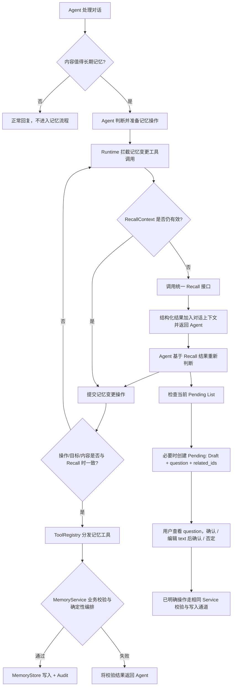
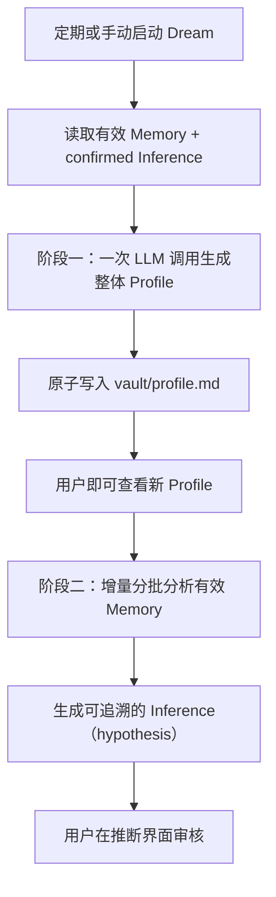

# Syvrio 记忆系统重构：设计决策与架构构想归档

> **日期**：2026-11-18；**最近同步**：2026-11-19  
> **阶段**：设计讨论；**未实施、未授权修改代码**  
> **仓库**：[Shardkiht/Syvrio](https://github.com/Shardkiht/Syvrio)  
> **关联讨论**：[Issue #30 — 统一记忆字段语义与 Agent 写入决策流程](https://github.com/Shardkiht/Syvrio/issues/30)  
> **定位**：整理截至本次讨论已确定的结论，同时记录架构层面的初步构想和后续待定问题。本文以**本次最新讨论**为准；Issue #30 中部分早期方案已经被修正。

## 0. 阅读约定与范围

文中使用三个标识，避免把设想误认为定稿：

- **[已确定]**：讨论中明确接受的业务定义、模型边界或交互规则。
- **[架构构想]**：方向基本一致，但接口、参数、流程细节尚未审定。
- **[待讨论]**：仍有明显语义边界或实现决策未确定。

本阶段仅将本文档提交至 GitHub 仓库；**不修改 Issue、现有 Vault、历史数据、代码或发布版本**。

## 1. 设计目标与基本原则 [已确定]

1. **Agent LLM 负责语义理解与业务决策**：识别值得记录的长期事实，结合 Recall 判断语义重复、冲突、事实变化与纠错，决定调用哪种记忆工具。
2. **MemoryService 集中实现记忆工具业务**：负责 `memorize/transition/correct/deprecate` 等具体工具方法的业务参数校验、确定性操作编排与可靠执行；只拒绝能够确定不合法的操作，不通过相似度阈值猜测自然语言事实之间是否冲突。
3. **Pending 只用于 LLM 无法判断、需要用户确认的情形**：它不是低置信度候选池，也不是 Service 校验失败的兜底队列。
4. **一旦 Agent 决定需要记录某条事实，先 Recall，再决策写入操作**；不要求对每一轮无记忆价值的聊天都检索。
5. **消除二次 LLM 抽取**：Agent 已理解并组织好事实时，`memorize` 不应再接收整段对话并另调 LLM 做一遍抽取。
6. **存储、运行时模型、检索结果分层**：需要持久化的审计与追溯信息可以保留，但不应全部暴露给 LLM 或参与向量/关键词索引。
7. **沿用原有人工审核体验**：用户可确认、只编辑正文后确认或否定 Pending；普通审核不额外调用 LLM。
8. **允许 Agent 主动澄清**：当影响事实内容或操作选择的关键信息不明确时，LLM 可以在当前对话中向用户追问，经过多轮补充后再判断和记录；不为补齐非必要 Context 强制追问，也不把具体场景硬编码成 Service 规则。
9. **Pending 创建前检查**：强制 Memory Recall + Pending List 检查；Confirmed Inference 仅作可选参考，不自动拒写。
10. **Memory 不物理删除**：即使错误记忆也有历史价值；只标记为 `deprecated`，不设计硬删除能力。
11. **历史保留区分对象**：Memory 保留旧事实，Inference 不维护完整编辑版本史；Pending 审核历史范围尚需讨论。

> **已废弃的旧方向**：让 MemoryService 在写入前自行按自然语言相似度/冲突阈值复核语义，再用 `confidence`、`kind`、`sensitive` 决定自动入库或 Pending。该方案不再作为目标架构。

## 2. 领域模型 [已确定]

### 2.1 MemoryDraft：待记录事实

```python
class MemoryDraft(BaseModel):
    text: str
    topic: str
    context: MemoryContext | None = None
```

| 字段 | 含义 | 约束 |
|---|---|---|
| `text` | 准备记录的事实正文 | 必填；内容不为空 |
| `topic` | 记忆分类／对应主题文件 | 必填；已有分类优先复用，不存在时可创建；程序校验路径安全 |
| `context` | 事实的可选上下文 | 可为空；参照下文 `MemoryContext` |

- `MemoryDraft` 是准备落盘的**内容模型**，不是带置信度的候选列表。
- **删除旧 Candidate 字段**：`title`、`confidence`、`sensitive`、`kind`、`reason`；不再允许用这些字段驱动下游 `policy` 判定。
- `topic` 已承担分类/文件定位职责，不在 Draft 中额外定义 `title`。
- 来源追溯、创建时间、审计信息由程序维护，不要求 Agent 自行填写。

### 2.2 PendingItem：无法裁决的 Draft

**业务语义：`Pending = MemoryDraft + 待确认问题 + 相关记忆引用`。**

```python
class PendingItem(MemoryDraft):
    question: str
    related_ids: list[str] = Field(default_factory=list)
```

| 新增字段 | 含义 |
|---|---|
| `question` | LLM 无法确定、需要用户确认的问题；展示给用户 |
| `related_ids` | Recall 找到的相关旧记忆 ID；仅供关联，不代表自动覆盖它们 |

- Pending 复用 Draft 的 `text/topic/context`，不另造第二套候选内容结构。
- Pending 的队列 ID、`created_at`、来源引用及处理记录是**队列/持久化层元数据**，不必放到这个业务模型，也无需 LLM 生成。
- Pending **不进入正常记忆 Recall 的事实集合**，`question` 不拼接进正式记忆正文或语义索引。
- 不保留 `confidence`、`sensitive`、`kind` 等旧候选判定字段。
- 采用继承表达概念关系；具体持久化包装格式可按实现需要设计，业务上不重复存储 Draft 字段。

### 2.3 MemoryEntry：已经持久化的事实

```python
class MemoryEntry(MemoryDraft):
    id: str
    status: Literal["active", "deprecated"] = "active"
    recorded_at: datetime
```

- 直接继承 Draft 的三个内容字段，**不重复声明** `text/topic/context`。
- 新增 `id`、`status`、`recorded_at`；它们由程序管理。
- `recorded_at` 表示**何时记录事实**，与 `event_time` / `valid_from` / `valid_to` 的事实时间语义不同。
- `active` 表示记录仍可作为事实使用（可能是历史事实，需结合 Context 判断）；`deprecated` 表示记录已弃用，不再用于正常事实检索，但保留原文与必要审计。**不提供物理删除**，错误记忆仍可用于追溯纠错。
- 删除正式事实模型中的 `confidence`；不将 `supersedes`、`change_kind` 等操作历史塞回 Entry 业务模型。
- `raw_markdown`、文件路径、行号、字段偏移等属于 **Markdown 解析/存储结构**，不是正式记忆的业务内容；具体拆分由实现阶段处理。

### 2.4 MemoryContext：事实上下文 [已确定方向，细节仍需校对]

目标字段：

| 字段 | 语义 |
|---|---|
| `event_time` | 事件发生时间 |
| `valid_from` | 事实开始有效的时间 |
| `valid_to` | 事实有效期结束的时间 |
| `location` | 相关地点 |
| `emotion` | 用户实际表达的情绪 |
| `emotion_at` | 情绪关联的时间语义；此前讨论倾向只标注确实属于事件当时的情绪 |

- 从旧模型中移除 `time_text`、`location_kind`、`emotion_source` 等冗余字段。
- 不把 LLM 猜测出的情绪当作用户事实；时间精度、区间校验应保持明确。
- **Context 只保留记忆形成时的事实语义上下文**；来源分类 `source` 不属于 Context，目标设计中删除该字段，不要求 LLM 或程序为每条 Memory 维护来源类型。

### 2.5 事实与待确认模型关系

```text
MemoryDraft
├─ text
├─ topic
└─ context?
    │
    ├── PendingItem
    │   ├─ question
    │   └─ related_ids[]
    │      + 队列元数据（在队列层维护）
    │
    └── MemoryEntry
        ├─ id
        ├─ status: active | deprecated
        └─ recorded_at
```

> 这是**目标领域模型**，不是当前仓库已落地的实现。GitHub `main` 在归档时仍使用旧 `Candidate`、`Entry`、`Core` 等结构。

### 2.6 Inference：可追溯的推断 [已确定]

Inference 与 MemoryDraft/Pending 分离：它是 LLM 基于既有事实得出的**推断**，即使经用户确认，也不自动变成正式 Memory。

```python
InferenceStatus = Literal["hypothesis", "confirmed", "deprecated"]

class Inference(BaseModel):
    id: str
    text: str
    kind: str
    source_ids: list[str]
    status: InferenceStatus = "hypothesis"
    created_at: datetime
    updated_at: datetime
```

- `kind` 表示**对用户哪一方面的推断**，与 `MemoryDraft.topic` 的动态分类原则一致：LLM 可复用已有类型，也可创建新类型；不采用固定枚举。生成方式 `reflection`/`dream` 和用途 `profile` 不应被强制当作推断分类。
- `source_ids` 必须指向真实 Memory，保留可追溯证据；不使用其他 Inference 作为推断证据，防止假设层层自证。
- `hypothesis` 为未确认假设；`confirmed` 为用户确认、但仍属于推断；`deprecated` 为已弃用。用户否定、改写旧推断、来源失效等情形都可弃用；**具体原因进 Audit**，不单独保留 `rejected/superseded` 状态。
- 来源指纹等确定性证据校验信息继续保留机制，但由存储层维护，不放入给 LLM 的核心业务字段；来源变化可以由程序检测，推断是否在语义上仍然成立不由程序猜测。
- 推断的编辑与审核应沿用已有交互体验；用户确认不会自动写入事实 Markdown。
- **Inference 不保留每次编辑的完整历史正文版本**：Markdown 保存最新正文与状态；弃用时保留最后内容。必要操作可审计，但不要求 before/after 全文快照。

## 3. Markdown 与数据分层 [已确定方向]

**Memory、Pending、Inference 全部使用 Markdown**，复用 Content / Core / Context / Extensions 的组织思路，但三者 Schema 不必完全相同；原始 Session 与 Audit 属于追加式事件，继续使用 JSONL。

| 存储区域 | 职责 | 约束 |
|---|---|---|
| **Content** | 正文 | Memory 是事实，Pending 是待确认 Draft，Inference 是推断 |
| **Core** | ID、当前状态等 | Memory Core 仅含 `id/status`；其他类型按自身语义 |
| **Context** | 时间、地点、情绪等可选事实语义 | Memory 与 Pending 的 Draft 复用 |
| **Extensions** | `recorded_at`、真实来源关联等程序元数据 | 会话衍生 Memory 必存 `session_id/message_id`；不保存独立 `source` |
| **Audit** | 追加式操作/审计事件 | 可继续 JSONL；不同对象的必要历史粒度另行决定 |

| 数据 | 目标位置/用途 | 结论 |
|---|---|---|
| Memory | `vault/memories/**/*.md`；按 topic 分类 | 已确定 |
| Inference | `vault/inferences/**/*.md`；按 kind 分类 | Markdown 已确定，文件粒度实现时决定 |
| Pending | `vault/pending/**/*.md`；可编辑正文与审核状态 | Markdown 已确定，处理完成后的保留方式待定 |
| Profile | 唯一 `vault/profile.md`；下次 Dream 可覆盖人工修改 | 已确定 |
| Sessions | 原始消息与 `distilled/up_to` 等事件 | JSONL |
| Audit | 操作事件与必要审计 | JSONL；不强制存完整推断版本快照 |
| Dream 调度与进度 | Runtime 状态/事件数据，不是知识正文 | 实现细节待定 |

**类型识别 [暂定方案，已接受]**：目录区分三类 Markdown；文件**一级标题显式标记类型**，例如 `# Memory · Career`、`# Inference · Preferences`、`# Pending · Review`。具体标题格式不强制；程序以路径/Schema 判断类型，不依赖可编辑标题。同一文件可容纳多条记录，不要求一条一文件。

**来源与数据边界 [已确定]**：

- 前台 Agent 对话和后台 Session 沉淀生成的 Memory，**必须在 Extensions 中关联真实 `session_id`、`message_id`**；外部导入不强制要求这两个 ID。它们不由 LLM 自行编造。
- `distilled/up_to` 是后台处理进度游标，**不能代替每条 Memory 的原始消息 ID**；由 Runtime 负责将批量沉淀结果逐条关联到原始消息，再把可信来源交给 Service。具体关联与传递机制属于实现阶段的验证重点。
- 原始对话保存在 Sessions JSONL，不复制全文进 Memory；可据来源 ID 回查。Extensions **不参与 BM25、向量索引、正常 Recall 或 `read_topic` 的 LLM 返回**。
- 不设置独立 `source` 类型字段，不把写入来源和纠错/审核操作混为一个字段。
- Memory 历史变化与错误记录继续保留；Inference 可维护当前正文/状态而不保留完整版本史；Pending 拒绝后正文是否留存尚待定。
- `topic` 负责主题文件定位，不必在每条 Markdown Core 中重复存储；Schema/Store 仍需无损保留手工编辑与未知扩展字段。
- `profile.md` 与 `SOUL.md` 分别是用户画像和助手约束；Profile 不反向覆盖 Memory/Inference。纠错、变更和弃用不能凭 `related_ids` 自动覆盖旧 Memory。

## 4. Pending 产生条件和用户体验 [已确定方向，Context 编辑待讨论]

### 4.1 唯一业务定位

Agent 认为某项信息值得记忆，但经过 Recall 和当前对话澄清仍无法确定事实内容或处理方式，且有延后人工确认价值时，才创建 Pending。Pending **不是低置信度候选池**，也不是 Service 校验失败的兜底队列。

- Agent 可在正常对话中先向用户多轮追问，不为补齐非关键 Context 强制提问。
- 相关旧 Memory 的 `related_ids` 只表示关联，**不是自动纠错或弃用指令**。
- 行为引导优先写在 Pending 工具自身 description 中，不为具体情况硬编码复杂规则。

### 4.2 创建 Pending 前的强制检查

| 检查对象 | 规则 |
|---|---|
| **Memory Recall** | **强制**；与其它记忆写入使用相同的 Runtime 前置 Recall 和 RecallContext 检查 |
| **当前 Pending List** | **强制**；避免重复待审核，完全一致可以确定性幂等拦截；语义相似仍由 Agent 判断 |
| Confirmed Inference | **仅可选参考**；不强制检索，不作为禁止写入的事实依据 |
| Hypothesis Inference | 不作为强制检查依据 |

- 即使存在高度相似的 confirmed Inference，也不能机械禁止用户明确陈述的事实写入 Memory。Agent 可以在已知某条 confirmed Inference 高度相似时，判断是否仍有必要创建 Pending；不引入固定相似度阈值。
- Pending **不参与普通 Memory Recall** 的事实集合；因此必须额外检查待审核 Pending List。
- 当前实际问题包括无关紧要内容被写入、重复内容进入 Pending；先优化工具描述与上述检查，不建复杂拒绝历史库或语义阈值裁决。

### 4.3 保持人工审核方式

| 用户操作 | 处理 | 默认额外调用 LLM |
|---|---|---|
| 确认 | 接受当前 Draft，进入合法的 Service 写入通道 | 否 |
| 编辑正文后确认 | 仅允许编辑 `text`；修改后再做确定性校验 | 否 |
| 否定 | 关闭该待确认项；必要状态/审计信息按持久化方案保存 | 否 |

- UI 展示 `question`，暂不提供 Context 编辑入口；**修改 `text` 后原 Context 如何处理未定**，不得默认全部清空，也不能未经确认一律沿用。
- `PendingItem(MemoryDraft)` 仍以 `question` 和 `related_ids` 为额外业务字段，队列 ID、审核状态、来源和时间由持久化层管理；**当前队列正文采用 Markdown**。
- 用户提供新的语义信息时可由 Agent 重新判断；普通审核不额外调用 LLM。
- Service 确定性校验失败直接返回错误，**不自动转 Pending**。

### 4.4 与旧记忆及长期维护的边界

- **确认 Pending 不等于自动修改或弃用相关旧 Memory**；不得凭 `related_ids` 猜测 `correct/transition` 的操作及目标。
- 对 Memory、Pending、Inference 之间的重复、语义不一致与旧错误，沿用**未来定时 LLM 质量维护**构想：程序发现确定性异常，LLM 判断语义，经既定操作及必要用户确认处理。**后台维护尚未实现，也不纳入当前重构。**
- Pending 是待审核工作区，被拒绝正文不一定值得长期保留；**具体保留方式及最小 Audit 粒度待定**，不默认建立完整版本系统。

## 5. Agent / Recall / MemoryService 职责 [已确定]

| 组件 | 应负责 | 不应负责 |
|---|---|---|
| **Agent LLM** | 判断记忆价值、事实提炼、语义重复/冲突、变化/纠错、是否需要用户确认；选择工具 | 直接修改 Vault；自评置信度作为写入依据 |
| **AgentRuntime** | 统筹会话、LLM 与工具调用；对写入/创建 Pending 执行强制 Recall 与 Pending List 检查；关联可信 `session_id/message_id` 并交给记忆业务执行；协调后台 Session 沉淀 | 实现记忆业务校验、解析或写入 Markdown；替 Agent 判断自然语言语义关系 |
| **ToolRegistry** | **保留全部工具的注册**（含记忆、搜索、网页与文件工具），维护工具 Schema、可调用目标、超时/取消和通用执行机制；将工具调用分发给对应实现 | 记忆专属参数/状态校验、纠错/变化编排；引入独立的记忆业务 Handler 层 |
| **Recall** | 提供统一的记忆检索应用接口，返回结构化事实及必要 ID/Context | 判断事实之间的语义关系 |
| **MemoryService** | 直接实现 `memorize/transition/correct/deprecate` 等记忆工具；承担其业务参数校验、状态/凭据/并发校验、确定性编排及结果返回；在内部复用 `add()/apply()` 完成一致性写入，并负责 Pending 审核业务 | 注册/调度通用工具、获取或推断 Session/Message ID、管理 LLM 循环、用阈值作语义裁决或重复调用 LLM 抽取 |
| **MemoryStore / Schema** | Markdown 无损解析、路径校验和持久化；执行 Service 下发的底层记录操作 | 记忆价值判断、工具注册或业务流程编排 |
| **Pending Store** | 读写 Markdown Pending、维护当前审核状态；必要操作事件与知识正文分离 | 对自然语言进行二次理解 |
| **Audit** | 记录操作历史以便追溯 | 替代事实正文或承担 Recall 语义检索 |

**确定性校验举例**：

- ID 不存在、目标记录状态不允许操作；
- `topic` 路径不合法、字段格式或事实有效时间区间不合法；
- 内容包含 API Key、密码、Token、私钥等凭据；
- 完全相同的写入请求或已存在的相同 Pending 可按幂等规则拒绝重复（此处不是**语义**去重）；
- Recall 后目标记录已被其他写入修改，导致操作基于过期状态；
- 存储和审计不能保证一组写入原子完成。

**不能靠简单规则擅自决定的内容**：

- “用户喜欢咖啡”与“用户喜欢清爽中烘咖啡”是否应合并；
- “目前在 A 公司”“现在在 B 公司”是否必然冲突；
- 新说法是事实变化还是旧事实错误；
- 相似度/覆盖率低是否代表不能保存。

**安全策略 [已确定]**：只限制记忆存储中的敏感**凭据**（密码、密钥、Token、私钥等）；普通个人事实如姓名、住址、健康、收入等，不因“敏感信息”标签被额外拒绝。仍需遵循 Vault 的私有边界，不得意外公开。

## 6. 目标架构与操作流 [架构构想]

### 6.1 Agent 主路径



- 这是**逻辑职责流**，不是规定所有入口都必须生成完全相同的执行栈。
- **所有 Memory 写入/变更与 Pending 创建**都必须经过 Runtime 的前置 Memory Recall 检查；Pending 创建还必须检查当前 Pending List。不能依赖提示词保证 Agent 一定主动 Recall。
- 如果没有可复用的有效 RecallContext，Runtime 在执行变更工具前拦截调用，直接调用统一 Recall 接口，并把结果交回 Agent；Agent 结合结果重新判断后再提交操作。
- 如果操作类型、目标或内容发生变化，必须重新 Recall；操作与目标内容未变、证据未变化且上下文未压缩时，复用已有 Recall，一次即可。
- LLM 主动调用 Recall 与 Runtime 自动 Recall 共用同一个接口和结果格式；两者不需要额外的触发来源参数或独立 Recall Tool Handler。
- 确认/编辑等普通 Pending 操作默认不再调用 LLM；用户新回答语义问题时可由 Agent 重新解释。Confirmed Inference 只是可选参考，不纳入强制前置检查。
- Recall 未命中不代表 Vault 中绝对不存在相关记忆；用检索质量评测优化，而不是让 Service 再开发一套自然语言理解规则。
### 6.2 各层的职责边界 [已确定]

```text
LLM：事实提炼、语义判断、选择工具
  │ Tool Call（只包含业务参数，不包含 session_id/message_id）
  ▼
AgentRuntime：对话/工具调度、强制 Recall、Pending List 检查
  │ 关联当前 Session/Message 的可信来源信息；控制工具执行时机
  ▼
ToolRegistry：注册全部工具（包括记忆工具）、Schema、超时/取消、分发
  │ 通过通用适配把工具调用映射到已注册的业务方法
  ▼
MemoryService：直接实现记忆工具方法、业务校验、确定性编排、返回结果
  │ memorize → add；transition / correct / deprecate → apply
  ▼
MemoryStore + Markdown Schema：文件解析、持久化及底层原子操作
```

- **并非所有工具都经过 MemoryService**：搜索、网页、文件等非记忆工具仍由 ToolRegistry 分发给各自实现。
- 工具注册表里的 `handler` 只表示一个可调用目标，**不要求存在单独的记忆业务 Handler 层**。记忆工具可以注册到 MemoryService 的对应方法；Registry 保留必要的通用参数绑定和结果转换。
- **记忆业务参数校验及服务编排放在工具实现中**（MemoryService），不放在 Registry 或 `tools.py` 中的专用包装函数。Schema 的声明与通用协议转换仍由工具注册/执行机制负责。
- **Runtime 提供来源，不由 Service 查找 Session**：Runtime 负责提供准确的 `session_id/message_id` 等可信调用上下文；Service 负责接收并持久化到 Extensions。来源上下文的具体传递方式（如内部绑定/参数）交给实现阶段，不暴露为 LLM 工具参数；后台批次必须逐条关联真实消息，不能以游标代替。
- Pending 人工审核前端仍展示只读 `question` 与可编辑 `text`（Context 编辑暂缓）；审核业务由 Service 处理，Pending Store 管理其 Markdown 数据。

建议的边界调整（均未进入实施）：

- **`extract_candidates()`**：从正常 `memorize()` 链路移出；非对话的导入/后台沉淀另行决定如何利用同一套 Draft 语义。
- **`_adjudicate()` / `policy.decide()`**：移除基于 `kind` / `confidence` / `sensitive` 的旧裁决；能复用的确定性安全检查下沉到共用写入通道。
- **`find_conflicts()`**：不再作为阻断新增的通用语义阈值裁决；真正的关系判断由 Agent 基于 Recall 完成。
- **`manual_add()`、`approve()` 和其他入口**：不再绕过统一的确定性验证、状态约束与审计。
- 对同一 Vault 的写入保持可恢复性，避免事实文件、状态及审计只完成一部分。
- `read_topic` 与正常 Recall 采用一致的 LLM 数据边界：不直接返回带 Extensions 的原始 Markdown，只返回筛选后的正文、Context 与必要 ID。

### 6.3 工具词汇与事实生命周期

讨论中的主要 Agent 工具：

| 工具 | 目标语义 | 对应 MemoryService | 状态 |
|---|---|---|---|
| `recall` | 读取相关事实及必要 ID | 统一 Recall 接口 | 已确定保留 |
| `memorize` | 添加新长期事实 | `add(draft)` | 已确定保留；参数为整理好的 Draft |
| `transition` | 真实世界中的状态变化，保留历史时间关系 | `apply(add=..., updates=...)` | 已确定采用此命名，替代 `evolve` |
| `correct` | 原事实错误；新增正确事实并弃用错误旧记录 | `apply(add=..., updates=...)` | 已确定保留 |
| `deprecate` | 将不再使用的旧记忆标记为弃用 | `apply(updates=...)` | 已确定命名，替代 `forget` |

MemoryService 直接实现已注册的记忆工具方法，**在内部统一复用两个底层写入入口** `add()` 与 `apply()`；它们不是额外暴露给 LLM 的工具：

```python
class MemoryUpdate(BaseModel):
    id: str
    context: MemoryContext | None = None
    status: Literal["active", "deprecated"] | None = None


def add(draft: MemoryDraft) -> ToolResult: ...

def apply(
    add: MemoryDraft | None = None,
    updates: list[MemoryUpdate] | None = None,
) -> ToolResult: ...
```

- `memorize` 工具方法校验 Draft 后调用 `add()`；`transition/correct/deprecate` 在各自业务方法内校验参数、编排操作，再调用 `apply()`。Pending 确认/拒绝等审核业务也由 Service 处理。
- ToolRegistry 仍注册上述所有记忆工具，但**不另写记忆专用 Handler 来重复校验、拼接业务结果或编排 Service 调用**；保留必要的通用协议适配。
- `apply()` 的 `add` 是可选的新 Draft；`updates` 是按旧记忆 ID 指定的修改列表。
- `MemoryUpdate.context` 只允许补充旧记录中原本为空的 Context 字段，不覆盖已有非空值；`status` 可以按允许的状态值变更。
- 旧记忆的 `text`、`topic` 和已有非空 Context 不允许原地覆盖；纠错通过新增正确事实并弃用旧记录完成。
- `deprecate` 只改变状态，不提供物理删除入口。**来源职责已定**：Runtime 提供可信 `session_id/message_id`，Service 校验并写入 Extensions；LLM 不负责这些 ID。具体内部传参/上下文绑定属于实现细节。

事实变化和纠错**不是同一件事**：

- **事实变化**：旧事实以前成立，新事实后来成立；可通过 `valid_from/valid_to` 表述，两者在历史意义上都可能 `active`。
- **纠错**：旧事实本来就不正确；将错误记录设为 `deprecated`，新事实独立保存，保留审计。
- **冲突**：是 Agent 对证据关系的判断或未确定的状态，不预设要额外开发一个 `conflict` 工具。

### 6.4 非实时入口与后台 Session 沉淀 [方向已确定，接口待落实]

- **前台 Agent**：对话中直接形成 `MemoryDraft`，不再为同一事实调用第二次 LLM 候选抽取。
- **后台 Session 沉淀**：保留按 `distilled/up_to` 游标增量处理未沉淀消息的能力；可继续利用后台 LLM 提取，但应复用新的 Recall、语义决策及 `MemoryService.add/apply` 写入通道，而不是旧 `_adjudicate` 阈值裁决。通过 Recall 避免重复保存前台已写入的事实。
- **精确来源**：游标不等于单条 Memory 的来源消息；每条会话衍生 Memory 必须关联真实 `message_id`，由 Runtime 负责提供，由 Service 落盘。批次内逐条映射及传递方式在实现阶段落实并验证。
- **外部导入**：可保留独立 ImportExtractor 组织 Draft，后续复用校验与写入层；外部导入无须 Session/Message ID。
- 以上为职责与数据约束，不预设新的通用抽取框架。

## 7. Recall 接口、结果与上下文管理 [已确定]

### 7.1 统一 Recall 接口与调用方式

Recall 只有一套应用接口，供两种调用方式复用：

- **LLM 主动 Recall**：通过 Agent 暴露的 Recall 工具调用该接口。
- **Runtime 自动 Recall**：Runtime 拦截记忆变更工具调用后，程序直接调用同一个 Recall 接口。

两者使用相同的请求参数、检索实现和结构化结果。**不增加独立的 Recall Tool Handler，也不增加用于区分触发来源的参数**；Runtime 的职责是前置拦截和状态管理，不是再包装一层 Recall 业务接口。

Recall 请求参数：

| 参数 | 必需 | 默认值 | 语义 |
|---|---|---|---|
| **query** | 是 | — | 检索所需的语义查询 |
| **limit** | 否 | **7** | 最多返回的记忆条数 |
| **time_range** | 否 | — | 一个时间区间，用于按事实发生时间或有效期筛选 |
| **location** | 否 | — | 地点筛选条件 |
| **emotion** | 否 | — | 情绪筛选条件 |

- 删除 **view** 参数，不再提供多种 Recall 视图。
- 时间筛选只接收一个 **time_range**，不再把多个时间字段暴露成独立请求参数。
- **time_range** 命中规则：**event_time** 落在查询区间内，或记忆的 **valid_from/valid_to** 有效区间与查询区间重叠。
- **recorded_at** 表示记录写入时间，不参与 **time_range** 过滤；它不代表事实发生或有效时间。
- 时间区间的具体序列化形式及边界精度在实现阶段确定，不在本次设计中额外扩展参数。

### 7.2 结构化结果与 MemoryDraft 复用

Recall 返回结构化数据，不再把 Markdown 原文作为正常工具结果交给 LLM，也不为 Recall 重新设计一套重复的事实字段模型。

**RecallEntry 复用 MemoryDraft，并只增加 id 与 status：**

```python
class RecallEntry(MemoryDraft):
    id: str
    status: Literal["active", "deprecated"]
```

其中 MemoryDraft 已定义 **text**、**topic**、**context**；RecallEntry 只补充已持久化记录的 **id** 与 **status**。

**返回范围：Core + Context 全部返回，Extensions 不返回。**

- Core：返回全部核心字段，包括 **id**、**status**。
- 内容字段：复用 Draft 的 **text**、**topic**。
- Context：当前定义的 Context 字段全部返回，包括 **event_time**、**valid_from**、**valid_to**、**location**、**emotion**、**emotion_at**；字段不存在时按可选字段处理。
- Extensions：**全部不返回**，包括 `recorded_at`、会话衍生 Memory 必存的 `session_id/message_id` 及其他程序维护信息；这些 ID 不向 LLM 暴露。
- 检索分数、Markdown 原文、文件路径、行号、Audit 和 Pending 队列信息也不属于 RecallEntry，不放入正常 Recall 结果。

Recall 不调用 LLM 对存储内容进行二次提取或改写；只将已有 MemoryEntry 的 Core 与 Context 提取为上述结构化结果。

### 7.3 原始对话查阅工具 [架构构想]

未来如需让 Agent 核实某条记忆的原始对话依据，可考虑增加一个独立的查阅工具：

```python
def read_memory_source(memory_id: str) -> ToolResult:
    ...
```

- LLM 只传入 Recall 已返回的 `memory_id`；不需要知道或传入 `session_id`、`message_id`。
- 对会话衍生的 Memory，程序从 Extensions 获取真实 `session_id/message_id`，**直接读取对应 Session/Message**，无需靠正文相似度或时间猜测。
- 外部导入的 Memory 可以没有这些 ID；没有会话来源时明确返回无对应会话，不虚构关联。
- 这一工具仍是**未来构想，本次不新增**。Runtime 提供来源、Service 写入 Extensions 的职责已确定；具体技术传递方式留待实现。

### 7.4 RecallContext 与强制前置 Recall

**RecallContext** 是 Agent Runtime 内部的运行时状态类，**不是记忆内容，也不是对话上下文本身**。它用于判断当前操作是否仍可复用之前的 Recall 结果。

目标记录的信息：

| 字段 | 用途 |
|---|---|
| **operation** | Recall 对应的记忆操作类型 |
| **target_id** | 操作目标记录 ID |
| **payload_hash** | 操作内容的指纹 |
| **evidence_version** | Recall 所依据的记忆证据版本 |
| **context_generation** | 对话上下文代次，用于识别上下文压缩 |

复用与失效规则：

- 操作类型、目标、操作内容均未变化，证据版本未变化，且上下文代次未变化时，复用已有 Recall。
- 操作类型、目标或操作内容变化时，原 Recall 不再适用于新操作，必须重新 Recall。
- Recall 之后相关记忆证据发生变化时，必须重新 Recall。
- 对话上下文发生压缩时，当前 RecallContext 失效，后续记忆变更操作必须重新 Recall。

**Recall 结果与 RecallContext 分开管理：**

- Recall 的结构化结果直接加入 Agent 对话上下文，供 LLM 理解和决策；不是只存放在一个对 LLM 不可见的独立缓存中。
- RecallContext 只保存用于判断结果能否复用的元数据，不复制或替代 Recall 事实内容。
- 上下文压缩时，Recall 结果随对话上下文一起处理；但压缩会使 RecallContext 失效，不能继续把压缩前的 Recall 当作当前操作的有效证据。

### 7.5 Recall 上下文预算与检索文本

**不另设 Recall 专用 Token 预算、逐条结果裁剪或 LLM Reranker。** 默认 `limit=7`，Agent 可自行调整条数，检索结果按排序完整返回；整体容量由现有 Agent 上下文管理和压缩机制控制。检索效果仍需评测。

当前 **Entry.index_text** 会拼入大量 Context/Extensions 字段并采用**排除名单**过滤内部元数据。目标设计已确定改为按检索方式区分的**明确允许名单**：

| 数据来源 | BM25 关键词检索文本 | 向量 Embedding 文本 |
|---|---|---|
| Memory 正文 `text` | 包含 | **仅包含此项** |
| Context `location` | 包含 | 不包含 |
| Context `emotion` | 包含 | 不包含 |
| 其余 Context（时间、有效期、情绪时间等） | 不包含 | 不包含 |
| Extensions（包括新增内部字段） | **全部不包含** | **全部不包含** |
| Core ID / 状态 / 审计元数据 | 不包含 | 不包含 |

- BM25 按 **正文 + 存在的地点 + 存在的情绪** 组装文本；**不增加语义去重规则**。正文与 Context 中相同/关联的语义可能重复，程序无法可靠判断自然语言同义、上下位或隐含关系，先保留简单确定的拼接逻辑。
- 向量检索保持 **纯正文**，不再把 Context 或 Extensions 拼进 Embedding；不添加与事实正文无关的主题/元数据文本。
- Context 的时间、地点、情绪等字段**仍作为结构化检索条件和 Recall 结果的一部分**，不进入文本索引不意味着丢弃或不返回。
- Extensions 是程序判断与维护使用的内部元数据，**不用于全文检索或向量相似度**；后续增加字段也不得自动进入索引。
- 不为减少上下文而丢掉持久化元数据本身；持久化结构与交给 LLM 的 Recall 投影是两回事。
- 改动效果**尚未经实测**。以原实现为基线，在相同查询集上对比 Hit@3、Hit@5、MRR，覆盖短正文、地点、情绪、时间查询；根据结果调整检索方案，不预设改动必然提升所有指标。
## 8. 统一 Dream：先 Profile，后 Inference [已确定方向，执行细节待定]

### 8.1 一个 Dream 入口与调度器

**Dream 是后台长期记忆整理任务**，不再将 `profile` 和 `dream` 设计成两套独立的定时/手动流程。自动按周期及数据变化触发，也保留一次手动启动完整 Dream 的入口；具体触发条件、频率和请求预算待实现审查。



### 8.2 Profile 阶段：优先快速完成 [已确定]

- 每次更新**原则上只调用一次 LLM**，输入为有效 Memory 与已确认 Inference；使用更紧凑的输入和输出 Token 预算，优先得到可用画像，具体超长内容选择策略待定。
- 输出为一份完整的 `vault/profile.md`，生成成功即原子替换；用户无需等 Inference 阶段结束，就可以看到更新。
- Profile 可被用户直接编辑；下一次 Dream 可以重建并覆盖人工修改，不实现人工片段的合并/锁定。Profile 只作上下文参考（按 Token 预算注入），不作为 Memory/Inference 的事实证据。
- **前端 Profile 只读展示**现有 `profile.md`；不设独立的 Profile 手动刷新或生成按钮，打开页面不触发 LLM。原 `profile-summary.json` 不再作为目标最终产物，可由 Profile Markdown 取代。

### 8.3 Inference 阶段：后台增量生成 [已确定方向]

- Profile 写入完成后，再对有效 Memory **按批次**进行推断；可能多次调用 LLM，输出带 `kind/source_ids` 的 `Inference(status=hypothesis)`，不自动转为事实。
- 用户仍能在推断审核界面确认、修改或弃用推断；手动 Dream 触发可整合在该入口，无需单独复杂的 Dream 页面。
- 本轮新生成的假设不立即纳入刚生成的 Profile；仅已确认推断在**下一次 Dream** 被纳入画像，避免为了追新结果重复调用 Profile LLM。
- Profile 已成功但推断阶段失败/取消时，**保留已生成的 Profile**；阶段进度分别保存，下次从未完成的增量批次继续，不无谓重复生成 Profile。

### 8.4 计划中的架构收敛 [架构构想]

- 当前 `ReflectionEngine` 的 `profile/dream` 双模式（画像推断与反思推断）收敛成单一 Dream 流程：先画像后推断。
- 统一 Dream Scheduler，去掉 Profile 独立调度；保留增量变化检测、取消、冷却、预算、失败退避和恢复，但不要求沿用现有具体实现。
- 原 ProfileItem/画像推断列表、运行时画像摘要缓存与相关前端入口应随新方案重新审查，避免产生第二份长期画像或重复审核路径。
- Inference Markdown 只需保存当前正文/状态，不要求完整正文历史版本；来源变化可触发复核，但**指纹变化不等于语义失效，不能由程序直接自动弃用**。
- LLM 输出的推断分类改为动态 `kind`，不再用 `kind=profile/reflection` 表示生成模式。

### 8.5 未来自动质量维护 [仅架构构想，不属于当前重构]

- 未来可用定期任务结合 LLM，检查 Memory、Pending、Inference 的关联、重复、过时与语义一致性；程序只做确定性检测，LLM 解释语义，再经既定工具和必要人工确认处理。
- 不凭简单相似度阈值、来源指纹或 `related_ids` 自动修改 Memory 或弃用 Inference；人工确认 Pending 不直接推导对相关旧事实的操作。
- 这项方案尚未实现，调度频率、扫描规则、审核策略均待未来再讨论；**本轮重构不实施定期维护系统，也不修改 Issue #30**。

## 9. 历史数据与实现约束 [已确定原则 / 待细化]

- 现有仓库仍使用 `Candidate`、旧 `Entry`、`Core.source/confidence`、`active/superseded/deleted`、基于阈值的 `policy` 和旧 Pending 审批逻辑；**本文描述的是目标设计，并不声称已实现**。
- 现有 Vault 数据量不大，采用**强模型辅助分析 + 显式迁移脚本 + 人工核验**的一次性迁移，不建立长期兼容层；必须先备份，再核验原文、条目数量、状态、引用及可重建索引。旧 Pending/Inference JSONL 转为 Markdown，旧 `superseded/deleted` 状态须结合具体历史语义处理，不能直接机械映射。
- 不得使用、上传或提交真实私有 Vault 资料；实现与自动化验证应以隔离的合成 Vault 为主。
- 检索索引、缓存视作可重建派生数据；**Memory 正文及 Inference 当前人工编辑**不得因迁移或无关后台任务被覆盖。Inference 不要求保存所有编辑前正文的完整历史版本。**例外：Profile 已明确允许 Dream 定期整体重建并覆盖人工修改。**
- Draft 字段删减必须同步调整所有 Service 参数验证、导入器、工具 Schema、Pending 审核、存储、前端 UI 与测试，不能只修改 Pydantic 类。
- 在设计讨论结束、明确授权以前，**不提交或推送实现代码、不发版，也不编辑 Issue #30**；本文档的归档提交不代表实施授权。

## 10. 尚未定稿的问题清单 [待讨论]

这里仅列真实未定的**语义与接口边界**，不再重复列出已经确定的软弃用、Markdown 类型、Pending 双重检查和 Recall 预算方案。

| 优先级 | 问题 | 已知边界 |
|---|---|---|
| 低（实施） | **来源 ID 的内部传递与批量逐条关联** | 职责已定：Runtime 提供可信 `session_id/message_id`，Service 落盘，LLM 不参与；具体参数/上下文绑定及后台逐条准确性需实现测试 |
| 中（暂缓） | **Pending 编辑正文后的 Context 处理** | 仅允许编辑 `text` 已确定；是否验证、清空或重算 Context 尚未定，不得擅自猜测 |
| 中 | **`transition` 的时间精度与历史查询边界** | 不编造具体日期；仅有年月/年份等部分精度时的存储和有效期边界尚未确定 |
| 中 | **Pending 审核后保留范围与审计粒度** | Pending 使用 Markdown、Inference 不做完整版本史已定；拒绝后的 Pending 正文是否保留及最小事件字段仍可细化 |
| 中（后续） | **Inference 来源变化后的复核细节** | 三态、`source_ids` 及证据可追溯已定；来源变化不等于自动弃用，未来维护规则另议 |
| 低（实施） | **Dream 调度/续跑、Profile 大输入处理** | 单一 Dream 先 Profile 后分批 Inference 已定；触发间隔、批次、失败续跑、Token 输入选取留待实现 |
| 低（验收） | **检索策略评测** | BM25=正文+地点+情绪；向量=正文；用 Hit@3、Hit@5、MRR 验证效果 |
| 低（实施） | **Markdown 文件组织、并发原子性及迁移核验** | 方向与类型标题已定，细节交由重构阶段设计和测试 |

## 11. 后续设计审查顺序 [建议]

1. `transition` 的时间精度、Pending 编辑正文后的 Context 一致性（后者暂缓）。
2. Pending 审核历史保留范围仍可细化。
3. Runtime 来源传递、后台逐条消息关联、通用工具协议适配及其余迁移/评测由实施和验收推进；不再反复讨论已定职责划分。

---

### 决策摘要

**领域模型与工具**：`MemoryDraft(text,topic,context?)`；`PendingItem = Draft + question + related_ids`；`MemoryEntry = Draft + id + status + recorded_at`；Inference 独立为 `id/text/kind/source_ids/status/created_at/updated_at`。Memory 仅 `active/deprecated`，不物理删除；Inference 为 `hypothesis/confirmed/deprecated`，确认推断不自动转 Memory。Agent 负责语义判断，Runtime 负责对话与工具调度、强制 Recall、Pending 检查及可信来源注入；ToolRegistry 保留所有工具注册、Schema、超时/取消和分发；MemoryService **直接实现** `memorize/transition/correct/deprecate` 等记忆业务方法及其参数校验/确定性编排，并在内部使用 `add(draft)` 与 `apply(add?, updates?)` 完成写入；无独立的记忆专用 Handler 业务层，也不额外进行 LLM 候选抽取或阈值语义裁决。

**Markdown 与来源**：Memory、Inference、Pending 均采用 Markdown；按目录与一级标题区分类型；Profile 为唯一 `profile.md`；Session、Audit 使用 JSONL。会话衍生 Memory 在 Extensions 必存真实 `session_id/message_id`，外部导入可无；Extensions 不用于 Recall、`read_topic`、BM25 或 Embedding。记录保留历史错误与变更；Inference 不需要完整正文版本史；Pending 审核历史粒度未完全定稿。

**Recall 与 Pending**：统一 Recall 接口，`query` 必填，`limit=7` 默认，另可按事实时间范围、地点、情绪过滤；不按记录时间做语义时间过滤。Runtime 拦截 Memory 变更和 Pending 创建，保证前置 Memory Recall；**创建 Pending 前强制再检查当前 Pending List**。Confirmed Inference 仅可选参考；高度相似时 Agent 可考虑是否仍有 Pending 价值，但不因为推断存在就禁止用户事实入库。Recall 返回 `RecallEntry(MemoryDraft)` 加 `id/status`，不含 Extensions 和底层文件信息；不设单独 Recall Token 预算或重排序器。Pending 审核可确认、仅编辑正文后确认或拒绝；Context 编辑及编辑正文后的影响待定。

**后台入口与 Dream**：前台 Agent 直接生成 Draft；后台 Session 沉淀保留增量游标，并复用 Recall + 语义决策 + Service，游标不得冒充消息来源；外部导入有独立提取入口。Dream 合一，先一次调用生成/覆写 Profile，再增量批量生成 Inference；仅 confirmed Inference 进入后续 Profile。定期 LLM 质量维护仅为**未来构想**，本次不实施。

**迁移与未决**：旧 Vault 数据规模小，使用强模型辅助、脚本与人工核验迁移；旧文件和状态必须先备份、逐项验证。来源职责和工具分层已定，内部来源传递方式及后台逐条关联属于实施细节；主要语义未决为 Pending 正文修改后的 Context（暂缓）、部分时间精度与 Pending 审核记录范围。本文档更新不代表授权修改代码、真实 Vault、Issue #30 或发布版本。
